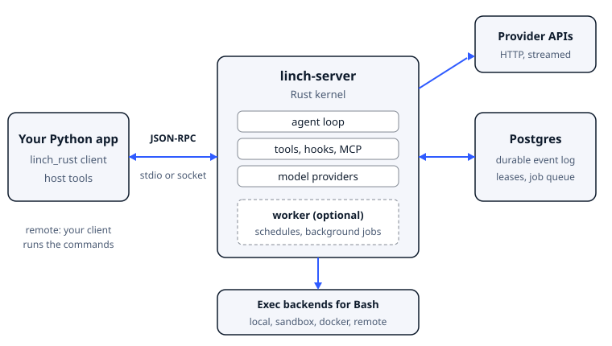
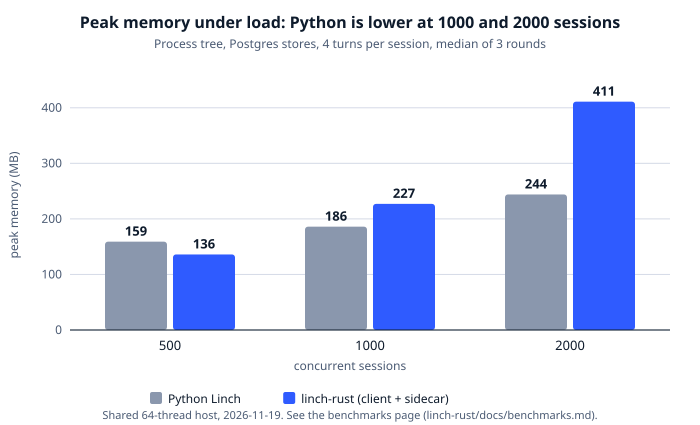

<div align="center">

<picture>
  <source media="(prefers-color-scheme: dark)" srcset="docs/assets/logo-dark.svg">
  
</picture>

[Tiếng Việt](README.vi.md) · [Tài liệu tiếng Việt](docs/vi/usage/README.md)

An embeddable, headless agent kernel with durable runs on Postgres; the host owns the HTTP API and deployment.

[](https://pypi.org/project/linch/)
[](https://pypi.org/project/linch-rust/)
[](LICENSE)
[](pyproject.toml)

</div>

Linch 3.0 is a headless agent kernel. Applications embed its async agent loop,
provide tools and permissions, and consume streamed events. It breaks compatibility
with 2.x; see the [3.0 migration guide](docs/migration-3.0.md).

## Why linch

- **Durable runs.** Postgres session and run stores, leases with epoch fencing, checkpoints before guarded side effects, and event replay by sequence.
- **Group-committed writes.** Pending events and checkpoints are durable before the next external effect (provider call, tool start, terminal).
- **Tenant isolation.** Each agent owns its own `Context` scope; the Rust server gives each tenant its own tokens, allowlists and limits.
- **Sandboxed execution.** `Bash` runs locally, in a Landlock and seccomp sandbox, in Docker, or on a host your client supplies (Rust kernel).
- **Provider-agnostic.** OpenAI, Anthropic, Gemini and Vertex AI, DeepSeek, llama.cpp and compatible endpoints.
- **OpenTelemetry.** Traces and metrics through the OpenTelemetry API; the host configures the SDK and exporter.

## Two ways to use it

| | `linch` (Python package) | `linch-rust` (client + `linch-server`) |
|---|---|---|
| What it is | The agent loop in your Python process | The same agent model as a Rust kernel; the `linch_rust` client starts and drives `linch-server` over JSON-RPC |
| Pick it when | You want the loop in-process, or the full `linch.ext` extension set | You want the production-scale direction: many concurrent runs, a worker for schedules and background jobs, tenants and sandboxes |
| Start with | [Usage guide](docs/usage/README.md) | [Usage guide](linch-rust/docs/usage/README.md) ([Tiếng Việt](linch-rust/docs/vi/usage/README.md)) |

Both are developed side by side and the Python package stays supported. linch-rust is
an SDK to embed, not a ready-made agent product: your application owns the HTTP API,
TLS and metrics, and chooses how commands are isolated.

<div align="center">

<picture>
  <source media="(prefers-color-scheme: dark)" srcset="docs/assets/architecture-dark.svg">
  
</picture>

</div>

*linch-rust: your Python app drives `linch-server` over JSON-RPC; runs are durable in Postgres. See the [architecture index](linch-rust/docs/architecture/README.md).*

## Install

```sh
pip install linch-rust              # the client and the linch-server binary
pip install 'linch-rust[otel]'      # with OpenTelemetry spans and metrics
```

The `linch` package, from a checkout:

```sh
pip install ./linch-rust/crates/linch-python   # native extension; needs a Rust toolchain
pip install -e .
pip install -e '.[postgres,worker,anthropic,gemini,mcp]'   # the extras you use
```

OpenTelemetry's API is included in core. Install `opentelemetry-sdk` and an exporter
in the host to collect telemetry.

## Quickstart

This example runs without credentials or network access. `ScriptedProvider` is
an eval extension that supplies a fixed response.

```python
import asyncio

from linch import Agent, InMemorySessionStore
from linch.ext.evals import ScriptedProvider, TextTurn


async def main() -> None:
    """Run one offline conversation and print its result."""
    agent = Agent(
        model="demo-model",
        provider=ScriptedProvider([TextTurn(text="Hello from Linch.")]),
        session_store=InMemorySessionStore(),
    )
    try:
        session = await agent.session()
        async for event in session.run("Say hello"):
            if event.type == "result":
                print(event.final_text)
    finally:
        await agent.close()


asyncio.run(main())
```

Expected output: `Hello from Linch.` For a live provider, tools, and durable
stores, follow the [quickstart guide](docs/usage/quickstart.md). Production
hosts configure both session and run stores explicitly; the
[production guide](docs/usage/production.md) covers workers, streaming, resume,
and shutdown.

For linch-rust, start a project that runs and tests offline, or read its
[quickstart](linch-rust/docs/usage/quickstart.md):

```sh
linch-rust new my-agent             # a project that runs and tests offline
linch-rust docs path                # where the installed docs are
```

## Measured

Python Linch against linch-rust, one shared 64-thread host, 2026-11-19. The
[benchmarks page](linch-rust/docs/benchmarks.md) ([Tiếng Việt](linch-rust/docs/vi/benchmarks.md))
has the setup, method and known gaps.

<picture>
  <source media="(prefers-color-scheme: dark)" srcset="docs/assets/memory-dark.svg">
  
</picture>

Rust uses more memory per concurrent session than Python from 1000 sessions up
(411 MB against 244 MB at 2000); it is lower at 500. The page also reports that
through the client it completes 351 turns per second at 500 sessions and 686 at 2000, against
89 for Python, whose event loop saturates, and that after a forced kill right after
`run.start` it now finds all 160 runs (before a fix it lost 70 of 160). It has
no Python figure for that kill test, so no comparison is claimed.

## More features of the Python package

| Area | Implementation |
|---|---|
| Runtime | `Agent`, `Session`, typed event streams, tool scheduling, context compaction, and run budgets |
| Plugins and profiles | [`agent.use(plugin, config)`](docs/architecture/kernel.md#plugins) mounts scoped plugins; [versioned profiles](docs/usage/profiles.md) pin each run's profile for resume |
| Tool search | [Deferred tool and skill discovery](docs/usage/tools.md#tool-search-for-large-catalogs) loads schemas when needed |
| Worker fleet | Optional `linch.worker`: PgQueuer dispatch, lease renewal, recovery after worker death, and graceful drain |
| Reliability | Bounded response correction, optional tool prerequisites and completion gates |
| Permissions | Per-run `Principal`, tool/path/shell rules with role conditions, and durable approval decisions |
| Retrieval and memory | `RagConnector`, citation grounding checks, scoped file memory, and virtual filesystem backends |
| Extensions | Explicit `linch.ext` packages for workflows, evals, deep agents, reports, loop runners, and scaffolding; hooks, MCP, skills, and subagents |
| Lifecycle | [Typed lifecycle catalog and trace IDs](docs/architecture/events.md#typed-lifecycle-catalog) connect hooks, kernel seams, events, and host logs |

Postgres is the durable backend. InMemory stores are for tests and development.
Read-scoped tools can run in parallel. An input-aware `parallel` predicate also
allows read-only subagent calls; write/exec tools with boolean flags stay serial.

## Documentation

- [Usage index](docs/usage/README.md): setup and examples for each feature.
- [Architecture index](docs/architecture/README.md): module boundaries, contracts, and invariants.
- [linch-rust usage guide](linch-rust/docs/usage/README.md) and [architecture](linch-rust/docs/architecture/README.md).
- [Migration from 2.x](docs/migration-3.0.md): removed APIs and replacement imports.
- [Versioning](docs/versioning.md): public API, prereleases, and persisted formats.
- [Examples](examples/): runnable examples grouped by subsystem.
- [Contributing](docs/contributing.md): development and review rules.
- [Changelog of linch](CHANGELOG.md) and [of linch-rust](linch-rust/CHANGELOG.md).

Kernel imports come from `linch.__all__`. Import extensions explicitly, for
example `from linch.ext.workflow import run_workflow`; they are absent from the
kernel's top-level exports. Status: linch-rust is at 0.1 (latest release 0.1.1), so
read its changelog before each upgrade; its own sizing numbers are in
[Embedding](linch-rust/docs/usage/embedding.md#sizing-what-was-measured).

## Build with a coding agent

Give Claude Code, Codex, or another coding agent the `build-agent-with-linch` skill. It tells the
agent where the installed docs are and how to build and test on Linch.

```sh
npx skills add DuyTa506/linch   # from GitHub
linch skill install             # offline, matches the installed Linch version
```

`linch new` includes the skill. See the [CLI guide](docs/usage/cli.md).

## Development

```sh
pip install ./linch-rust/crates/linch-python   # native extension; needs a Rust toolchain
pip install -e '.[dev,postgres,worker,mcp,anthropic,gemini]'
python -m pytest -q
ruff check . && ruff format --check .
pyright
```
