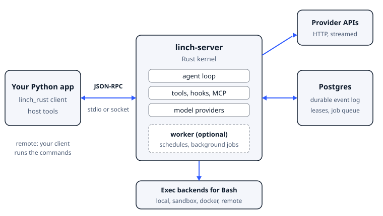
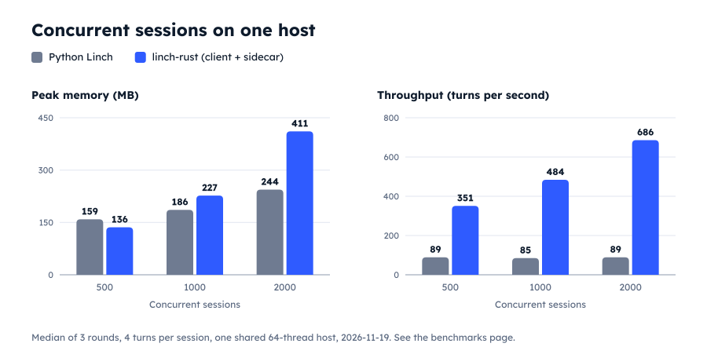

<div align="center">

<picture>
  <source media="(prefers-color-scheme: dark)" srcset="docs/assets/logo-dark.svg">
  
</picture>

[Bản gốc tiếng Anh](README.md)

Một kernel agent không giao diện, có thể nhúng, với run bền vững trên Postgres; ứng dụng chủ quản lý HTTP API và việc triển khai.

[](https://pypi.org/project/linch/)
[](https://pypi.org/project/linch-rust/)
[](LICENSE)
[](pyproject.toml)

</div>

Linch 3.0 là một kernel agent không có giao diện. Ứng dụng nhúng vòng lặp agent bất đồng bộ
của Linch, cung cấp tool và quyền, đồng thời tiếp nhận các event qua streaming. Linch 3.0
không tương thích với 2.x; xem [hướng dẫn chuyển đổi sang 3.0](docs/migration-3.0.md).

## Vì sao chọn linch

- **Run bền vững.** Kho lưu trữ session và run dùng Postgres, lease có cơ chế fencing theo epoch, checkpoint trước các tác động phụ được bảo vệ và phát lại event theo số thứ tự.
- **Ghi theo nhóm (group commit).** Các event và checkpoint đang chờ được ghi bền vững trước tác động bên ngoài kế tiếp (gọi provider, bắt đầu tool, trạng thái kết thúc).
- **Cô lập tenant.** Mỗi agent có phạm vi `Context` riêng; server Rust cấp cho mỗi tenant token, danh sách cho phép và giới hạn riêng.
- **Thực thi trong sandbox.** `Bash` chạy cục bộ, trong sandbox Landlock và seccomp, trong Docker, hoặc trên máy do client của bạn cung cấp (kernel Rust).
- **Không phụ thuộc provider.** OpenAI, Anthropic, Gemini và Vertex AI, DeepSeek, llama.cpp và các endpoint tương thích.
- **OpenTelemetry.** Trace và metric qua API OpenTelemetry; ứng dụng chủ cấu hình SDK và exporter.

## Hai cách sử dụng

| | `linch` (package Python) | `linch-rust` (client + `linch-server`) |
|---|---|---|
| Là gì | Vòng lặp agent chạy trong tiến trình Python của bạn | Cùng mô hình agent dưới dạng kernel Rust; client `linch_rust` khởi động và điều khiển `linch-server` qua JSON-RPC |
| Chọn khi | Bạn muốn vòng lặp chạy trong tiến trình, hoặc cần đủ bộ phần mở rộng `linch.ext` | Bạn muốn hướng dành cho quy mô production: nhiều run đồng thời, worker cho lịch và job nền, tenant và sandbox |
| Bắt đầu với | [Hướng dẫn sử dụng](docs/vi/usage/README.md) | [Hướng dẫn sử dụng](linch-rust/docs/vi/usage/README.md) ([English](linch-rust/docs/usage/README.md)) |

Cả hai được phát triển song song và package Python vẫn được hỗ trợ. linch-rust là một SDK
để nhúng, không phải sản phẩm agent làm sẵn: ứng dụng của bạn quản lý HTTP API, TLS và
metrics, đồng thời chọn cách cô lập các lệnh.

<div align="center">

<picture>
  <source media="(prefers-color-scheme: dark)" srcset="docs/assets/architecture-dark.svg">
  
</picture>

</div>

*linch-rust: ứng dụng Python điều khiển `linch-server` qua JSON-RPC; run được lưu bền vững trên Postgres. Xem [mục lục kiến trúc](linch-rust/docs/vi/architecture/README.md).*

## Cài đặt

```sh
pip install linch-rust              # client và binary linch-server
pip install 'linch-rust[otel]'      # kèm span và metric OpenTelemetry
```

Package `linch`, từ một bản checkout:

```sh
pip install ./linch-rust/crates/linch-python   # extension native; cần toolchain Rust
pip install -e .
pip install -e '.[postgres,worker,anthropic,gemini,mcp]'   # các extra bạn dùng
```

API của OpenTelemetry được tích hợp trong phần lõi. Cài `opentelemetry-sdk` và
một exporter trong ứng dụng chủ để thu thập telemetry.

## Bắt đầu nhanh

Ví dụ này chạy mà không cần thông tin xác thực hay truy cập mạng. `ScriptedProvider`
là một phần mở rộng eval cung cấp phản hồi cố định.

```python
import asyncio

from linch import Agent, InMemorySessionStore
from linch.ext.evals import ScriptedProvider, TextTurn


async def main() -> None:
    """Run one offline conversation and print its result."""
    agent = Agent(
        model="demo-model",
        provider=ScriptedProvider([TextTurn(text="Hello from Linch.")]),
        session_store=InMemorySessionStore(),
    )
    try:
        session = await agent.session()
        async for event in session.run("Say hello"):
            if event.type == "result":
                print(event.final_text)
    finally:
        await agent.close()


asyncio.run(main())
```

Kết quả dự kiến: `Hello from Linch.` Để dùng provider trực tuyến, tool và
kho lưu trữ bền vững, làm theo [hướng dẫn bắt đầu nhanh](docs/vi/usage/quickstart.md).
Ứng dụng chủ trong môi trường production cấu hình tường minh cả kho session và run;
[hướng dẫn production](docs/vi/usage/production.md) trình bày worker, streaming, resume
và tắt hệ thống.

Với linch-rust, tạo một dự án chạy và kiểm thử ngoại tuyến, hoặc đọc
[quickstart](linch-rust/docs/vi/usage/quickstart.md):

```sh
linch-rust new my-agent             # dự án chạy và kiểm thử ngoại tuyến
linch-rust docs path                # nơi cài đặt tài liệu
```

## Số đo

Python Linch so với linch-rust, một host chung 64 thread, 2026-11-19.
[Trang benchmark](linch-rust/docs/vi/benchmarks.md) ([English](linch-rust/docs/benchmarks.md))
có thiết lập, cách đo và các khoảng trống đã biết.

<picture>
  <source media="(prefers-color-scheme: dark)" srcset="docs/assets/scale-dark.svg">
  
</picture>

Biểu đồ bên trái là bộ nhớ đỉnh: linch-rust (client cộng sidecar) thấp hơn ở 500 session
(136 MB so với 159 MB của Python) và cao hơn từ 1000 trở lên (227 so với 186 MB, và 411
so với 244 MB ở 2000). Biểu đồ bên phải là thông lượng: qua client, linch-rust hoàn tất
351, 484 và 686 lượt mỗi giây ở 500, 1000 và 2000 session, so với 89, 85 và 89 của Python,
vốn làm vòng lặp event bão hòa. Trang benchmark còn ghi rằng sau một lần kill cưỡng bức ngay sau `run.start` nó tìm
thấy đủ 160 run (trước khi sửa lỗi là mất 70 trên 160). Trang không có số liệu của Python
cho bài kiểm tra kill này, nên không đưa ra phép so sánh nào.

## Thêm tính năng của package Python

| Mảng | Cách triển khai |
|---|---|
| Runtime | `Agent`, `Session`, luồng event có kiểu, lập lịch tool, nén context và budget cho run |
| Plugin và profile | [`agent.use(plugin, config)`](docs/vi/architecture/kernel.md#plugin) gắn plugin có phạm vi; [profile có phiên bản](docs/vi/usage/profiles.md) cố định profile của mỗi run để resume |
| Tìm kiếm tool | [Khám phá tool và skill theo cơ chế trì hoãn](docs/vi/usage/tools.md#toolsearchplugin--danh-mục-lớn) tải schema khi cần |
| Cụm worker | `linch.worker` tùy chọn: điều phối bằng PgQueuer, gia hạn lease, khôi phục sau khi worker ngừng hoạt động và dừng tiếp nhận việc mới để hoàn tất việc đang chạy |
| Độ tin cậy | Sửa phản hồi với số lần giới hạn, tùy chọn điều kiện tiên quyết cho tool và điều kiện hoàn tất |
| Quyền | `Principal` cho từng run, quy tắc tool/đường dẫn/shell có điều kiện theo vai trò và quyết định phê duyệt được lưu bền vững |
| Truy xuất và bộ nhớ | `RagConnector`, kiểm tra căn cứ trích dẫn, bộ nhớ tệp có phạm vi và backend hệ thống tệp ảo |
| Phần mở rộng | Các package `linch.ext` tường minh cho workflow, eval, deep agent, báo cáo, trình chạy vòng lặp và khởi tạo dự án; hook, MCP, skill và subagent |
| Vòng đời | [Danh mục vòng đời có kiểu và trace ID](docs/vi/architecture/events.md#danh-mục-vòng-đời-có-kiểu) kết nối hook, điểm tích hợp kernel, event và log của ứng dụng chủ |

Postgres là backend lưu trữ bền vững. Các kho InMemory dành cho kiểm thử và phát triển.
Tool có phạm vi đọc có thể chạy song song. Predicate `parallel` xét đầu vào còn
cho phép gọi subagent chỉ đọc; tool ghi/thực thi dùng cờ boolean vẫn chạy tuần tự.

## Tài liệu

- [Mục lục hướng dẫn sử dụng](docs/vi/usage/README.md): thiết lập và ví dụ cho từng tính năng.
- [Mục lục kiến trúc](docs/vi/architecture/README.md): ranh giới module, hợp đồng và các bất biến.
- [Hướng dẫn sử dụng linch-rust](linch-rust/docs/vi/usage/README.md) và [kiến trúc](linch-rust/docs/vi/architecture/README.md).
- [Chuyển đổi từ 2.x](docs/migration-3.0.md): các API đã bị loại bỏ và cách import thay thế.
- [Quản lý phiên bản](docs/versioning.md): API công khai, bản phát hành thử và định dạng lưu trữ bền vững.
- [Ví dụ](examples/): các ví dụ có thể chạy, được nhóm theo hệ thống con.
- [Đóng góp](docs/contributing.md): quy tắc phát triển và review.
- [Changelog của linch](CHANGELOG.md) và [của linch-rust](linch-rust/CHANGELOG.md).

Các thành phần kernel được import từ `linch.__all__`. Import phần mở rộng một cách
tường minh, ví dụ `from linch.ext.workflow import run_workflow`; chúng không có
trong các export ở cấp cao nhất của kernel. Trạng thái: linch-rust đang ở phiên bản 0.1
(bản phát hành mới nhất là 0.1.1), nên hãy đọc changelog của nó trước mỗi lần nâng cấp;
số liệu định cỡ của chính SDK nằm ở
[Embedding](linch-rust/docs/vi/usage/embedding.md#định-cỡ-những-gì-đã-được-đo).

## Xây dựng bằng coding agent

Cài skill `build-agent-with-linch` cho Claude Code, Codex hoặc coding agent khác. Skill chỉ cho agent
biết docs đã cài nằm ở đâu và cách build, test trên Linch.

```sh
npx skills add Intramind-Labs/linch   # cài từ GitHub
linch skill install             # offline, khớp với bản Linch đã cài
```

`linch new` đã kèm sẵn skill này. Xem [hướng dẫn CLI](docs/vi/usage/cli.md).

## Phát triển

```sh
pip install ./linch-rust/crates/linch-python   # extension native; cần toolchain Rust
pip install -e '.[dev,postgres,worker,mcp,anthropic,gemini]'
python -m pytest -q
ruff check . && ruff format --check .
pyright
```
