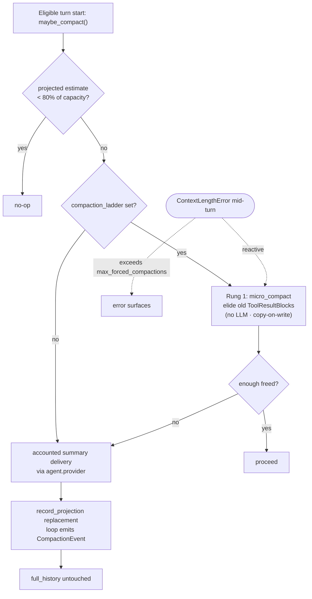

# Compaction

> Part of the [Linch architecture guide](./README.md).

Use this page when you need to trace proactive or reactive context compaction,
its accounting boundary, or restoration of a durable provider-view snapshot.

For each eligible turn start, `maybe_compact(session, agent)`:

1. Resolves the effective model, preferring the per-turn or skill override, then
   `session.active_model`, then `agent.model`.
2. Gets the model's context **capacity** from
   `agent.provider.context_window(resolved_model)`. This is not a token counter:
   Linch estimates the detached `provider_view` with `agent.token_estimator`
   when supplied, otherwise with its serialized-message fallback, and
   adds the configured output reservation (or the default capped reserve).
3. Returns without a projection when the estimated input plus reserve is below
   80% of that capacity. With `CompactionLadder`, it first tries the LLM-free
   `micro_compact`; in a normal run, a remaining summary is submitted through
   the accounted auxiliary gateway, which uses `agent.provider`.
4. In an accounted run, the summary delivery receipt is settled before the
   result is applied. The replacement is then recorded as a **logged projection** —
   `session.session_log.record_projection(...)` appends a `ProjectionEntry`
   and rewrites the derived `provider_view`. The loop reinjects any required
   skill context, saves a supported durable snapshot, resets catalog notification
   digests, and emits `CompactionEvent` after the projection is accepted.

**Invariant:** `full_history` is never modified. Only `provider_view` (a projection of the single append-only log) shrinks, and it shrinks by a *logged* projection, not an untracked in-place mutation. This covers session-owned model input; per-request `ContextInjectionHook`/RAG context is ephemeral and exists only in `ProviderRequest`. Compaction uses the configured `agent.provider` — never a hardcoded OpenAI call.

The compaction path is provider-agnostic: built-in summaries use the same
normalized provider stream contract as a normal turn and retain message/tool
pairing. The mechanism does not require a coding workspace, and a strategy can
override the prompt for another domain. Missing or malformed current wire-3
snapshot caches can be rebuilt from `full_history`; incompatible snapshot
versions are rejected rather than treated as cache misses.

Compaction preserves the persisted prefix `system` and `base` catalog; when
present, the original skill listing remains in that system prefix, and compaction
does not reload skills. If `notified` differs from `base`, the loop resets it to a
copy of `base` and clears the catalog fast path. A later `sync_catalog` compares
the live catalog and may update `prefix["tools"]`/`notified` digests and append
one `CatalogChangeBlock` for differences. A run that bypasses snapshots uses the
live listing. Reinjected listings and invoked-skill reminders are provider-view-
only log entries (`historical=False`); they do not add duplicate skill bodies to
`full_history`.

The direct `summarize_with_provider(...)` helper remains available for
standalone callers with its existing provider-stream behavior. The normal run
path wraps built-in strategies and compliant custom strategies in the
accounting gateway so cancellation, one provider-slot acquisition, and receipt
settlement are shared with the primary loop.



`DefaultCompaction` remains the default. `DetailedCompaction` is opt-in via
`Agent(compaction=DetailedCompaction())` and uses a continuation-safe summary
with user intent, key information/artifacts touched, errors/fixes, pending tasks,
current work, and the next step. The section wording is domain-neutral (it asks
for identifiers — paths, URLs, IDs, names — rather than assuming files/code), so
it suits non-coding hosts too.

`DefaultCompaction`'s default prompt is coding-oriented (it asks for file paths,
tool calls, and the like); `DetailedCompaction`'s default is domain-neutral.
Since linch is *embeddable* and not every host is a coding agent, **both** accept
a `prompt=` override — `DefaultCompaction(prompt=...)` /
`DetailedCompaction(prompt=...)` — so a non-coding host can reword the summary
without reimplementing a `CompactionStrategy`. Omitting it keeps each strategy's
built-in prompt, so default behavior is unchanged. A ready-made domain-neutral prompt ships as
`GENERAL_SUMMARY_PROMPT` (public) for hosts that want a sensible non-coding
default without writing their own:
`Agent(compaction=DefaultCompaction(prompt=GENERAL_SUMMARY_PROMPT))`.

### Accounting and durable paid-result recovery

The run-scoped ledger is the source of cumulative model usage. A physical
compaction delivery gets a fresh delivery ID, and a valid `message_end` usage is
settled exactly once before the result can be accepted, rejected, applied to
the provider view, or followed by another dispatch. Valid usage remains billed
even when the summary is empty, non-text, tool-using, oversized, or otherwise
unusable. A summary that exhausts a `RunBudget` is followed by an admission
recheck, so the next primary request is not dispatched.

For `DefaultCompaction` and `DetailedCompaction`, a durable accepted result is
paired with its receipt and an ordered, hash-only `compaction_source` recipe.
The recipe binds the physical delivery, request, strategy configuration,
durable full-history boundary, ordered source messages, and provider-view-only
reminders. Required invoked-skill bodies are flushed through the existing
session store before the recipe is written. On resume, Linch reconstructs only
from that verified historical source and applies the bounded accepted text
without another provider call or duplicate charge. A changed source, missing
skill body, changed listing wrapper, mismatched strategy/configuration, or
legacy source-less paid record fails closed.

Custom `CompactionStrategy` implementations receive the run's accounting,
cancellation, and limiter guarantees for calls made through the supplied
provider facade. Opaque calls outside the facade and arbitrary transforms are
not observable, and custom strategies have no deterministic paid-result replay
seam. Paid recovery is supported only for unchanged concrete
`DefaultCompaction` and `DetailedCompaction` implementations accepted by
`_builtin_compaction_config`.

An unknown final usage is never treated as zero. Capped runs block subsequent
model calls at the unknown-use fence; uncapped runs may report a known
lower-bound total. Shared receipt ownership covers the live in-process budget
tree only — it does not promise distributed cap recovery, exactly-once
external billing, or reservations for concurrent admissions.

### Compaction ladder (opt-in)

`Agent(compaction_ladder=CompactionLadder())` adds recovery rungs around the
strategy. With no ladder, the driver retains one compaction retry for a
`ContextLengthError` in a turn.

- **Rung 1 — micro-compact** (`micro_compact` in `compaction.py`): elide
  `ToolResultBlock` contents older than `keep_recent_turns` with a short
  placeholder. No LLM call; copy-on-write (changed messages are rebuilt, never
  mutated); every `tool_use_id` stays paired. Runs proactively inside `maybe_compact` (skips
  summarization when elision frees enough) and reactively, once per turn, when
  the provider raises `ContextLengthError`.
- **Rung 2 — forced compaction with a circuit breaker**: the shared
  `_stream_turn_with_recovery` driver in `loop/streaming.py` retries with forced
  compactions up to `max_forced_compactions` per run, then lets the error surface.

### Durable compacted views (opt-in, store-detected)

Compaction shrinks `provider_view` in memory. Without a durable snapshot, a
fresh process rebuilds the view from `full_history`, so the next eligible run
may compact it again.
A `SessionStore` **may** persist the compacted view so a reload skips that work:

```python
class ProviderViewSnapshotStore(Protocol):
    async def save_provider_snapshot(self, id: str, snapshot: ProviderViewSnapshot) -> None: ...
    async def load_provider_snapshot(self, id: str) -> ProviderViewSnapshot | None: ...
```

`ProviderViewSnapshot` pairs the compacted `provider_view` with `covers_seq` —
the message sequence number it accounts for. The loop saves a snapshot at the
compaction seam; on load, the agent restores the snapshot and appends only the
messages written *after* `covers_seq`, reproducing the live view exactly.

Both methods are optional and detected at runtime with `getattr`. The built-in
in-memory and Postgres stores implement them; a custom store that omits
them keeps reconstructing the view from full history.
The snapshot envelope requires exact wire version 3. Missing, older, or unknown
versions fail with the start-new-run error. After the version gate, the load path validates the current snapshot
cache and falls back to rebuilding from `full_history` on an ordinary loader
error, malformed payload, or a `covers_seq` that is negative, ahead of the newest
stored message, or inconsistent with a non-monotonic message log. Message-sequence gaps are legal and preserved;
out-of-order sequences simply disable snapshot caching for that session.
Compaction never mutates or removes the append-only session log's historical
projection — the snapshot is a cache of a derived view, never a source of truth.

## Design rationale

- **Only the provider projection shrinks; historical messages stay complete.**
  The model only ever sees `provider_view`, so `record_projection(...)` rewrites
  that derived projection while leaving the `full_history` projection intact.
  The append-only `SessionLog` remains the source of truth; its in-memory
  `ProjectionEntry` records are not persisted. Durable stores keep messages and,
  optionally, a provider-view snapshot cache.
- **Summarize through `agent.provider`, never a hardcoded vendor call.** Compaction
  is just another model turn, so it must honor the same provider the run uses.
  Hardcoding OpenAI would break Anthropic/Gemini/local users and split the cost
  accounting.
- **Cheapest rung first.** `micro_compact` is LLM-free (elide stale tool results)
  and runs before paying for a summarization call; summarization only fires when
  elision can't free enough. This keeps the common case free and fast.
- **Copy-on-write, not mutation.** `micro_compact` does not mutate its input;
  changed messages and `ToolResultBlock` values are rebuilt before the result is
  recorded as a projection. The append-only history therefore remains intact,
  and `tool_use_id` pairing is preserved so the provider does not receive an
  orphaned result.
- **Circuit breaker over open-ended retry.** Forced compaction is capped at
  `max_forced_compactions` per run so a pathologically large single turn surfaces a
  clear `ContextLengthError` instead of looping on summarization forever.

---

Back to the [architecture index](./README.md).
