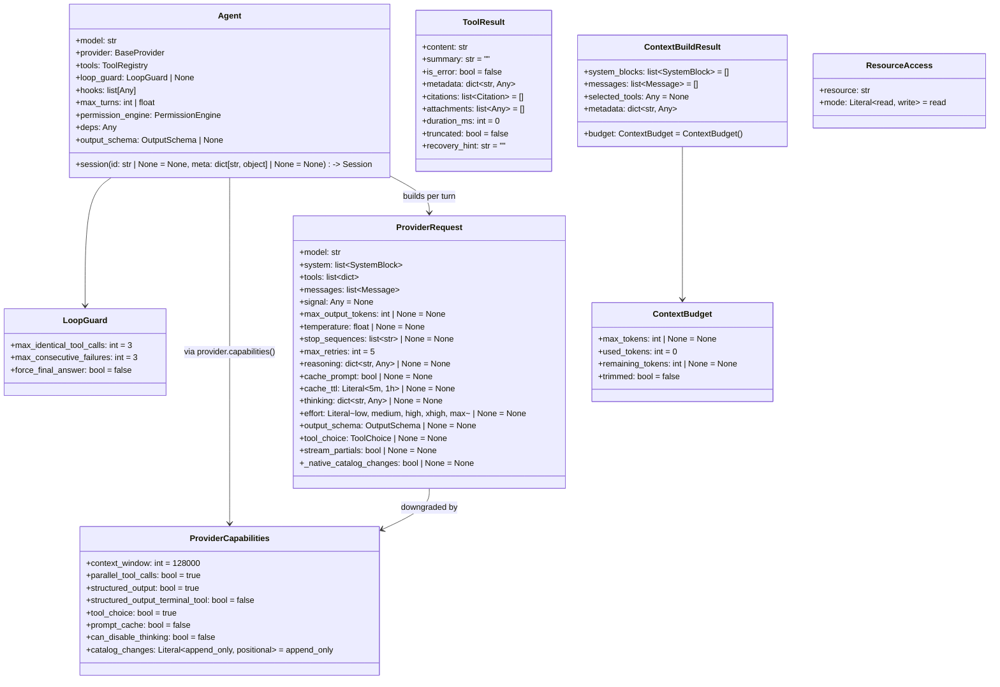

# Key Data Types

> Part of the [Linch architecture guide](./README.md).

Use this page when you need the normalized request, capability, context-build,
tool-result, or resource-access shapes exchanged by the kernel and providers.

```python
from linch import ProviderRequest, SystemBlock
```

`SystemBlock` carries `text: str`, `cacheable: bool = False`, and the fixed
`type: Literal["text"] = "text"`; `ProviderRequest` requires `model`, `system`,
`tools`, and `messages`. `Agent.session(...)` is asynchronous and must be
awaited. Empty list/dict defaults in the diagram denote fresh dataclass
factories for each instance, not shared mutable values.



## Design rationale

`CatalogChangeBlock` is an internal message-content variant with reminder text and
tuples of added and removed tool names, plus
`tool_definitions: tuple[dict[str, Any], ...] = ()` for frozen native additions.
Message codecs preserve these definitions through session store reloads. Providers
and token estimators consume its text; eligible positional adapters also render
its native tool structures. It adds no public top-level name or lifecycle event.
`ProviderCapabilities.catalog_changes` defaults to `"append_only"`; opt-in
providers may report `"positional"` for an eligible model/endpoint.

- **`Agent` owns long-lived configuration and lifecycle; `Session` owns mutable
  conversation state.** Splitting those responsibilities lets one `Agent` mint
  many concurrent sessions safely while the host keeps provider, tool, policy,
  and service ownership at the agent boundary.
- **`ProviderRequest` is rebuilt per turn and downgraded against
  `ProviderCapabilities`.** The request is assembled fresh each turn so per-turn context
  and capability stripping (drop `cache_*` for non-caching providers, drop
  `output_schema` where unsupported) never leak into the next turn or another provider.
- **`ToolResult` separates the model channel from the host channel.** Its
  `content` is the compact provider-facing text; `summary`/`metadata`/`citations`/
  `attachments`/`duration_ms`/`truncated` are rich fields for host consumers
  (UI, provenance, telemetry), while `is_error` and `recovery_hint` also guide
  loop result handling.
- **`ResourceAccess` is declarative, not lock-based.** A tool *declares* what it
  reads/writes; the scheduler derives safe parallelism from those declarations, so
  concurrency is a property of data, not hand-placed locks.

---

Back to the [architecture index](./README.md).
