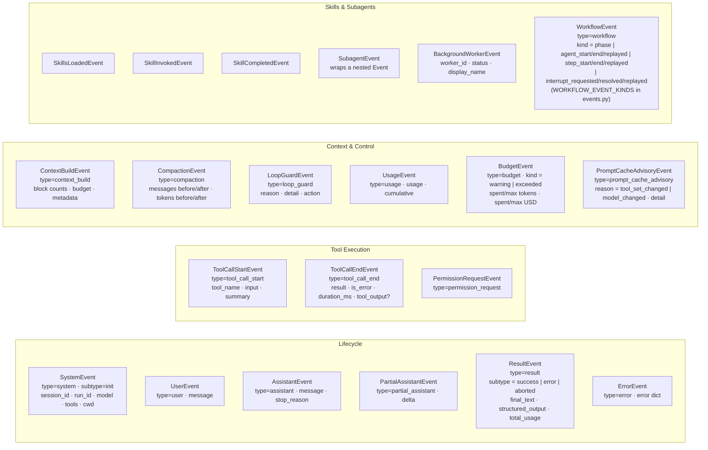

# Event Taxonomy

> Part of the [Linch architecture guide](./README.md).

All events are `@dataclass(slots=True)` with a `type: Literal[...]` discriminator. Every cross-cutting concern surfaces through events; callers never poll internal state.

## Typed lifecycle catalog

The kernel lifecycle is defined once as typed points with an explicit dispatch
mode. The table below is generated from `linch.lifecycle` and source call sites;
run `python scripts/generate_event_catalog.py --check` to detect drift.

<!-- BEGIN GENERATED LIFECYCLE CATALOG -->
| Point | Payload | Mode | Producers | Consumers |
|---|---|---|---|---|
| `AgentStart` | `AgentStartContext` | `serial` | `linch.loop.startup:initialize_run` | `linch.hooks.dispatcher:HookDispatcher.dispatch` |
| `AgentStop` | `AgentStopContext` | `serial` | `linch.loop.runner:_run_loop_impl` `linch.loop.startup:_emit_prompt_block` | `linch.hooks.dispatcher:HookDispatcher.dispatch` |
| `UserPromptSubmit` | `UserPromptSubmitContext` | `serial` | `linch.loop.dispatch:dispatch_user_prompt` | `linch.hooks.dispatcher:HookDispatcher.dispatch` |
| `TurnStart` | `TurnStartContext` | `serial` | `linch.loop.runtime:TurnLifecycle.start_turn` | `linch.hooks.dispatcher:HookDispatcher.dispatch` |
| `TurnStop` | `TurnStopContext` | `serial` | `linch.loop.runtime:TurnLifecycle.end_active_turn` | `linch.hooks.dispatcher:HookDispatcher.dispatch` |
| `BeforeProviderCall` | `BeforeProviderCallContext` | `serial` | `linch.loop.dispatch:dispatch_before_provider_call` | `linch.hooks.dispatcher:HookDispatcher.dispatch` |
| `ProviderCallStart` | `ProviderCallStartContext` | `serial` | `linch.loop.runtime:TurnLifecycle.start_provider_call` | `linch.hooks.dispatcher:HookDispatcher.dispatch` |
| `ProviderCallStop` | `ProviderCallStopContext` | `serial` | `linch.loop.runtime:TurnLifecycle.end_active_provider_call` | `linch.hooks.dispatcher:HookDispatcher.dispatch` |
| `AfterProviderCall` | `AfterProviderCallContext` | `serial` | `linch.loop.dispatch:dispatch_after_provider_call` | `linch.hooks.dispatcher:HookDispatcher.dispatch` |
| `PreToolUse` | `PreToolUseContext` | `serial` | `linch.scheduler:_dispatch_pre_tool_use` | `linch.hooks.dispatcher:HookDispatcher.dispatch` |
| `ToolUseStart` | `ToolUseStartContext` | `serial` | `linch.loop.tool_batch:run_tool_batch` | `linch.hooks.dispatcher:HookDispatcher.dispatch` |
| `ToolUseStop` | `ToolUseStopContext` | `serial` | `linch.loop.tool_batch:run_tool_batch` | `linch.hooks.dispatcher:HookDispatcher.dispatch` |
| `PostToolUse` | `PostToolUseContext` | `serial` | `linch.scheduler:_dispatch_post_tool_use` | `linch.hooks.dispatcher:HookDispatcher.dispatch` |
| `PostToolUseFailure` | `PostToolUseFailureContext` | `serial` | `linch.scheduler:_dispatch_post_tool_use_failure` | `linch.hooks.dispatcher:HookDispatcher.dispatch` |
| `PreCompact` | `PreCompactContext` | `serial` | `linch.compaction:_run_compaction_impl` | `linch.hooks.dispatcher:HookDispatcher.dispatch` |
| `PostCompact` | `PostCompactContext` | `serial` | `linch.compaction:_run_compaction_impl` | `linch.hooks.dispatcher:HookDispatcher.dispatch` |
| `BeforeFinalAnswer` | `BeforeFinalAnswerContext` | `serial` | `linch.loop.dispatch:dispatch_before_final_answer` | `linch.hooks.dispatcher:HookDispatcher.dispatch` |
| `Stop` | `StopContext` | `serial` | `linch.loop.dispatch:dispatch_stop` | `linch.hooks.dispatcher:HookDispatcher.dispatch` |
| `SubagentStart` | `SubagentStartContext` | `serial` | `linch.subagents.runner:continue_subagent` `linch.subagents.runner:run_subagent` | `linch.hooks.dispatcher:HookDispatcher.dispatch` |
| `SubagentStop` | `SubagentStopContext` | `serial` | `linch.subagents.runner:continue_subagent` `linch.subagents.runner:run_subagent` | `linch.hooks.dispatcher:HookDispatcher.dispatch` |
| `EventEmit` | `EventEmitContext` | `serial` | `linch.session:Session._iterate` | `linch.hooks.dispatcher:HookDispatcher.dispatch` |
| `tools/pre-execute` | `ToolExecution` | `waterfall` | `linch.tools.pipeline:ToolPipeline.run_pre_execute` | `linch.tools.pipeline:ToolPipeline.on_pre_execute` |
| `tools/execute` | `ToolExecution` | `waterfall` | `linch.tools.pipeline:ToolPipeline.run_execute` | `linch.tools.pipeline:ToolPipeline.on_execute` |
| `tools/post-execute` | `ToolExecution + result` | `waterfall` | `linch.tools.pipeline:ToolPipeline.run_post_execute` | `linch.tools.pipeline:ToolPipeline.on_post_execute` |
| `turn-stopping` | `TurnStopping` | `serial` | `linch.loop.turn_stopping:TurnStoppingDispatcher.dispatch` | `linch.loop.turn_stopping:TurnStoppingDispatcher.register` |
| `context/service` | `Context + key` | `emit` | `linch.kernel.context:Context._publish_plugin` `linch.kernel.context:Context._withdraw_plugin` `linch.kernel.context:Context.register` | `linch.kernel.plugins:_PluginMount.start` |
<!-- END GENERATED LIFECYCLE CATALOG -->

`BackgroundWorkerEvent` is emitted when a background worker task completes (success or failure); it carries `worker_id`, `status`, and `display_name`.

`PromptCacheAdvisoryEvent` is emitted (observationally, never mutating the request) when the tool set or model changes between provider calls on the same session and invalidates the cached request prefix — see [prompt caching](../usage/providers.md#the-prompt_cache_advisory-event).

`event_to_dict` and `event_from_dict` in `events.py` provide full round-trip serialization for all event types.

`SystemEvent` and the terminal `ResultEvent` carry the run `trace_id` when a
run is persisted or streamed. The creation/origin value is retained in
`RunRecord.meta`, captured read-only by `ToolContext.trace_id`, and can be
attached to host log records with `linch.TraceIdFilter`. A valid active
OpenTelemetry context supplies the ID; runs without one use the stable run ID
as their correlation fallback. A resumed attempt follows its caller's active
trace, while a caller without one reuses that same durable run ID.

Readers are strict by default: an unknown or malformed required event — at the
top level or nested inside an event payload — is a load error, because silently
dropping it could change the meaning of a resumed run. Only an event explicitly
tagged `ignorable` may decode to the public `IgnorableEvent` sentinel and be
skipped by a consumer. Ignorability is a producer-declared compatibility
property, not a fallback for unknown required fields or nested shapes.

## Design rationale

- **Events are the *only* output channel.** Every cross-cutting concern (assistant
  text, tool calls, permissions, usage, compaction, budget, subagents) surfaces as an
  event; callers never poll internal state. This makes the loop observable and lets a
  UI render progress live without reaching into `Session`.
- **A `type` literal discriminator + `slots=True`.** The literal makes events
  cheap to switch on and safe to pattern-match; `slots` keeps them light since one run
  can emit thousands.
- **Full round-trip serialization (`event_to_dict`/`event_from_dict`).** Events are
  the persisted run log, so they must survive a process restart and reload — which is
  what makes durable resume and offline run reports possible.
- **Nesting via `SubagentEvent`, not a flattened stream.** A child's events are wrapped
  rather than merged inline, so a consumer can tell parent activity from worker activity
  and reconstruct the tree.

---

Back to the [architecture index](./README.md).
