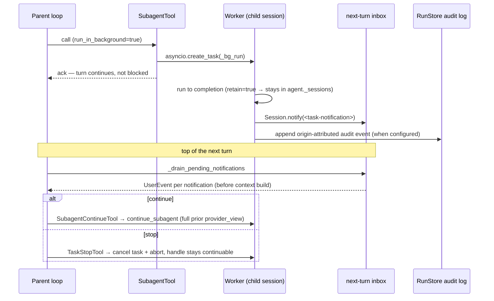

# Skills and Subagents

Use this page to understand skill invocation, subagent execution, and their lifecycle.

> Part of the [Linch architecture guide](./README.md).

**Skills** are loaded from `.linch/skills/*/SKILL.md`; built-in skills
such as `verify` are also registered unless a disk skill uses the same name.
Each file has YAML frontmatter (`name`, `description`, `allowed_tools`,
`model`) and a markdown body. When a skill is invoked, the body is
injected as a `<system-reminder>` per-turn via `_re_inject_skill_context`.
Gated by `FeatureFlags(skills=True)`. A bare `Agent` sets this flag
to `False`, so an SDK embedder does not discover project instructions merely
because its process is running in a checkout.

Ordinary sessions put the skill listing in their durable, cacheable system prefix
once. `await agent.reload_skills()` rescans files off the event loop, then replaces
the live skill mapping, listing, and skill-derived permission rules together. It
keeps the registered `Skill` tool, even when the new mapping is empty. Existing
sessions retain their prefix and receive a durable catalog reminder; new skills
can be invoked on the next provider request. Reminders reference skill names and
descriptions, never skill bodies. Durable resume and compaction use the frozen
listing when snapshots are enabled. A run that bypasses its existing snapshot
continues to reinject the live listing. Invoked-skill reinjection remains a
provider-view-only reminder and does not append to `full_history`.

**Subagents** are defined in `.linch/agents/*.md`; built-in named agents
such as `verification` are also registered unless a disk agent uses the same
name. A fresh child session has a filtered tool overlay. Its system blocks are built
from the child's tool names, retaining applicable host-provided system instructions,
and the child role is appended. A fork instead reuses the parent's system blocks and
conversation view. Gated by `FeatureFlags(subagents=True)`.

The model calls `Subagent` with required string fields `description` (a nonblank
label) and `prompt` (a nonempty task), and optional `subagent_type` (string)
and `run_in_background` (boolean). Omit the type for the general-purpose child;
include all relevant task context because a fresh child has no parent history.
`run_in_background` defaults to `false`; background execution must be enabled
on the agent. For example, a foreground call can use:

```json
{"description": "Review parser tests", "prompt": "Check parser boundary tests and report gaps.", "subagent_type": "verification"}
```

`reload_subagents()` replaces existing tool registrations in their original slots,
preserving the order of tools registered afterward, including MCP tools. Reloads
advance the agent's catalog revision so sessions detect changes before their next
context build. Description edits include the new description, including the
`Subagent` description's available agent types. MCP tools are identified by their
wrapper identity and receive name-only notifications, keeping third-party
descriptions and instructions out of the reminder's operator text.

The bare SDK agent also leaves `subagents`, `mcp`, and `filesystem` disabled.
Enable each trusted project resource explicitly, or use the opt-in
`create_deep_agent()` preset, which enables the capabilities it assembles.

`SubagentTool` stays exec-scoped and supplies an input-aware concurrency
predicate. Only a named type with an explicit tool list whose every tool resolves
to `scope="read"` may overlap another tool call. An explicit empty list is safe;
`None` or `"*"` inherits tool access and serializes. General-purpose, unknown,
unresolvable, write-capable, and background subagents serialize too. Lookup or
scope errors fail closed. The predicate resolves the current worker catalog,
including coordinator catalogs installed after the tool is registered. An active
parent exposing this tool through a session-specific registry also serializes:
the predicate cannot identify the invoking session from input alone. Child
completion may arrive out of order; result events and provider tool results
retain the original provider call order. `SubagentContinueTool` and `TaskStopTool`
keep their existing concurrency declarations.

**MCP** — `connect_mcp_servers(configs)` wraps each MCP tool as a duck-typed Linch tool. Names are normalized via `mcp/naming.py`. Agent-owned connections close with `agent.close()`; a host using `connect_mcp_servers()` directly owns the returned connection and closes it with `await connection.close()`. Automatic agent connection is gated by `FeatureFlags(mcp=True)`.

### Deep agent preset (`ext/deep_agent/`)

`create_deep_agent(model=..., profile=..., durable=..., coordinator=..., cwd=..., ...)` is an
explicit factory that assembles a full deep-agent configuration in one call:
task tools, a specialist subagent roster (researcher, planner, implementer),
file-memory context, and a deepened system prompt. Durable stores and the
filesystem backend are supplied by the host. The default `balanced` profile bounds a run to 64 turns and 1,000,000
tokens while retaining workers; `coordinator` has the same bounds and strips
heavy tools from the parent. `unbounded` is an explicit escape hatch for a
host that owns equivalent lifetime and cost controls.

- **`coordinator=True`** — the parent agent strips heavy tools (`Edit`, `Write`, `Bash`, `Grep`, `Glob`, `Read`); `COORDINATOR_SYSTEM_PROMPT` is injected via `SystemPromptConfig`; `TaskStopTool` is registered on the coordinator. Worker subagents receive full tool access via `build_child_tools`.
- **`durable=True`** — requires explicit session/run stores and an explicit filesystem when enabled. Supply `PostgresSessionStore`, `PostgresRunStore`, and a `CompositeFileBackend` with a `/memories` route to `PostgresFileBackend` for restart durability. An active detached worker task is process-local and is not reconstructed after a crash.

### Background workers and fork/continue



- `SubagentTool` retains foreground children when `Agent(retain_subagents=True)`; background children are always retained. Explicit release or opt-in `max_idle_sessions` eviction can release an idle child; continuation requires that the child remain live.
- `session.workers: dict[str, WorkerHandle]` indexes retained foreground and background workers by `worker_id`.
- **`run_in_background=True`** on `SubagentTool`: spawns `asyncio.create_task(_bg_run())` and returns an acknowledgement immediately. On completion, the task calls `Session.notify()` with a stable delivery ID before recording its `BackgroundWorkerEvent`. The default notification is in-memory; durable inbox mode persists an already-enqueued completion across restart.
- The loop drains the selected next-turn channel at the top of each new turn, yielding each notification as a `UserEvent` before `ContextInjectionHook.build_context()` runs, so the model sees task-completion content before the next provider call.
- `SubagentContinueTool` resolves a worker by exact id or a unique display name via `resolve_worker`, then calls `continue_subagent()`, which re-drives the live child session using the full prior `provider_view`. An ambiguous display name is rejected with the matching worker ids; callers must use the id.
- `TaskStopTool` uses the same exact-id or unique-name resolution before it cancels the background `asyncio.Task` and signals abort on the child session; an ambiguous name stops neither worker. The `WorkerHandle` remains in `session.workers` so the worker can be continued later.
- `session.abort()` and `agent.close()` both cancel all running background worker tasks. `agent.close()` additionally clears `agent._sessions`.
- A process restart cannot resume an active detached task. Durable inbox mode
  preserves only completions that reached `Session.notify()`; hosts that need
  durable execution must persist the work in an application-owned queue or
  workflow. Provider/tool execution remains at-least-once.

### Run budgets (`budget.py`)

`RunBudget` is a mutable accumulator shared across a run and its subagent tree.
Resolution order is `RunOptions.budget`, then the child session's inherited
budget, then `Agent(budget=...)`. Primary model calls and auxiliary compaction
calls charge the same budget using their usage receipts. Before each physical
model delivery, admission checks the current budget and blocks further calls
when it is exhausted. A capped budget also blocks new calls after usage becomes
unknown. Budget warnings fire once per budget object at `warn_ratio` (default
0.9).

Admission does not reserve the cost of a call: an admitted call, or concurrent
calls already admitted, can overshoot a limit. An admitted final response may
succeed even when its charge exhausts the budget. If another delivery is needed,
the budget fence stops it. See [model-call accounting](../usage/events.md#budget-fences-and-compaction)
for receipt and recovery details.

### Workflow engine (`ext/workflow/`)

`run_workflow(agent, fn)` drives a deterministic "closed fleet loop": *fn* is a
plain async function receiving a `WorkflowContext` (`wf`) and orchestrating
subagents via `wf.agent` / `wf.step` / `wf.interrupt` / `wf.parallel` /
`wf.settled` / `wf.pipeline` / `wf.phase`, with `wf.budget` exposing the shared
`RunBudget`.

- A host session parents every `wf.agent` run (each is a normal
  `run_subagent` child); child `SubagentEvent`s and `WorkflowEvent`s reach the
  host via the `on_event` callback.
- **Two journaled step kinds, one code path.** `wf.agent` runs a subagent;
  `wf.step` runs an arbitrary sync/async callable so deterministic code and
  side effects are replayable too. Both go through `_journaled_call`, which
  owns occurrence assignment, journal lookup, the `*_start` / `*_end` /
  `*_replayed` events, and recording — so the two cannot drift.
- **Journal = the run event log.** With `Agent(run_store=...)` and a
  `run_id`, each result persists as `WorkflowEvent(kind="agent_end")` or
  `kind="step_end"`. Re-invoking with the same `run_id` folds the stored events
  back into a `WorkflowJournal` (see `JOURNALED_KINDS`) and replays the
  unchanged call prefix with no provider call and no re-execution. Agent calls
  are keyed by `sha256(subagent_type, prompt, call_options)`, steps by
  `sha256("step", name, key)` — disjoint domains, so a step can never collide
  with a subagent — each plus a per-key occurrence counter, so parallel fan-out
  and loops replay safely and an edit invalidates only the call it touched.
- A step's value crosses the journal as JSON in `result_text`; the record's
  `record_kind` discriminates it from an agent's final text.
- The workflow function must be deterministic (no random/time-based
  branching) for resume replay to be correct. Branching on a *journaled* result
  is deterministic by construction; unjournaled variability is not.
- `wf.parallel` cancels and drains its remaining branches when one raises, and
  gives each nesting level its own semaphore so a nested fan-out cannot
  deadlock on slots its own caller holds. `wf.settled` is the opt-out: it lets
  siblings finish and returns one `StepOutcome` per branch. Both re-raise
  `CancelledError` / `WorkflowSuspended` rather than reporting them as
  outcomes — those are control flow, not results.
- **Failure policy is per call, applied outside the journal lookup.**
  `_journaled_call` assigns the occurrence and consults the journal *once*,
  then hands the work to `_call_with_policy`, which applies `timeout_ms`
  (per attempt) and `retry` (reusing `providers/retry.with_retry` with a
  `retry_on` predicate). A retry that burned a fresh occurrence would record
  under the wrong slot and silently break replay. With neither policy set,
  neither a `wait_for` nor a `with_retry` frame is constructed.
- **`wf.interrupt` is the suspend point.** No answer means an
  `interrupt_requested` event and a `WorkflowSuspended` — a `BaseException`, so
  a user's `except Exception:` cannot swallow it. `run_workflow` catches it
  *before* its `except BaseException` arm and writes a
  `save_checkpoint(status="suspended")` instead of `mark_failed`. A `resume=`
  mapping supplies the answer, which is journaled like any other node and
  consumed once per key.
- **Two independent concurrency knobs.** `max_concurrency` shapes one
  `wf.parallel` fan-out; `max_agent_concurrency` is a lazily created second
  semaphore held only around the live `run_subagent` call, so it caps real
  provider pressure without gating the replay path. It cannot deadlock because
  `wf.agent` is a leaf.
- **The journal snapshot is an accelerator, never a source of truth.** With
  `journal_snapshot_every=N`, every Nth record checkpoints the journal into
  `RunCheckpoint.extension_state["linch.workflow"]` with the event-log
  watermark it covers; a resume seeds from it and folds only later events. A
  record is always journaled *before* its `*_end` event is appended, so
  anything the snapshot missed is guaranteed to be in that tail. Missing,
  oversized (`_SNAPSHOT_MAX_BYTES`) or malformed, it falls back to folding the
  whole log.

## Design rationale

- **A fresh child computes tool-aware system blocks from its own tools.**
  Host instructions are still included and should account for the child role.
  Forks deliberately reuse the parent prefix.
- **Background workers don't block the turn.** Spawning via `asyncio.create_task` and
  returning an ack immediately keeps the parent responsive; results re-enter at a
  *fixed chokepoint* (drained at the top of the next turn) rather than racing into
  mid-turn state — deterministic ordering instead of a callback free-for-all.
- **Retention makes workers continuable.** Keeping the child session alive turns a
  one-shot subagent into a long-lived teammate (`continue_subagent` re-drives it with
  its full prior `provider_view`), without forcing every caller to manage session
  lifecycles.
- **The budget is one shared mutable object across the whole tree.** Children charge
  the *same* `RunBudget` the parent holds, so their spending is visible to later
  admission checks. Already admitted concurrent calls can overshoot the limit.
- **Coordinator mode strips heavy tools on purpose.** Removing `Edit`/`Write`/`Bash`/…
  from the parent forces delegation: the coordinator orchestrates, workers execute.
  That separation is a safety rail, not a limitation.
- **Workflows must be deterministic so resume can replay by content.** The journal keys
  each call by `sha256(subagent_type, prompt, call_options)`; nondeterministic branching
  would replay the wrong prefix, so determinism is the price of cheap, correct resume.

---

Back to the [architecture index](./README.md).
