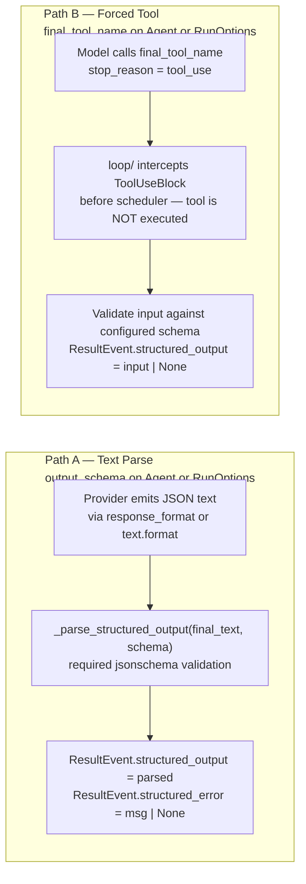

# Structured Output Paths

Use this page to understand how final text and terminal tools produce structured results.

> Part of the [Linch architecture guide](./README.md).

Two independent mechanisms surface the same field: `ResultEvent.structured_output: dict | None`.

`jsonschema` is a core dependency; configured schemas are always validated.

## Design rationale

- **Two capture paths.** The final-text path parses a JSON object and validates it
  against the configured schema. Providers that support structured output can
  constrain their responses; other providers may require prompting for JSON.
- **Terminal tool capture.** An explicit `final_tool_name`, or a provider's
  `structured_output_terminal_tool` capability with a schema, selects the terminal
  tool path. Its input is validated against the schema when one is configured.
  A validation error sets `structured_error` and leaves `structured_output` empty.
- **The final tool is intercepted.** The loop captures the named tool call before
  scheduling rather than executing it. It pairs tool calls with results in the
  session history.
- **Repair retries.** With `structured_output_retries` greater than zero, parse or
  validation errors can prompt another turn. When retries are exhausted, the
  result retains the structured error unless a hook changes the outcome. A
  structured error alone does not force an error result subtype: callers must
  inspect `structured_error` and `structured_output` even on success. Retries
  are subject to run limits.

---

Back to the [architecture index](./README.md).
