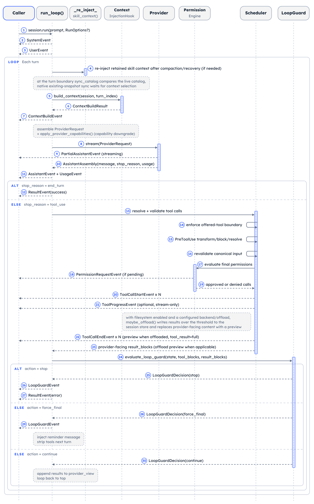

# Turn Lifecycle

> Part of the [Linch architecture guide](./README.md).

Use this page when you need to trace one `Session.run()`/`resume()` turn from
startup and context assembly through provider output, tool execution, and
terminal result handling.

One complete agent turn — from receiving the prompt to deciding whether to continue looping.

<picture>
  <source media="(prefers-color-scheme: dark)" srcset="../assets/py-turn-lifecycle-dark.svg">
  
</picture>

*One turn of `Session.run()`: events flow to the caller, and `LoopGuard` decides whether the loop stops, forces a final answer, or continues.*

## Typed lifecycle points

Catalog synchronization uses the tool registry generation and the agent catalog
revision as its unchanged fast path. Notifications are appended as user messages
containing an internal `CatalogChangeBlock`, wrapped in `<system-reminder>` tags,
before updating last-notified metadata. A crash between these writes can repeat a
reminder but cannot lose it. Notification text stays user-role on all providers;
opt-in positional adapters also render native tool structures as described in the
[provider contract](./provider-contract.md#native-catalog-rendering). Schema changes
use the existing `tool_set_changed` advisory. With native support enabled and an
existing snapshot, synchronization waits until context selection establishes the
offered-tool boundary; initial snapshot creation and option-off ordering remain
before context building. Both normal and reactive-compaction paths use the effective
per-turn model, including skill overrides.
Synchronization compares the live catalog directly with persisted `notified`
digests, including skills. Compaction resets these digests to immutable `base`
without changing the request prefix, so the next turn consolidates changes.

The sequence is backed by the catalog in [events.md](./events.md). Run, turn,
provider, and security hooks use `hook` points such as `AgentStart`,
`UserPromptSubmit`, `TurnStart`, `BeforeProviderCall`, `PreToolUse`, and
`AgentStop`. `HookDispatcher` awaits them in registration order and keeps the
security-sensitive mutation and permission ordering explicit.

The three kernel tool points — `tools/pre-execute`, `tools/execute`, and
`tools/post-execute` — are waterfalls. A wrapper must await its `next` callback
to continue the chain. `turn-stopping` is a serial veto point used before a
candidate finalization; an accepting listener returns control to the normal
terminal path, while a continue or fail decision changes that path. The bus
rejects dispatch through a mode that does not match the point's contract.

`HookDispatcher` remains the user-hook adapter rather than becoming a generic
bus listener. It threads mutations across hooks, isolates hook failures, and
preserves the canonical `PreToolUse` validation and permission ordering.

## Design rationale

- **The model decides when to stop, not a step counter.** The loop continues while
  the response contains tool calls and stops on a text-only (`end_turn`) response
  or an accepted terminal-tool answer. This lets a task take as many or as few
  turns as it needs; `max_turns` and the loop guard are safety bounds, not the
  primary control.
- **The security gate has a canonical order.** The scheduler resolves and validates the
  model proposal, enforces that the tool was offered in this request, runs `PreToolUse`,
  validates the transformed input again, and only then evaluates rules or asks the caller
  for approval. An unoffered call never reaches hooks; denied and unoffered calls never
  produce a side effect.
- **Context-builder output is appended to the request, never written into
  `provider_view`.** Per-turn RAG/memory is ephemeral: it informs one provider call
  without polluting the durable conversation, which keeps `provider_view` stable and
  replayable across turns.
- **Everything is an event over an async generator.** The caller drives iteration, so
  a slow consumer naturally backpressures the producer, and a UI can render
  streaming/usage/permission/progress events as they arrive instead of waiting for the
  turn to finish. `ToolProgressEvent` is observational only: it is neither provider
  history nor durable tool-result state.
- **Loop-guard and optional offload run at fixed chokepoints.** Loop detection evaluates
  each tool batch (no extra LLM call), and filesystem-enabled `maybe_offload` is applied
  at the single result chokepoint — both are structural, so an enabled path cannot be
  skipped by a code path that forgets to call them.

---

Back to the [architecture index](./README.md).
