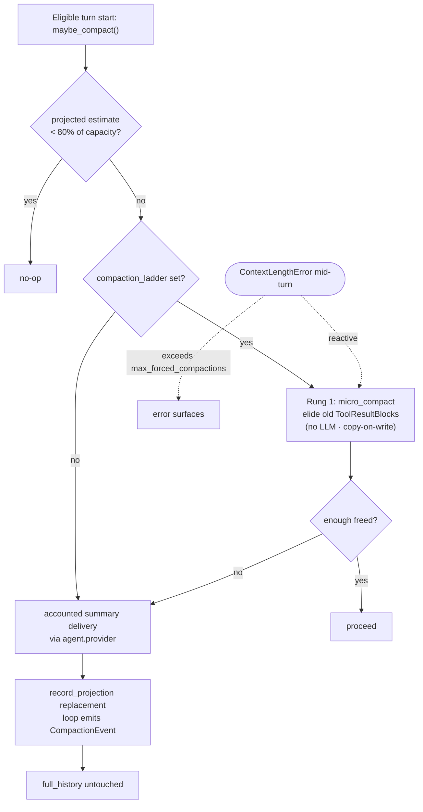

# Thu gọn ngữ cảnh

[Bản gốc tiếng Anh](../../architecture/compaction.md)

> Thuộc [hướng dẫn kiến trúc Linch](./README.md).

Dùng trang này khi bạn cần theo dõi quá trình thu gọn ngữ cảnh chủ động hoặc phản ứng,
ranh giới hạch toán của quá trình đó, hoặc việc khôi phục snapshot bền vững của góc nhìn provider.

Ở đầu mỗi lượt đủ điều kiện, `maybe_compact(session, agent)`:

1. Xác định model có hiệu lực, ưu tiên giá trị ghi đè theo lượt hoặc skill, sau đó
   đến `session.active_model`, rồi `agent.model`.
2. Lấy **sức chứa** ngữ cảnh của model từ
   `agent.provider.context_window(resolved_model)`. Đây không phải bộ đếm token:
   Linch ước tính `provider_view` đã tách riêng bằng `agent.token_estimator`
   nếu được cung cấp; nếu không, dùng phương án dự phòng dựa trên message đã tuần tự hóa,
   rồi cộng phần dự trữ đầu ra đã cấu hình (hoặc mức dự trữ mặc định có giới hạn).
3. Trả về mà không tạo phép chiếu khi tổng đầu vào ước tính và phần dự trữ thấp hơn
   80% sức chứa đó. Với `CompactionLadder`, trước tiên nó thử `micro_compact`
   không dùng LLM; trong run thông thường, phần tóm tắt còn cần thực hiện được gửi qua
   cổng phụ trợ có hạch toán, sử dụng `agent.provider`.
4. Trong run có hạch toán, biên nhận của lần cung cấp bản tóm tắt được quyết toán trước khi
   áp dụng kết quả. Phần thay thế sau đó được ghi nhận thành một **phép chiếu có ghi log** —
   `session.session_log.record_projection(...)` nối thêm một `ProjectionEntry`
   và viết lại `provider_view` dẫn xuất. Vòng lặp chèn lại ngữ cảnh skill cần thiết,
   lưu snapshot bền vững nếu được hỗ trợ, đặt lại các digest thông báo danh mục,
   và phát `CompactionEvent` sau khi phép chiếu được chấp nhận.

**Bất biến:** `full_history` không bao giờ bị sửa đổi. Chỉ `provider_view` (phép chiếu của một log duy nhất chỉ cho phép nối thêm) được thu nhỏ, và việc thu nhỏ diễn ra qua phép chiếu *có ghi log*, không phải sửa trực tiếp mà không theo dõi. Điều này bao quát đầu vào model do session quản lý; ngữ cảnh `ContextInjectionHook`/RAG theo từng request là tạm thời và chỉ tồn tại trong `ProviderRequest`. Quá trình thu gọn sử dụng `agent.provider` đã cấu hình — không bao giờ gọi OpenAI bằng cách mã hóa cứng.

Luồng thu gọn không phụ thuộc provider: các bản tóm tắt tích hợp dùng cùng
hợp đồng luồng provider đã chuẩn hóa như lượt thông thường và giữ nguyên
quan hệ ghép cặp message/tool. Cơ chế này không yêu cầu workspace lập trình,
và chiến lược có thể ghi đè prompt cho lĩnh vực khác. Cache snapshot wire-3 hiện hành
bị thiếu hoặc sai định dạng có thể được dựng lại từ `full_history`; phiên bản
snapshot không tương thích bị từ chối thay vì được xem là cache miss.

Quá trình thu gọn giữ nguyên tiền tố `system` và danh mục `base` đã lưu;
khi có, danh sách skill gốc vẫn nằm trong tiền tố system đó, và quá trình thu gọn
không tải lại skill. Nếu `notified` khác `base`, vòng lặp đặt lại nó thành bản sao
của `base` và xóa đường xử lý nhanh của danh mục. Một lần `sync_catalog` sau đó
so sánh danh mục đang hoạt động, có thể cập nhật các digest `prefix["tools"]`/`notified`
và nối thêm một `CatalogChangeBlock` cho các khác biệt. Run bỏ qua snapshot dùng
danh sách đang hoạt động. Các danh sách được chèn lại và lời nhắc về skill đã gọi
là các mục log chỉ dành cho góc nhìn provider (`historical=False`); chúng không
thêm các bản sao nội dung skill vào `full_history`.

Hàm trợ giúp trực tiếp `summarize_with_provider(...)` vẫn dành cho bên gọi
độc lập, với hành vi luồng provider hiện có. Luồng run thông thường bọc các
chiến lược tích hợp và chiến lược tùy chỉnh tuân thủ trong cổng hạch toán,
để dùng chung cơ chế hủy, một lần chiếm slot provider và quyết toán biên nhận
với vòng lặp chính.



`DefaultCompaction` vẫn là mặc định. Bạn có thể chọn `DetailedCompaction` qua
`Agent(compaction=DetailedCompaction())`; chiến lược này dùng bản tóm tắt đủ an toàn
để tiếp tục công việc, gồm ý định của người dùng, thông tin/tài nguyên quan trọng đã
xử lý, lỗi/cách sửa, việc còn chờ, công việc hiện tại và bước tiếp theo. Cách diễn
đạt các phần không gắn với lĩnh vực cụ thể (yêu cầu định danh — đường dẫn, URL, ID,
tên — thay vì mặc định là tệp/mã), nên cũng phù hợp với ứng dụng nhúng ngoài lập trình.

Prompt mặc định của `DefaultCompaction` hướng đến lập trình (yêu cầu đường dẫn tệp,
lệnh gọi tool và nội dung tương tự); mặc định của `DetailedCompaction` không gắn với
lĩnh vực cụ thể. Vì linch có thể *được nhúng* và không phải ứng dụng nhúng nào cũng
là agent lập trình, **cả hai** đều nhận giá trị ghi đè `prompt=` —
`DefaultCompaction(prompt=...)` / `DetailedCompaction(prompt=...)` — để ứng dụng
ngoài lập trình có thể đổi cách diễn đạt bản tóm tắt mà không cần triển khai lại
`CompactionStrategy`. Khi bỏ qua tham số này, mỗi chiến lược giữ prompt tích hợp,
nên hành vi mặc định không đổi. Prompt không gắn với lĩnh vực cụ thể có sẵn dưới tên
`GENERAL_SUMMARY_PROMPT` (công khai), dành cho ứng dụng nhúng muốn có mặc định
hợp lý ngoài lập trình mà không phải tự viết:
`Agent(compaction=DefaultCompaction(prompt=GENERAL_SUMMARY_PROMPT))`.

### Hạch toán và khôi phục bền vững kết quả đã trả phí

Sổ cái trong phạm vi run là nguồn dữ liệu về tổng mức sử dụng model tích lũy.
Mỗi lần cung cấp kết quả thu gọn thực tế có một ID cung cấp mới; mức sử dụng
`message_end` hợp lệ được quyết toán đúng một lần trước khi kết quả có thể được
chấp nhận, từ chối, áp dụng vào góc nhìn provider hoặc dẫn đến lần gửi tiếp theo.
Mức sử dụng hợp lệ vẫn được tính phí ngay cả khi bản tóm tắt rỗng, không phải văn bản,
sử dụng tool, quá lớn hoặc không dùng được vì lý do khác. Sau bản tóm tắt làm cạn
`RunBudget`, hệ thống kiểm tra lại điều kiện tiếp nhận, nên request chính tiếp theo
không được gửi đi.

Với `DefaultCompaction` và `DetailedCompaction`, kết quả đã chấp nhận được lưu
bền vững đi kèm biên nhận và một công thức `compaction_source` có thứ tự, chỉ chứa
hash. Công thức này ràng buộc lần cung cấp thực tế, request, cấu hình chiến lược,
ranh giới lịch sử đầy đủ bền vững, các message nguồn có thứ tự và lời nhắc chỉ dành
cho góc nhìn provider. Nội dung skill đã gọi cần thiết được ghi xuống qua session
store hiện có trước khi ghi công thức. Khi resume, Linch chỉ dựng lại từ nguồn lịch
sử đã xác minh đó và áp dụng văn bản đã chấp nhận trong giới hạn, không gọi lại
provider hoặc tính phí lặp. Nguồn thay đổi, thiếu nội dung skill, thay đổi lớp bao
danh sách, chiến lược/cấu hình không khớp hoặc bản ghi đã trả phí kiểu cũ không có
nguồn đều khiến hệ thống từ chối xử lý để bảo toàn an toàn.

Các triển khai `CompactionStrategy` tùy chỉnh nhận được các bảo đảm về hạch toán,
hủy và bộ giới hạn của run đối với các lệnh gọi qua facade provider được cung cấp.
Không thể quan sát các lệnh gọi ẩn bên ngoài facade và các phép biến đổi tùy ý;
chiến lược tùy chỉnh cũng không có điểm tích hợp để phát lại kết quả đã trả phí
một cách xác định. Khôi phục kết quả đã trả phí chỉ được hỗ trợ cho các triển khai
cụ thể `DefaultCompaction` và `DetailedCompaction` không bị thay đổi, được
`_builtin_compaction_config` chấp nhận.

Mức sử dụng cuối cùng chưa biết không bao giờ được xem là bằng không. Run có giới
hạn chặn các lệnh gọi model tiếp theo tại hàng rào mức sử dụng chưa biết; run không
có giới hạn có thể báo cáo tổng đã biết ở mức cận dưới. Quyền sở hữu biên nhận dùng
chung chỉ bao quát cây budget đang hoạt động trong cùng tiến trình — không bảo đảm
khôi phục giới hạn phân tán, tính phí bên ngoài đúng một lần hay dự trữ cho các lần
tiếp nhận đồng thời.

### Thang thu gọn (tùy chọn)

`Agent(compaction_ladder=CompactionLadder())` bổ sung các nấc khôi phục bao quanh
chiến lược. Khi không có thang, trình điều khiển vẫn giữ một lần thử lại thu gọn
cho `ContextLengthError` trong một lượt.

- **Nấc 1 — thu gọn nhỏ** (`micro_compact` trong `compaction.py`): lược bỏ
  nội dung `ToolResultBlock` cũ hơn `keep_recent_turns`, thay bằng một đoạn giữ chỗ
  ngắn. Không gọi LLM; sao chép khi ghi (dựng lại message thay đổi, không bao giờ
  sửa trực tiếp); mọi `tool_use_id` vẫn được ghép cặp. Chạy chủ động bên trong
  `maybe_compact` (bỏ qua tóm tắt khi việc lược bỏ giải phóng đủ chỗ) và chạy phản
  ứng một lần mỗi lượt khi provider phát sinh `ContextLengthError`.
- **Nấc 2 — thu gọn bắt buộc với cơ chế ngắt mạch**: trình điều khiển dùng chung
  `_stream_turn_with_recovery` trong `loop/streaming.py` thử lại với các lần thu gọn
  bắt buộc, tối đa `max_forced_compactions` mỗi run, sau đó để lỗi truyền ra.

### Góc nhìn đã thu gọn bền vững (tùy chọn, phát hiện qua store)

Quá trình thu gọn thu nhỏ `provider_view` trong bộ nhớ. Khi không có snapshot bền
vững, tiến trình mới dựng lại góc nhìn từ `full_history`, nên run đủ điều kiện tiếp
theo có thể lại thu gọn nó.
`SessionStore` **có thể** lưu bền vững góc nhìn đã thu gọn để tránh làm lại khi tải lại:

```python
class ProviderViewSnapshotStore(Protocol):
    async def save_provider_snapshot(self, id: str, snapshot: ProviderViewSnapshot) -> None: ...
    async def load_provider_snapshot(self, id: str) -> ProviderViewSnapshot | None: ...
```

`ProviderViewSnapshot` ghép cặp `provider_view` đã thu gọn với `covers_seq` —
số thứ tự message mà nó bao quát. Vòng lặp lưu snapshot tại điểm thu gọn; khi tải,
agent khôi phục snapshot và chỉ nối thêm các message được ghi *sau* `covers_seq`,
tái tạo chính xác góc nhìn đang hoạt động.

Cả hai phương thức đều tùy chọn và được phát hiện lúc chạy bằng `getattr`.
Các store tích hợp trong bộ nhớ và Postgres đều triển khai chúng; store tùy chỉnh
bỏ qua chúng sẽ tiếp tục dựng lại góc nhìn từ lịch sử đầy đủ.
Lớp bao snapshot yêu cầu chính xác wire version 3. Phiên bản bị thiếu, cũ hơn hoặc
không xác định đều thất bại với lỗi yêu cầu bắt đầu run mới. Sau bước kiểm tra phiên
bản, luồng tải xác minh cache snapshot hiện hành và quay về dựng lại từ
`full_history` khi gặp lỗi trình tải thông thường, payload sai định dạng hoặc
`covers_seq` âm, vượt quá message mới nhất đã lưu hay không nhất quán với log
message có thứ tự không tăng đơn điệu. Khoảng trống trong số thứ tự message là hợp
lệ và được giữ nguyên; số thứ tự sai trật tự chỉ vô hiệu hóa cache snapshot cho
session đó. Quá trình thu gọn không bao giờ sửa hoặc xóa phép chiếu lịch sử của
log session chỉ cho phép nối thêm — snapshot là cache của góc nhìn dẫn xuất,
không bao giờ là nguồn dữ liệu chuẩn.

## Cơ sở thiết kế

- **Chỉ phép chiếu provider thu nhỏ; message lịch sử vẫn đầy đủ.**
  Model chỉ thấy `provider_view`, nên `record_projection(...)` viết lại phép chiếu
  dẫn xuất đó và giữ nguyên phép chiếu `full_history`. `SessionLog` chỉ cho phép
  nối thêm vẫn là nguồn dữ liệu chuẩn; các bản ghi `ProjectionEntry` trong bộ nhớ
  của nó không được lưu bền vững. Store bền vững giữ message và có thể giữ thêm
  cache snapshot của góc nhìn provider.
- **Tóm tắt qua `agent.provider`, không bao giờ mã hóa cứng lệnh gọi nhà cung cấp.**
  Thu gọn cũng là một lượt model, nên phải tuân theo provider mà run sử dụng.
  Mã hóa cứng OpenAI sẽ làm hỏng việc sử dụng Anthropic/Gemini/model cục bộ và
  chia tách việc hạch toán chi phí.
- **Nấc rẻ nhất trước.** `micro_compact` không dùng LLM (lược bỏ kết quả tool cũ)
  và chạy trước khi trả phí cho lệnh gọi tóm tắt; tóm tắt chỉ diễn ra khi lược bỏ
  không giải phóng đủ chỗ. Nhờ đó trường hợp thông thường vừa miễn phí vừa nhanh.
- **Sao chép khi ghi, không sửa trực tiếp.** `micro_compact` không sửa đầu vào;
  message và giá trị `ToolResultBlock` thay đổi được dựng lại trước khi kết quả
  được ghi thành phép chiếu. Vì vậy lịch sử chỉ cho phép nối thêm vẫn nguyên vẹn,
  và quan hệ ghép cặp `tool_use_id` được giữ để provider không nhận kết quả mồ côi.
- **Cơ chế ngắt mạch thay cho thử lại không giới hạn.** Thu gọn bắt buộc bị giới hạn ở
  `max_forced_compactions` mỗi run để một lượt đơn lẻ lớn bất thường phát sinh
  `ContextLengthError` rõ ràng thay vì lặp tóm tắt mãi mãi.

---

Quay lại [mục lục kiến trúc](./README.md).
