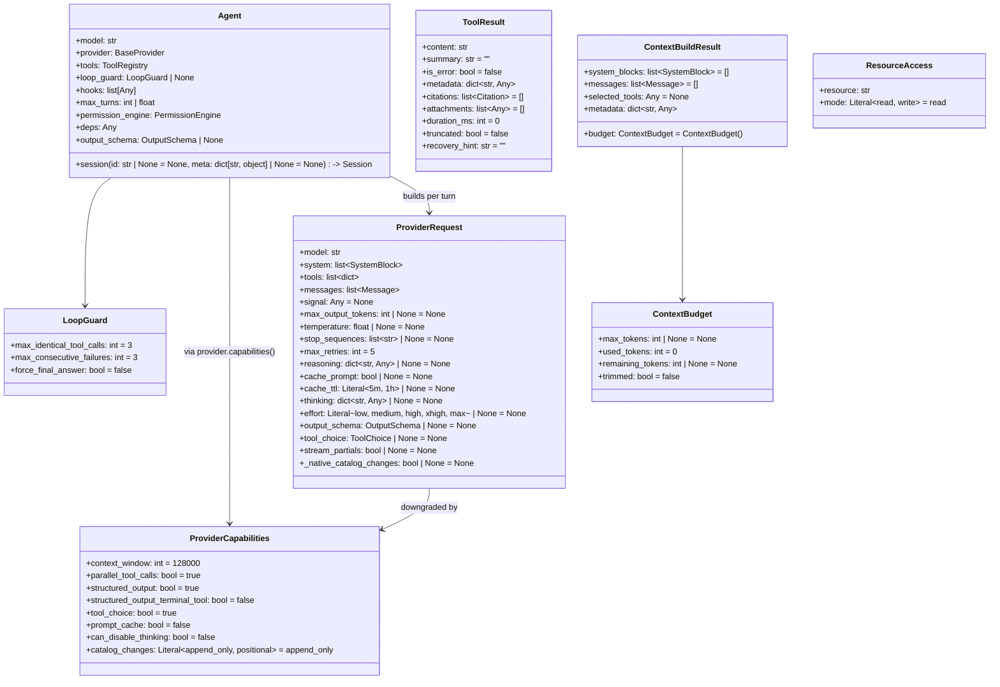

# Các kiểu dữ liệu cốt lõi

[Bản gốc tiếng Anh](../../architecture/data-types.md)

> Thuộc [hướng dẫn kiến trúc Linch](./README.md).

Dùng trang này khi bạn cần biết cấu trúc đã chuẩn hóa của yêu cầu, khả năng, kết
quả dựng ngữ cảnh, kết quả tool hoặc truy cập tài nguyên được trao đổi giữa kernel
và các provider.

```python
from linch import ProviderRequest, SystemBlock
```

`SystemBlock` chứa `text: str`, `cacheable: bool = False` và giá trị cố định
`type: Literal["text"] = "text"`; `ProviderRequest` yêu cầu có `model`, `system`,
`tools` và `messages`. `Agent.session(...)` là bất đồng bộ và phải được await.
Các giá trị mặc định là list/dict rỗng trong sơ đồ biểu thị các giá trị được
factory của dataclass tạo mới cho từng instance, không phải các giá trị khả biến
dùng chung.



## Cơ sở thiết kế

`CatalogChangeBlock` là một biến thể nội bộ của nội dung thông điệp, chứa văn bản
nhắc nhở và các tuple tên tool được thêm và bị loại bỏ, cùng với
`tool_definitions: tuple[dict[str, Any], ...] = ()` để giữ các phần bổ sung native
đã được đóng băng. Các codec thông điệp bảo toàn những định nghĩa này qua các lần
tải lại từ kho session. Provider và bộ ước tính token sử dụng phần văn bản của nó;
các adapter positional đủ điều kiện còn kết xuất các cấu trúc tool native của nó.
Nó không thêm tên công khai cấp cao nhất hay event vòng đời nào.
`ProviderCapabilities.catalog_changes` mặc định là `"append_only"`; các provider
bật tùy chọn này một cách tường minh có thể báo `"positional"` cho một mô hình/endpoint đủ điều kiện.

- **`Agent` sở hữu cấu hình và vòng đời tồn tại lâu dài; `Session` sở hữu trạng
  thái hội thoại khả biến.** Tách các trách nhiệm đó cho phép một `Agent` tạo
  nhiều session đồng thời một cách an toàn, trong khi host giữ quyền sở hữu
  provider, tool, chính sách và dịch vụ tại ranh giới agent.
- **`ProviderRequest` được dựng lại mỗi lượt và được hạ mức theo
  `ProviderCapabilities`.** Yêu cầu được tập hợp mới ở mỗi lượt để ngữ cảnh riêng
  của từng lượt và việc loại bỏ tính năng theo khả năng (bỏ `cache_*` với provider
  không hỗ trợ cache, bỏ `output_schema` khi không được hỗ trợ) không bao giờ rò
  sang lượt kế tiếp hay provider khác.
- **`ToolResult` tách kênh mô hình khỏi kênh host.** `content` của nó là văn bản
  ngắn gọn dành cho provider; `summary`/`metadata`/`citations`/
  `attachments`/`duration_ms`/`truncated` là các trường chứa thông tin chi tiết dành cho
  thành phần sử dụng phía host (UI, nguồn gốc dữ liệu, telemetry), trong khi `is_error`
  và `recovery_hint` cũng định hướng cách vòng lặp xử lý kết quả.
- **`ResourceAccess` mang tính khai báo, không dựa trên khóa.** Một tool *khai báo*
  những gì nó đọc/ghi; bộ lập lịch suy ra mức song song an toàn từ các khai báo
  đó, nên tính đồng thời là một thuộc tính của dữ liệu, không phải của các khóa
  được đặt thủ công.

---

Quay lại [mục lục kiến trúc](./README.md).
