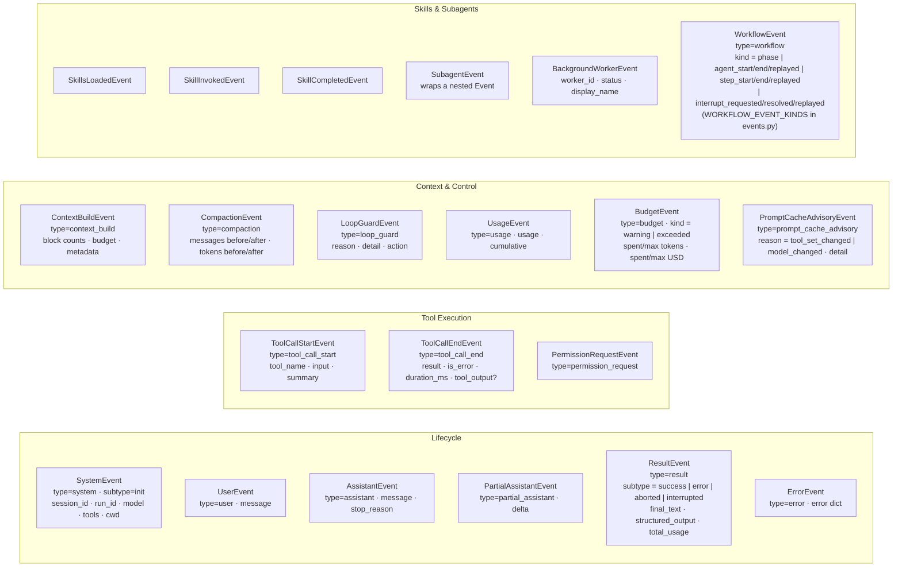

# Phân loại event

[Bản gốc tiếng Anh](../../architecture/events.md)

Trang này giúp bạn tìm hiểu các loại event và các điểm điều phối trong vòng đời.

> Thuộc [hướng dẫn kiến trúc Linch](./README.md).

Các loại event là các đối tượng `@dataclass(slots=True)` có trường phân biệt `type: Literal[...]`. Sơ đồ tóm tắt các event streaming thường gặp; event nhật ký và event tạm thời có cách lưu bền vững khác nhau.

## Danh mục vòng đời có kiểu

Vòng đời kernel được định nghĩa một lần dưới dạng các điểm có kiểu với chế độ
điều phối tường minh. Bảng dưới đây được tạo từ `linch.lifecycle` và các vị trí gọi
trong mã nguồn; chạy `python scripts/generate_event_catalog.py --check` để phát hiện
sự sai lệch.

<!-- BEGIN GENERATED LIFECYCLE CATALOG -->
| Điểm | Payload | Chế độ | Bên phát | Bên nhận |
|---|---|---|---|---|
| `context/service` | `Context + key` | `emit` | `linch.kernel.context:Context._publish_plugin` `linch.kernel.context:Context._withdraw_plugin` `linch.kernel.context:Context.register` `linch.kernel.context:Context.scope` | `linch.kernel.context:Context.scope` `linch.kernel.plugins:_PluginMount.start` |
| `AgentStart` | `AgentStartContext` | `hook` | `linch.loop.startup:initialize_run` | `linch.hooks.dispatcher:HookDispatcher.dispatch` |
| `AgentStop` | `AgentStopContext` | `hook` | `linch.loop.runner:_run_loop_impl` `linch.loop.startup:_emit_prompt_block` | `linch.hooks.dispatcher:HookDispatcher.dispatch` |
| `UserPromptSubmit` | `UserPromptSubmitContext` | `hook` | `linch.loop.dispatch:dispatch_user_prompt` | `linch.hooks.dispatcher:HookDispatcher.dispatch` |
| `TurnStart` | `TurnStartContext` | `hook` | `linch.loop.runtime:TurnLifecycle.start_turn` | `linch.hooks.dispatcher:HookDispatcher.dispatch` |
| `TurnStop` | `TurnStopContext` | `hook` | `linch.loop.runtime:TurnLifecycle.end_active_turn` | `linch.hooks.dispatcher:HookDispatcher.dispatch` |
| `BeforeProviderCall` | `BeforeProviderCallContext` | `hook` | `linch.loop.dispatch:dispatch_before_provider_call` | `linch.hooks.dispatcher:HookDispatcher.dispatch` |
| `ProviderCallStart` | `ProviderCallStartContext` | `hook` | `linch.loop.runtime:TurnLifecycle.start_provider_call` | `linch.hooks.dispatcher:HookDispatcher.dispatch` |
| `ProviderCallStop` | `ProviderCallStopContext` | `hook` | `linch.loop.runtime:TurnLifecycle.end_active_provider_call` | `linch.hooks.dispatcher:HookDispatcher.dispatch` |
| `AfterProviderCall` | `AfterProviderCallContext` | `hook` | `linch.loop.dispatch:dispatch_after_provider_call` | `linch.hooks.dispatcher:HookDispatcher.dispatch` |
| `PreToolUse` | `PreToolUseContext` | `hook` | `linch.scheduler:_dispatch_pre_tool_use` | `linch.hooks.dispatcher:HookDispatcher.dispatch` |
| `ToolUseStart` | `ToolUseStartContext` | `hook` | `linch.loop.tool_batch:run_tool_batch` | `linch.hooks.dispatcher:HookDispatcher.dispatch` |
| `ToolUseStop` | `ToolUseStopContext` | `hook` | `linch.loop.tool_batch:run_tool_batch` | `linch.hooks.dispatcher:HookDispatcher.dispatch` |
| `PostToolUse` | `PostToolUseContext` | `hook` | `linch.coordination.mailbox.__init__:_render_peer_message` `linch.scheduler:_dispatch_post_tool_use` `linch.tools.subagent:SubagentTool.execute` | `linch.hooks.dispatcher:HookDispatcher.dispatch` |
| `PostToolUseFailure` | `PostToolUseFailureContext` | `hook` | `linch.scheduler:_dispatch_post_tool_use_failure` | `linch.hooks.dispatcher:HookDispatcher.dispatch` |
| `PreCompact` | `PreCompactContext` | `hook` | `linch.compaction:_run_compaction_impl` | `linch.hooks.dispatcher:HookDispatcher.dispatch` |
| `PostCompact` | `PostCompactContext` | `hook` | `linch.compaction:_run_compaction_impl` | `linch.hooks.dispatcher:HookDispatcher.dispatch` |
| `BeforeFinalAnswer` | `BeforeFinalAnswerContext` | `hook` | `linch.loop.dispatch:dispatch_before_final_answer` | `linch.hooks.dispatcher:HookDispatcher.dispatch` |
| `Stop` | `StopContext` | `hook` | `linch.loop.dispatch:dispatch_stop` | `linch.hooks.dispatcher:HookDispatcher.dispatch` |
| `SubagentStart` | `SubagentStartContext` | `hook` | `linch.subagents.runner:_run_subagent_owned` `linch.subagents.runner:continue_subagent` | `linch.hooks.dispatcher:HookDispatcher.dispatch` |
| `SubagentStop` | `SubagentStopContext` | `hook` | `linch.subagents.runner:_run_subagent_owned` `linch.subagents.runner:continue_subagent` | `linch.hooks.dispatcher:HookDispatcher.dispatch` |
| `EventEmit` | `EventEmitContext` | `hook` | `linch.session:Session._iterate` | `linch.hooks.dispatcher:HookDispatcher.dispatch` |
| `tools/pre-execute` | `ToolExecution` | `waterfall` | `linch.tools.pipeline:ToolPipeline.run_pre_execute` | `linch.tools.pipeline:ToolPipeline.on_pre_execute` |
| `tools/execute` | `ToolExecution` | `waterfall` | `linch.tools.pipeline:ToolPipeline.run_execute` | `linch.tools.pipeline:ToolPipeline.on_execute` |
| `tools/post-execute` | `ToolExecution + result` | `waterfall` | `linch.tools.pipeline:ToolPipeline.run_post_execute` | `linch.tools.pipeline:ToolPipeline.on_post_execute` |
| `tools/resolve` | `str + dict + Session` | `serial` | `linch.scheduler:execute_tool_calls` | `linch.tools.search:ToolSearchPlugin.setup` |
| `turn-stopping` | `TurnStopping` | `serial` | `linch.loop.turn_stopping:TurnStoppingDispatcher.dispatch` | `linch.loop.turn_stopping:TurnStoppingDispatcher.register` |
<!-- END GENERATED LIFECYCLE CATALOG -->

`BackgroundWorkerEvent` được phát khi tác vụ worker nền hoàn tất (thành công hoặc thất bại); nó mang theo `worker_id`, `status` và `display_name`.

`PromptCacheAdvisoryEvent` được phát (chỉ để quan sát, không bao giờ sửa đổi request) khi tập tool hoặc mô hình thay đổi giữa các lời gọi provider trong cùng session, làm mất hiệu lực tiền tố request đã cache — xem [cache prompt](../usage/providers.md#event-prompt_cache_advisory).

Bộ tuần tự hóa event hỗ trợ chuyển event sang dữ liệu rồi khôi phục lại. Tiến độ tool là tạm thời và không được lưu trong log event bền vững của run; các event ghi nhận mức sử dụng của lời gọi mô hình chỉ được lưu trong nhật ký.

`SystemEvent` và `ResultEvent` kết thúc mang theo `trace_id` của run khi run
được lưu bền vững hoặc streaming. Giá trị tại thời điểm tạo/khởi nguồn được giữ
trong `RunRecord.meta`, được `ToolContext.trace_id` ghi nhận ở chế độ chỉ đọc và
có thể được gắn vào bản ghi log của ứng dụng chủ bằng `linch.TraceIdFilter`.
Ngữ cảnh OpenTelemetry đang hoạt động và hợp lệ cung cấp ID này; run không có
ngữ cảnh như vậy dùng ID run ổn định làm giá trị dự phòng để liên kết dữ liệu.
Một lần resume đi theo trace đang hoạt động của bên gọi, còn bên gọi không có
trace thì sử dụng lại cùng ID run bền vững đó.

Mặc định, bộ đọc áp dụng quy tắc nghiêm ngặt: event bắt buộc không xác định hoặc
sai định dạng — ở cấp cao nhất hay lồng trong payload của event — đều gây lỗi tải,
vì âm thầm bỏ qua có thể làm thay đổi ý nghĩa của run được resume. Chỉ event được
gắn nhãn `ignorable` tường minh mới có thể được giải mã thành giá trị đánh dấu công khai
`IgnorableEvent` và được bên nhận bỏ qua. Khả năng bỏ qua là thuộc tính tương thích
do bên phát khai báo, không phải cơ chế dự phòng cho các trường bắt buộc không xác định
hay cấu trúc lồng nhau không xác định.

## Cơ sở thiết kế

- **Event giúp quan sát run.** UI có thể tiếp nhận văn bản assistant, lời gọi tool,
  quyền, mức sử dụng, nén ngữ cảnh, budget và hoạt động của subagent.
- **Trường phân biệt `type` dạng literal + `slots=True`.** Literal giúp phân nhánh
  theo event với chi phí thấp và khớp mẫu an toàn; `slots` giúp chúng gọn nhẹ vì một
  run có thể phát ra hàng nghìn event.
- **Tuần tự hóa và khôi phục đầy đủ (`event_to_dict`/`event_from_dict`).** Event có
  thể được tuần tự hóa cho log bền vững và báo cáo ngoại tuyến. Không phải mọi event
  streaming đều được lưu bền vững, và các bản ghi mức sử dụng chỉ được lưu trong nhật ký.
- **Lồng qua `SubagentEvent`, không làm phẳng luồng.** Event của agent con được bọc
  lại thay vì trộn trực tiếp vào luồng, nên bên nhận có thể phân biệt hoạt động của
  agent cha với worker và tái dựng cây.

---

Quay lại [mục lục kiến trúc](./README.md).
