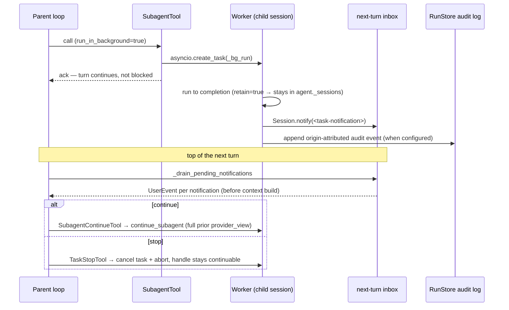

# Skill và subagent
[Bản gốc tiếng Anh](../../architecture/skills-subagents.md)

Trang này giúp bạn hiểu cách gọi skill, thực thi subagent và vòng đời của chúng.

> Thuộc [hướng dẫn kiến trúc Linch](./README.md).

**Skill** được nạp từ `.linch/skills/*/SKILL.md`; các skill tích hợp sẵn
như `verify` cũng được đăng ký, trừ khi có một skill trên đĩa dùng cùng tên.
Mỗi tệp có phần frontmatter YAML (`name`, `description`, `allowed_tools`,
`model`) và phần nội dung markdown. Khi một skill được gọi, phần nội dung được
chèn vào dưới dạng `<system-reminder>` ở mỗi lượt thông qua `_re_inject_skill_context`.
Tính năng này được bật bằng `FeatureFlags(skills=True)`. Một `Agent` thuần đặt cờ này
thành `False`, nên ứng dụng nhúng SDK sẽ không phát hiện các chỉ dẫn của dự án chỉ
vì tiến trình của nó đang chạy trong một bản checkout.

Phép thay thế skill mở rộng `${SKILL_DIR}` và `${LINCH_SKILL_DIR}` thành thư mục
skill đã nạp, cùng các đối số gọi và `${LINCH_SESSION_ID}`. Script đi kèm như
`python "${SKILL_DIR}/scripts/check.py"` chạy qua Bash cùng đường quyền/backend
thông thường; phép thay thế không cấp quyền thực thi. Tác giả đặt dấu nháy quanh
đường dẫn có khoảng trắng; thư mục phải hiển thị trong môi trường thực thi đã cấu hình.

Các session thông thường đặt danh sách skill vào phần tiền tố hệ thống bền vững,
có thể được cache của chúng một lần. `await agent.reload_skills()` quét lại các tệp
ngoài event loop, sau đó thay thế đồng thời ánh xạ skill đang dùng, danh sách và các
quy tắc quyền được suy ra từ skill. Phương thức này giữ lại tool `Skill` đã đăng ký,
ngay cả khi ánh xạ mới rỗng. Các session hiện có giữ nguyên tiền tố và nhận một lời
nhắc bền vững về danh mục; các skill mới có thể được gọi ở yêu cầu provider tiếp
theo. Lời nhắc tham chiếu tên và mô tả skill, không bao giờ chứa nội dung skill.
Resume bền vững và compaction dùng danh sách đã được cố định khi snapshot được bật.
Một run bỏ qua snapshot hiện có của nó sẽ tiếp tục chèn lại danh sách đang dùng.
Việc chèn lại skill đã gọi vẫn chỉ là lời nhắc trong góc nhìn của provider và không
thêm vào `full_history`.

**Subagent** được định nghĩa trong `.linch/agents/*.md`; các agent có tên tích hợp
sẵn như `verification` cũng được đăng ký, trừ khi có một agent trên đĩa dùng cùng
tên. Một session con mới có lớp phủ tool đã được lọc. Các khối hệ thống của nó được
tạo từ tên tool của session con, giữ lại các chỉ dẫn hệ thống phù hợp do ứng dụng
chủ cung cấp, rồi thêm vai trò của session con vào cuối. Ngược lại, một bản fork
tái sử dụng các khối hệ thống và góc nhìn hội thoại của session cha. Tính năng này
được bật bằng `FeatureFlags(subagents=True)`.

Mô hình gọi `Subagent` với hai trường chuỗi bắt buộc là `description` (nhãn không
chỉ chứa khoảng trắng) và `prompt` (nhiệm vụ không rỗng), cùng hai trường tùy chọn
là `subagent_type` (chuỗi) và `run_in_background` (boolean). Bỏ qua loại để dùng
session con đa dụng; hãy cung cấp đầy đủ ngữ cảnh liên quan đến nhiệm vụ vì session
con mới không có lịch sử của session cha. `run_in_background` mặc định là `false`;
việc thực thi nền phải được bật trên agent. Ví dụ, một lời gọi chạy trực tiếp có
thể dùng:

```json
{"description": "Review parser tests", "prompt": "Check parser boundary tests and report gaps.", "subagent_type": "verification"}
```

`reload_subagents()` thay thế các đăng ký tool hiện có tại vị trí ban đầu của chúng,
giữ nguyên thứ tự các tool được đăng ký sau đó, bao gồm cả tool MCP. Việc nạp lại
tăng số phiên bản danh mục của agent để các session phát hiện thay đổi trước lần
tạo ngữ cảnh tiếp theo. Các chỉnh sửa mô tả bao gồm mô tả mới, kể cả các loại agent
khả dụng trong mô tả của `Subagent`. Các tool MCP được nhận diện qua định danh của
wrapper và nhận thông báo chỉ chứa tên, giúp mô tả và chỉ dẫn của bên thứ ba không
xuất hiện trong phần văn bản điều hành của lời nhắc.

Agent SDK thuần cũng để `subagents`, `mcp` và `filesystem` ở trạng thái tắt.
Hãy bật rõ ràng từng tài nguyên dự án mà bạn tin cậy, hoặc chủ động dùng cấu hình
sẵn `create_deep_agent()`, vốn bật các khả năng mà nó tập hợp.

`SubagentTool` vẫn có phạm vi exec và cung cấp một hàm kiểm tra điều kiện chạy đồng
thời dựa trên đầu vào. Chỉ một loại có tên với danh sách tool tường minh, trong đó
mọi tool đều được phân giải thành `scope="read"`, mới có thể chạy đồng thời với
một lời gọi tool khác. Danh sách rỗng tường minh là an toàn; `None` hoặc `"*"` kế
thừa quyền truy cập tool và buộc chạy tuần tự. Các subagent đa dụng, không xác định,
không thể phân giải, có khả năng ghi và chạy nền cũng chạy tuần tự. Lỗi tra cứu
hoặc phạm vi đều dẫn đến từ chối chạy đồng thời. Hàm kiểm tra phân giải danh mục
worker hiện tại, bao gồm cả danh mục coordinator được cài đặt sau khi tool được
đăng ký. Một session cha đang hoạt động cung cấp tool này qua registry riêng của
session cũng buộc chạy tuần tự: hàm kiểm tra không thể xác định session gọi chỉ từ
đầu vào. Các session con có thể hoàn thành không theo thứ tự; event kết quả và kết
quả tool gửi cho provider giữ nguyên thứ tự lời gọi ban đầu của provider.
`SubagentContinueTool` và `TaskStopTool` giữ nguyên các khai báo về khả năng chạy
đồng thời hiện có.

**MCP** — `connect_mcp_servers(configs)` bọc mỗi tool MCP thành một tool Linch theo cơ chế duck typing. Tên được chuẩn hóa qua `mcp/naming.py`. Các kết nối do agent sở hữu được đóng bằng `agent.close()`; ứng dụng chủ dùng trực tiếp `connect_mcp_servers()` sở hữu kết nối được trả về và đóng nó bằng `await connection.close()`. Việc agent tự động kết nối được bật bằng `FeatureFlags(mcp=True)`.

### Cấu hình sẵn deep agent (`ext/deep_agent/`)

`create_deep_agent(model=..., profile=..., durable=..., coordinator=..., cwd=..., ...)` là
một hàm factory tường minh, tập hợp cấu hình deep agent đầy đủ trong một lời gọi:
các tool quản lý nhiệm vụ, danh sách subagent chuyên trách (researcher, planner,
implementer), ngữ cảnh bộ nhớ tệp và system prompt mở rộng. Các kho lưu trữ bền vững
và backend filesystem do ứng dụng chủ cung cấp. Profile mặc định `balanced` giới
hạn một run ở 64 lượt và 1.000.000 token, đồng thời giữ lại các worker;
`coordinator` có cùng giới hạn và loại bỏ các tool nặng khỏi session cha.
`unbounded` là lựa chọn tường minh để bỏ các giới hạn này cho ứng dụng chủ đã tự
quản lý vòng đời và chi phí bằng các cơ chế tương đương.

- **`coordinator=True`** — agent cha loại bỏ các tool nặng (`Edit`, `Write`, `Bash`, `Grep`, `Glob`, `Read`); `COORDINATOR_SYSTEM_PROMPT` được chèn qua `SystemPromptConfig`; `TaskStopTool` được đăng ký trên coordinator. Các subagent worker nhận registry của worker qua `build_child_tools`, hàm này loại bỏ các tool điều phối (`Subagent`, `SubagentContinue`, `TaskStop`): một worker không có worker riêng nào để tiếp tục hay dừng.
- **`durable=True`** — yêu cầu cung cấp tường minh các kho lưu trữ session/run và một filesystem tường minh khi được bật. Cung cấp `PostgresSessionStore`, `PostgresRunStore` và một `CompositeFileBackend` có tuyến `/memories` đến `PostgresFileBackend` để dữ liệu tồn tại sau khi khởi động lại. Một tác vụ worker tách rời đang hoạt động chỉ tồn tại trong tiến trình và không được dựng lại sau khi tiến trình gặp sự cố.

### Worker chạy nền và fork/continue



- `SubagentTool` giữ lại các session con chạy trực tiếp khi có `Agent(retain_subagents=True)`; các session con chạy nền luôn được giữ lại. Việc giải phóng tường minh hoặc cơ chế loại bỏ `max_idle_sessions` được chủ động bật có thể giải phóng một session con nhàn rỗi; muốn tiếp tục thì session con phải còn tồn tại.
- `session.workers: dict[str, WorkerHandle]` lập chỉ mục các worker chạy trực tiếp và chạy nền được giữ lại theo `worker_id`.
- **`run_in_background=True`** trên `SubagentTool`: tạo `asyncio.create_task(_bg_run())` và trả về xác nhận ngay lập tức. Khi hoàn thành, tác vụ gọi `Session.notify()` với ID chuyển giao ổn định trước khi ghi `BackgroundWorkerEvent` của nó. Thông báo mặc định nằm trong bộ nhớ; chế độ inbox bền vững lưu giữ thông báo hoàn thành đã được đưa vào hàng đợi qua lần khởi động lại.
- Vòng lặp lấy hết thông báo từ kênh dành cho lượt tiếp theo đã chọn ở đầu mỗi lượt mới, phát từng thông báo dưới dạng `UserEvent` trước khi `ContextInjectionHook.build_context()` chạy, để mô hình thấy nội dung hoàn thành nhiệm vụ trước lời gọi provider tiếp theo.
- `SubagentContinueTool` phân giải worker bằng ID chính xác hoặc tên hiển thị duy nhất qua `resolve_worker`, rồi gọi `continue_subagent()`, phương thức này chạy lại session con còn tồn tại bằng toàn bộ `provider_view` trước đó. Handle có trạng thái `running` trong khi lần tiếp tục chạy; một lần tiếp tục gửi tới worker đang chạy trả về lỗi `WorkerBusy` và không thay đổi handle. Tên hiển thị không duy nhất bị từ chối kèm theo các ID worker trùng khớp; bên gọi phải dùng ID.
- `TaskStopTool` dùng cùng cách phân giải bằng ID chính xác hoặc tên duy nhất trước khi hủy `asyncio.Task` chạy nền và gửi tín hiệu abort đến session con; tên không duy nhất sẽ không dừng worker nào. Nó chỉ tác động lên worker đang `running`, đánh dấu worker là `killed` và ghi `reason` vào `WorkerHandle.stop_reason`; worker đã kết thúc được giữ nguyên. `WorkerHandle` vẫn nằm trong `session.workers` để có thể tiếp tục worker sau đó.
- Cả `session.abort()` và `agent.close()` đều hủy tất cả tác vụ worker chạy nền đang hoạt động. `agent.close()` còn xóa `agent._sessions`.
- Việc khởi động lại tiến trình không thể resume một tác vụ tách rời đang hoạt động.
  Chế độ inbox bền vững chỉ giữ lại các thông báo hoàn thành đã tới
  `Session.notify()`; ứng dụng chủ cần thực thi bền vững phải lưu công việc vào
  hàng đợi hoặc workflow do ứng dụng sở hữu. Việc thực thi provider/tool vẫn có
  ngữ nghĩa ít nhất một lần.

### Budget của run (`budget.py`)

`RunBudget` là bộ tích lũy có thể thay đổi, được chia sẻ trong toàn bộ một run và
cây subagent của nó. Thứ tự phân giải là `RunOptions.budget`, sau đó đến budget mà
session con kế thừa, rồi đến `Agent(budget=...)`. Các lời gọi mô hình chính và lời
gọi compaction phụ trợ đều tính vào cùng budget dựa trên bản ghi sử dụng của chúng.
Trước mỗi lần gửi yêu cầu thực tế đến mô hình, cơ chế kiểm soát tiếp nhận kiểm tra
budget hiện tại và chặn các lời gọi tiếp theo khi budget đã cạn. Budget có giới hạn
cũng chặn các lời gọi mới sau khi mức sử dụng trở thành không xác định. Cảnh báo
budget được phát một lần cho mỗi đối tượng budget tại `warn_ratio` (mặc định 0,9).

Việc tiếp nhận không dành trước chi phí của một lời gọi: một lời gọi đã được tiếp
nhận, hoặc các lời gọi đồng thời đã được tiếp nhận, có thể vượt quá giới hạn. Một
phản hồi cuối cùng đã được tiếp nhận có thể thành công ngay cả khi chi phí của nó
làm cạn budget. Nếu cần gửi thêm yêu cầu, rào chắn budget sẽ chặn yêu cầu đó. Xem
[thống kê lời gọi mô hình](../usage/events.md#rào-chắn-budget-và-nén-ngữ-cảnh)
để biết chi tiết về bản ghi sử dụng và khôi phục.

### Bộ máy workflow (`ext/workflow/`)

`run_workflow(agent, fn)` vận hành một "vòng lặp đội agent khép kín" có tính xác
định: *fn* là một hàm async thông thường nhận `WorkflowContext` (`wf`) và điều phối
các subagent qua `wf.agent` / `wf.step` / `wf.interrupt` / `wf.parallel` /
`wf.settled` / `wf.pipeline` / `wf.phase`, còn `wf.budget` cung cấp quyền truy cập
`RunBudget` được chia sẻ.

- Một session của ứng dụng chủ làm cha cho mọi run `wf.agent` (mỗi run là một
  session con `run_subagent` thông thường); các `SubagentEvent` và
  `WorkflowEvent` của session con đến ứng dụng chủ qua callback `on_event`.
- **Hai loại bước được ghi nhật ký, cùng một luồng mã.** `wf.agent` chạy một
  subagent; `wf.step` chạy một callable đồng bộ/bất đồng bộ bất kỳ để cả mã có
  tính xác định và các hiệu ứng phụ cũng có thể được phát lại. Cả hai đều đi qua
  `_journaled_call`, nơi quản lý việc gán số lần xuất hiện, tra cứu nhật ký, các
  event `*_start` / `*_end` / `*_replayed` và việc ghi lại — nhờ đó hai loại
  không thể lệch nhau.
- **Nhật ký = nhật ký event của run.** Với `Agent(run_store=...)` và một
  `run_id`, mỗi kết quả được lưu bền vững dưới dạng
  `WorkflowEvent(kind="agent_end")` hoặc `kind="step_end"`. Gọi lại với cùng
  `run_id` sẽ tổng hợp các event đã lưu thành `WorkflowJournal` (xem
  `JOURNALED_KINDS`) và phát lại chuỗi lời gọi đầu không thay đổi mà không gọi
  provider hay thực thi lại. Các lời gọi agent được định danh bằng
  `sha256(subagent_type, prompt, call_options)`, các bước bằng
  `sha256("step", name, key)` — hai miền tách biệt, nên một bước không bao giờ
  có thể trùng khóa với một subagent — mỗi loại cộng thêm bộ đếm số lần xuất
  hiện theo khóa, để việc phân nhánh song song và vòng lặp được phát lại an
  toàn, còn một chỉnh sửa chỉ làm mất hiệu lực lời gọi bị chỉnh sửa đó.
- Giá trị của một bước đi qua nhật ký dưới dạng JSON trong `result_text`;
  `record_kind` của bản ghi phân biệt nó với văn bản cuối cùng của agent.
- Hàm workflow phải có tính xác định (không rẽ nhánh dựa trên ngẫu nhiên/thời
  gian) để việc phát lại khi resume được chính xác. Rẽ nhánh dựa trên kết quả
  *đã được ghi nhật ký* có tính xác định ngay từ cách xây dựng; sự biến thiên
  không được ghi nhật ký thì không.
- `wf.parallel` hủy và chờ xử lý xong các nhánh còn lại khi một nhánh phát sinh
  ngoại lệ, đồng thời cấp cho mỗi cấp lồng nhau một semaphore riêng để việc
  phân nhánh lồng nhau không thể deadlock vì các suất mà chính bên gọi của nó
  đang giữ. `wf.settled` là lựa chọn bỏ qua hành vi này: nó cho phép các nhánh
  cùng cấp hoàn thành và trả về một `StepOutcome` cho mỗi nhánh. Cả hai đều
  ném lại ngoại lệ `CancelledError` / `WorkflowSuspended` thay vì báo chúng
  như kết quả — chúng là luồng điều khiển, không phải kết quả.
- **Chính sách xử lý lỗi áp dụng cho từng lời gọi, bên ngoài bước tra cứu nhật
  ký.** `_journaled_call` gán số lần xuất hiện và tra cứu nhật ký *một lần*,
  sau đó chuyển công việc cho `_call_with_policy`, nơi áp dụng `timeout_ms`
  (cho mỗi lần thử) và `retry` (tái sử dụng `providers/retry.with_retry` với
  hàm điều kiện `retry_on`). Một lần thử lại làm tăng số lần xuất hiện mới
  sẽ ghi vào sai vị trí và âm thầm làm hỏng việc phát lại. Khi không đặt
  chính sách nào, không có khung gọi `wait_for` hay `with_retry` nào được tạo.
- **`wf.interrupt` là điểm tạm dừng.** Không có câu trả lời sẽ dẫn đến một
  event `interrupt_requested` và một `WorkflowSuspended` — đây là
  `BaseException`, nên `except Exception:` của người dùng không thể nuốt nó.
  `run_workflow` bắt ngoại lệ này *trước* nhánh `except BaseException` của nó
  và ghi `save_checkpoint(status="suspended")` thay vì `mark_failed`. Một ánh
  xạ `resume=` cung cấp câu trả lời, được ghi nhật ký như mọi nút khác và được
  tiêu thụ một lần cho mỗi khóa.
- **Hai tham số điều khiển mức đồng thời độc lập.** `max_concurrency` điều
  chỉnh một lần phân nhánh `wf.parallel`; `max_agent_concurrency` là semaphore
  thứ hai được tạo khi cần, chỉ được giữ trong lúc thực sự gọi `run_subagent`,
  nhờ đó giới hạn tải thực tế lên provider mà không chặn luồng phát lại. Nó
  không thể deadlock vì `wf.agent` là một nút lá.
- **Snapshot nhật ký là cơ chế tăng tốc, không bao giờ là nguồn dữ liệu chuẩn.**
  Với `journal_snapshot_every=N`, cứ mỗi bản ghi thứ N, nhật ký được lưu thành
  checkpoint trong `RunCheckpoint.extension_state["linch.workflow"]` cùng mốc
  đánh dấu nhật ký event mà nó bao phủ; một lần resume khởi tạo từ đó và chỉ
  tổng hợp các event về sau. Một bản ghi luôn được ghi vào nhật ký *trước* khi
  event `*_end` của nó được thêm vào, nên mọi thứ snapshot bỏ sót được bảo đảm
  sẽ nằm trong phần đuôi đó. Khi snapshot bị thiếu, quá lớn
  (`_SNAPSHOT_MAX_BYTES`) hoặc sai định dạng, cơ chế này quay về tổng hợp toàn
  bộ nhật ký.

## Cơ sở thiết kế

- **Một session con mới tính toán các khối hệ thống có xét đến tool từ chính
  các tool của nó.** Các chỉ dẫn của ứng dụng chủ vẫn được đưa vào và nên tính
  đến vai trò của session con. Các bản fork chủ đích tái sử dụng tiền tố của
  session cha.
- **Worker chạy nền không chặn lượt.** Tạo tác vụ qua `asyncio.create_task` và
  trả về xác nhận ngay lập tức giúp session cha tiếp tục phản hồi; kết quả
  quay lại tại một *điểm tiếp nhận cố định* (được lấy hết ở đầu lượt tiếp theo)
  thay vì chen vào trạng thái giữa lượt — thứ tự có tính xác định thay cho
  việc các callback tự do chạy đua với nhau.
- **Việc giữ lại giúp có thể tiếp tục worker.** Giữ session con còn tồn tại
  biến một subagent chỉ chạy một lần thành cộng sự lâu dài
  (`continue_subagent` chạy lại nó với toàn bộ `provider_view` trước đó), mà
  không buộc mọi bên gọi phải quản lý vòng đời session.
- **Budget là một đối tượng có thể thay đổi được chia sẻ trong toàn bộ cây.**
  Các session con tính chi phí vào *cùng* `RunBudget` mà session cha giữ, nên
  mức chi của chúng được phản ánh trong các lần kiểm tra tiếp nhận về sau.
  Các lời gọi đồng thời đã được tiếp nhận có thể vượt quá giới hạn.
- **Chế độ coordinator chủ đích loại bỏ các tool nặng.** Loại bỏ
  `Edit`/`Write`/`Bash`/… khỏi session cha buộc nó phải giao việc: coordinator
  điều phối, worker thực thi. Sự tách biệt đó là một rào chắn an toàn, không
  phải một hạn chế.
- **Workflow phải có tính xác định để resume có thể phát lại theo nội dung.**
  Nhật ký định danh mỗi lời gọi bằng `sha256(subagent_type, prompt, call_options)`;
  việc rẽ nhánh không xác định sẽ phát lại sai chuỗi lời gọi đầu, nên tính xác
  định là cái giá để resume chính xác với chi phí thấp.

---

Quay lại [mục lục kiến trúc](./README.md).
