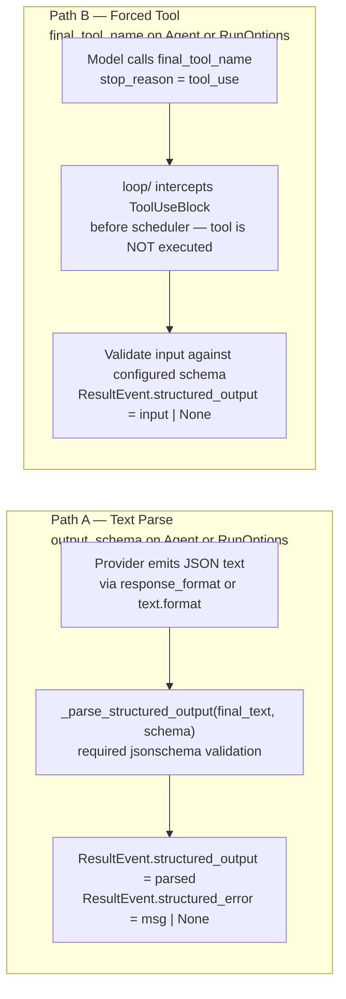

# Các luồng đầu ra có cấu trúc
[Bản gốc tiếng Anh](../../architecture/structured-output.md)

Trang này giúp bạn hiểu cách văn bản cuối cùng và các tool kết thúc tạo ra kết quả có cấu trúc.

> Thuộc [hướng dẫn kiến trúc Linch](./README.md).

Hai cơ chế độc lập đưa kết quả vào cùng một trường: `ResultEvent.structured_output: dict | None`.

`jsonschema` là một thư viện phụ thuộc cốt lõi; các schema đã cấu hình luôn được kiểm tra tính hợp lệ.

## Cơ sở thiết kế

- **Hai luồng thu nhận.** Luồng văn bản cuối cùng phân tích một đối tượng JSON và kiểm tra
  tính hợp lệ của đối tượng đó theo schema đã cấu hình. Các provider hỗ trợ đầu ra có cấu trúc có thể
  ràng buộc phản hồi của mình; với các provider khác, bạn có thể cần dùng prompt để yêu cầu JSON.
- **Thu nhận qua tool kết thúc.** Việc chỉ định rõ `final_tool_name`, hoặc khả năng
  `structured_output_terminal_tool` của provider đi kèm một schema, sẽ chọn luồng
  tool kết thúc. Đầu vào của tool được kiểm tra theo schema nếu đã cấu hình schema.
  Lỗi kiểm tra tính hợp lệ sẽ đặt `structured_error` và để trống `structured_output`.
- **Tool cuối cùng được chặn để thu nhận.** Vòng lặp thu nhận lời gọi tool có tên đã chỉ định trước khi
  đưa vào lịch thực thi, thay vì thực thi tool đó. Vòng lặp ghép các lời gọi tool với kết quả trong
  lịch sử session.
- **Thử lại để sửa lỗi.** Khi `structured_output_retries` lớn hơn 0, lỗi phân tích hoặc
  kiểm tra tính hợp lệ có thể dẫn đến một lượt xử lý tiếp theo. Khi hết số lần thử lại, kết
  quả vẫn giữ lỗi cấu trúc trừ khi một hook thay đổi kết quả xử lý. Chỉ riêng
  lỗi cấu trúc không buộc kết quả phải thuộc kiểu con lỗi: bên gọi phải
  kiểm tra `structured_error` và `structured_output` ngay cả khi thành công. Các lần thử lại
  chịu sự ràng buộc của giới hạn run.

---

Quay lại [mục lục kiến trúc](./README.md).
