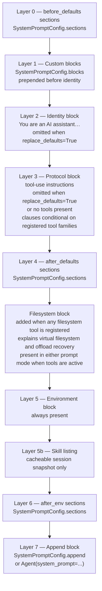

# Các lớp của system prompt

[Bản gốc tiếng Anh](../../architecture/system-prompt.md)

Trang này giúp bạn hiểu cách lắp ráp prompt và cách hoạt động của phần tiền tố session.

> Thuộc [hướng dẫn kiến trúc Linch](./README.md).

`Agent._build_system_blocks(tool_names)` lắp ráp system prompt từ các lớp
có thứ tự. Một `Agent` chưa được cấu hình có danh tính trung lập và một registry
tool rỗng; nó không tự động trở thành agent lập trình hay tin cậy workspace
mà nó đang chạy trong đó. Hãy truyền một registry tường minh, chẳng hạn
`workspace_tools()` (hoặc các tool của bạn), để bổ sung khả năng. Khi một tính năng
đáng tin cậy được bật, các tool của tính năng đó được thêm vào trước khi tạo prompt.

`SystemPromptConfig.sections` cho phép chèn các phần có tên, có thể tái sử dụng,
trước các phần mặc định, sau các phần mặc định hoặc sau khối môi trường mà không
thay đổi nội dung prompt tích hợp sẵn:

## Tiền tố session và thay đổi danh mục

Trước request provider thông thường đầu tiên, session lưu bền vững một tiền tố
phiên bản 1 tại `session.meta["linch.prefix"]` thông qua `session.update_meta`.
Tiền tố này chứa các khối `system` theo thứ tự, `tools` ở định dạng truyền qua API
và hai ánh xạ digest danh mục: `base` bất biến và `notified` ghi nhận trạng thái
đã thông báo gần nhất. Cả hai ánh xạ đều chứa `tools`, `skills` và `subagents`;
các mục tool và skill dùng tên làm khóa.
Danh sách skill có thể được cache và nằm sau khối môi trường, trước các chỉ dẫn
người dùng được nối thêm. Các request tiếp theo và worker được khởi động lại sử dụng
những khối đã lưu này mà không tính lại metadata về hệ điều hành máy chủ, shell hay
Python. Các khối ngữ cảnh theo lượt nằm sau tiền tố cố định với `cacheable=False`;
việc chọn tool, `allowed_tools` và điều chỉnh giảm theo khả năng provider vẫn được áp dụng.

Việc đồng bộ danh mục thường diễn ra trước khi xây dựng ngữ cảnh. Các run native
được bật và đã có snapshot sẽ hoãn đồng bộ cho đến khi xác định được ngữ cảnh sẽ chọn,
nên các hook ngữ cảnh có thể chạy trước thông báo tiếp theo. Các chỉnh sửa mô tả,
thay đổi skill và thao tác xóa tạo ra lời nhắc được lưu bền vững ở cuối hội thoại,
đồng thời giữ nguyên tiền tố cố định. Trên các nhánh chỉ nối thêm, tool mới được thêm
schema vào cuối; schema đầu vào đã chỉnh sửa thay thế vị trí hiện có của chúng.
Thay vào đó, các nhánh theo vị trí đủ điều kiện và được bật tường minh đưa định nghĩa mới
vào các khối danh mục được lưu bền vững và giữ nguyên danh sách tool ban đầu.
Chỉnh sửa schema, tiền tố rỗng và việc thu hẹp tool ở cấp run/ngữ cảnh sử dụng nhánh
chỉ nối thêm của giai đoạn 2. Nhánh dự phòng chỉ nối thêm bao gồm cả các tool đã được
thêm theo cơ chế native trước đó. Schema đã xóa vẫn nằm trong tiền tố, và việc gọi
tool đã xóa đi qua nhánh lỗi tool không xác định hiện có. Thay đổi tool làm thay đổi
các schema được cung cấp sẽ kích hoạt thông báo tư vấn cache hiện có.

Lớp cấu hình ghi đè của profile, ghi đè tool cho session, ghi đè các khối system
có hiệu lực và danh mục request đang hoạt động bỏ qua snapshot, tiếp tục lắp ráp
request trực tiếp. Lời nhắc skill của chúng chỉ được chèn khi văn bản chính xác đó
chưa có trong dữ liệu mà provider nhìn thấy. Các giao thức provider native mặc định
bị tắt và CHƯA ĐƯỢC KIỂM CHỨNG với endpoint thực; xem
[cách sử dụng provider](../usage/providers.md#thay-đổi-danh-mục-theo-cơ-chế-gốc-cần-bật).

Sau khi nén ngữ cảnh, `system` và `tools` vẫn giữ nguyên từng byte. Đặt lại `notified`
về `base` khiến lần đồng bộ tiếp theo gộp mọi thay đổi thành một lời nhắc ở cuối.
Các digest skill được lưu bền vững trong `notified` ngăn thông báo lặp lại sau khi
worker khởi động lại hoặc một thay đổi registry không liên quan. Chỉ session mới
mới đưa danh mục hiện hành vào tiền tố system của nó.

**Bất biến:** khi preset tường minh `workspace_tools()` được đăng ký và
`replace_defaults=False`, các điều khoản được chọn của giao thức workspace phần mềm
được cố định bằng kiểm thử trong `tests/context/test_system_blocks.py`. Một agent
chưa được cấu hình hiển thị danh tính trung lập và metadata runtime mà không có
chỉ dẫn workspace. Chỉ thay đổi cách diễn đạt khi có chủ đích và cập nhật các
assertion của giao thức.

## Cơ sở thiết kế

- **Chèn theo lớp, không chỉnh sửa chuỗi trực tiếp.** Bên gọi thêm các phần có tên
  trước/sau các phần mặc định hoặc sau khối môi trường — không chỉnh sửa nội dung
  prompt tích hợp sẵn. Nhờ vậy, SDK có thể phát triển prompt mặc định mà không phá vỡ
  các tùy chỉnh, và các phần bổ sung của ứng dụng chủ luôn ở vị trí được xác định rõ.
- **Các điều khoản prompt phụ thuộc vào tập tool đã đăng ký.** Khối giao thức chỉ
  mô tả các nhóm tool thực sự hiện diện (và khối filesystem chỉ xuất hiện khi có
  các tool fs), nên mô hình không bao giờ được hướng dẫn dùng tool mà nó không có —
  điều này cũng giúp prompt của agent điều phối/bị giới hạn phản ánh đúng khả năng.
- **Tool có thể tự cung cấp nội dung cho prompt.** Tool có thể cung cấp một iterable
  `system_prompt_sections` tùy chọn hoặc một callable không nhận đối số. Registry
  đang hoạt động xác thực các giá trị `SystemPromptSection` này, sắp xếp theo tên
  tool và thứ tự khai báo, rồi chèn chúng vào vị trí đã khai báo.
  Tool không hoạt động không thể ảnh hưởng đến prompt của request; các phần đang
  hoạt động bị trùng lặp hoặc sai định dạng sẽ gây lỗi trước lời gọi provider.
- **Giao thức workspace được cố định bằng các assertion có mục tiêu.** Các kiểm tra
  trong `tests/context/test_system_blocks.py` bảo đảm các điều khoản Read/Edit/Bash/Glob/Grep
  quan trọng không thể vô tình biến mất. Việc đổi cách diễn đạt phải có chủ đích vì
  nội dung prompt ảnh hưởng đáng kể đến hành vi.

---

Quay lại [mục lục kiến trúc](./README.md).
