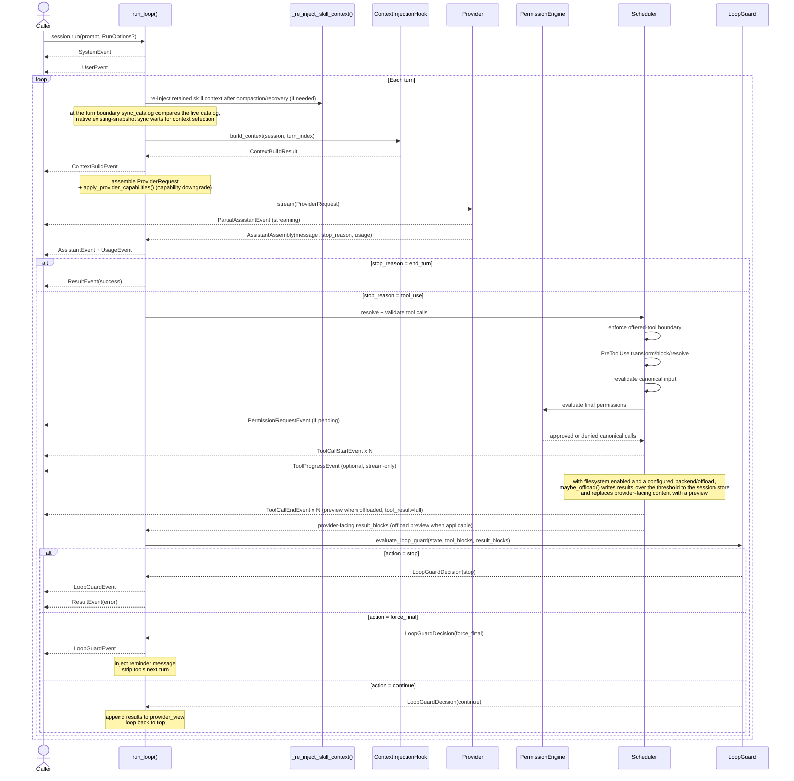

# Vòng đời của một lượt

[Bản gốc tiếng Anh](../../architecture/turn-lifecycle.md)

> Thuộc [hướng dẫn kiến trúc Linch](./README.md).

Dùng trang này khi bạn cần lần theo một lượt `Session.run()`/`resume()` từ lúc
khởi động và lắp ghép context, qua đầu ra provider và thực thi tool, đến
xử lý kết quả kết thúc.

Một lượt agent hoàn chỉnh — từ khi nhận prompt đến khi quyết định có tiếp tục vòng lặp hay không.

## Các điểm vòng đời có kiểu

Đồng bộ danh mục dùng thế hệ của registry tool và số phiên bản danh mục agent
để xử lý nhanh trường hợp không có thay đổi. Thông báo được ghi thêm dưới dạng tin nhắn
người dùng chứa `CatalogChangeBlock` nội bộ, bọc trong các thẻ `<system-reminder>`,
trước khi cập nhật metadata về lần thông báo gần nhất. Sự cố giữa các lần ghi này có thể
khiến lời nhắc lặp lại nhưng không làm mất nó. Văn bản thông báo giữ vai trò user trên
mọi provider; các adapter theo vị trí được bật tùy chọn cũng kết xuất cấu trúc tool gốc
như mô tả trong [hợp đồng provider](../../architecture/provider-contract.md#native-catalog-rendering).
Các thay đổi schema dùng thông báo tư vấn `tool_set_changed` hiện có. Khi bật hỗ trợ
định dạng gốc và đã có snapshot, việc đồng bộ chờ đến khi quá trình chọn context xác lập
ranh giới các tool được cung cấp; việc tạo snapshot ban đầu và thứ tự xử lý khi tùy chọn
bị tắt vẫn diễn ra trước khi dựng context. Cả luồng bình thường lẫn luồng nén context
phản ứng đều dùng model thực sự có hiệu lực trong lượt, bao gồm cả ghi đè từ skill.
Quá trình đồng bộ so sánh trực tiếp danh mục đang hoạt động với các digest `notified`
đã lưu, bao gồm cả skill. Nén context đặt lại các digest này về `base` bất biến
mà không thay đổi tiền tố request, để lượt kế tiếp hợp nhất các thay đổi.

Trình tự này dựa trên danh mục trong [events.md](./events.md). Các hook cho run, lượt,
provider và bảo mật dùng các điểm `hook` như `AgentStart`,
`UserPromptSubmit`, `TurnStart`, `BeforeProviderCall`, `PreToolUse` và
`AgentStop`. `HookDispatcher` chờ chúng theo thứ tự đăng ký, đồng thời giữ rõ ràng
thứ tự biến đổi và phân quyền có ảnh hưởng đến bảo mật.

Ba điểm tool của lõi — `tools/pre-execute`, `tools/execute` và
`tools/post-execute` — hoạt động theo chuỗi waterfall. Một wrapper phải chờ callback
`next` của nó để chuỗi tiếp tục. `turn-stopping` là điểm phủ quyết tuần tự được dùng
trước khi hoàn tất một kết quả dự kiến; listener chấp nhận sẽ trả quyền điều khiển về
luồng kết thúc thông thường, còn quyết định tiếp tục hoặc thất bại sẽ thay đổi luồng đó.
Bus từ chối điều phối qua một chế độ không khớp với hợp đồng của điểm đó.

`HookDispatcher` tiếp tục là adapter cho hook của người dùng thay vì trở thành
listener bus tổng quát. Nó chuyển tiếp các biến đổi qua các hook, cô lập lỗi hook
và duy trì thứ tự xác thực `PreToolUse` chuẩn cùng với phân quyền.

## Cơ sở thiết kế

- **Model quyết định khi nào dừng, không phải bộ đếm bước.** Vòng lặp tiếp tục khi
  phản hồi chứa lời gọi tool và dừng khi nhận phản hồi chỉ có văn bản (`end_turn`)
  hoặc câu trả lời được chấp nhận từ tool kết thúc. Nhờ đó, tác vụ có thể dùng số lượt
  nhiều hay ít tùy nhu cầu; `max_turns` và bộ bảo vệ vòng lặp là các giới hạn an toàn,
  không phải cơ chế điều khiển chính.
- **Cổng bảo mật có một thứ tự chuẩn.** Bộ lập lịch phân giải và xác thực đề xuất
  của model, bảo đảm tool đã được cung cấp trong request này, chạy `PreToolUse`,
  xác thực lại đầu vào sau biến đổi rồi mới đánh giá quy tắc hoặc yêu cầu bên gọi
  phê duyệt. Lời gọi đến tool chưa được cung cấp không bao giờ tới hook; các lời gọi
  bị từ chối hoặc đến tool chưa được cung cấp không bao giờ tạo ra tác động phụ.
- **Đầu ra của bộ dựng context được nối vào request, không bao giờ ghi vào
  `provider_view`.** RAG/bộ nhớ theo từng lượt chỉ tồn tại tạm thời: nó cung cấp thông tin
  cho một lời gọi provider mà không làm lẫn dữ liệu vào hội thoại được lưu bền vững,
  nhờ đó giữ `provider_view` ổn định và có thể phát lại qua các lượt.
- **Mọi thứ đều là event qua một generator bất đồng bộ.** Bên gọi điều khiển quá trình
  lặp, nên bên nhận chậm sẽ tự nhiên tạo áp lực ngược lên bên tạo dữ liệu, và UI có thể
  hiển thị các event streaming/mức sử dụng/phân quyền/tiến độ ngay khi chúng đến thay vì
  chờ lượt kết thúc. `ToolProgressEvent` chỉ phục vụ quan sát: nó không thuộc lịch sử
  provider hay trạng thái kết quả tool được lưu bền vững.
- **Bộ bảo vệ vòng lặp và cơ chế chuyển dữ liệu ra lưu trữ ngoài tùy chọn chạy tại các điểm kiểm soát cố định.**
  Phát hiện vòng lặp đánh giá từng lô tool (không gọi thêm LLM), còn `maybe_offload`
  khi bật hệ thống tệp được áp dụng tại điểm kiểm soát kết quả duy nhất — cả hai đều
  được bảo đảm bởi cấu trúc, nên một luồng đã bật không thể bị bỏ qua do nhánh mã nào đó
  quên gọi chúng.

---

Quay lại [mục lục kiến trúc](./README.md).
