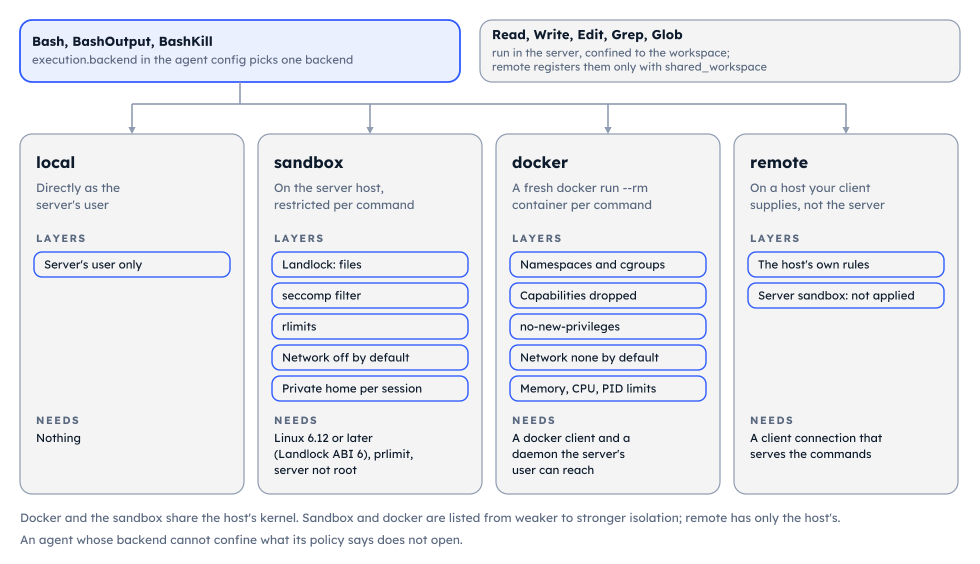

# Tools

> Part of the [linch-rust architecture guide](./README.md).

This page covers the tool contract in `linch-core` (the `Tool` trait, scopes,
the registry and how a batch runs) and the tools in `linch-tools`: the
workspace tools, the virtual filesystem with result offload, and the session
task tools. Use it when you write a tool, change how calls are scheduled, or
touch file confinement.

Python Linch's [tool protocol](../../../docs/architecture/tool-protocol.md)
describes the same ideas. What differs in Rust:

- A tool is any type that implements the `Tool` trait; there is no base
  struct and no `@tool` decorator. The trait's required methods are the
  attributes Python reads by duck typing.
- `scope()` has no default. In Linch 3.x a defaulted `read` scope let
  side-effecting functions run unapproved and in parallel (issue #99,
  `crates/linch-core/src/tool.rs:4-7`).
- A result is always `Result<ToolOutput, ToolOutputError>`. There is no
  `ToolResult` object; `output_schema` is optional.

## The tool trait

`Tool` (`crates/linch-core/src/tool.rs:226`) is `Send + Sync` and stateless
per call; per-call data arrives in `ToolContext`.

| Method | Default | Contract |
|---|---|---|
| `name()` | required | 1 to 64 ASCII letters, digits, `_` or `-`: what Anthropic, OpenAI and Gemini all accept (`crates/linch-core/src/registry.rs:288-291`) |
| `description()` | required | Shown to the model |
| `input_schema()` | required | JSON Schema draft 2020-12 with `"type": "object"` at the top |
| `scope()` | required | `Read`, `Write` or `Exec` |
| `output_schema()` | `None` | When set, a successful value must satisfy it |
| `validate(input)` | identity | Checks beyond the schema; runs after schema validation and again after a `pre_tool_use` hook rewrites the input |
| `parallel(input)` | `scope().is_parallel_safe()` | Whether this call may run alongside other read calls |
| `polls()` | `false` | Whether the tool polls something that runs on, so the loop guard never counts its calls as repeats ([turn lifecycle](./turn-lifecycle.md#the-loop-guard)); `BashOutput` says yes |
| `summarize(input)` | the name | One line for events and approval prompts |
| `execute(input, ctx)` | required | Run on validated input; return promptly once `ctx.cancel` fires |

`ToolOutput` holds the `value` the model sees and `metadata` it does not.
`ToolOutputError` holds the `message` the model sees, an optional `code` for
the host, and optional `details` for the host: an object reaches the call's
`tool_call_end` event as its `metadata` (`tool.rs:42-83`).

`ToolContext` (`tool.rs:117`) carries the session id, run id, `tool_use_id`,
the caller's `principal`, a `cancel` token (cancelled on run abort or when the
call ends) and the call's `deadline` when the agent sets a call timeout.
`idempotency_key()` is `run_id:tool_use_id` (`tool.rs:182-192`); `Bash` hands
it to a `remote` host in `exec.start` (`Launch::idempotency_key`) and to no other
backend. A resumed
run never re-runs a call whose start was durable but whose end was not: it
reports it as interrupted. `Subagent` and `SubagentContinue` are the
exception: they are planned again and resume their durable child run
(`crates/linch-core/src/runner/batch.rs:118-139`). `report_progress` is best
effort and never fails the tool (`tool.rs:195`).

### Scopes and approval

| Scope | Default permission mode | Runs in parallel |
|---|---|---|
| `Read` | allowed | yes, with neighboring read calls |
| `Write` | asks | no |
| `Exec` | asks | no |

The scope decides auto-approval (`crates/linch-core/src/permissions/engine.rs:320`)
and, through the default `parallel`, concurrency. It is also part of the run
contract digest, next to the schema (`registry.rs:216-218`).

## The registry

`ToolRegistry` (`registry.rs:72`) is shared across runs behind an `Arc`.

- `register(tool)` (`registry.rs:86`) adds a tool under a free name. It fails
  on an invalid name, a duplicate, a top-level schema that is not an object,
  or a schema that is not valid draft 2020-12 or has a `$ref` that needs I/O.
  Schemas are compiled once here.
- `replace(tool)` (`registry.rs:95`) hides any tool of the same name. The
  replacement keeps the old position in `definitions()`.
- Every change to the visible set bumps `generation()` (`registry.rs:100`).
- `snapshot()` (`registry.rs:107`) returns an immutable `ToolSnapshot`. Each
  turn takes one and uses it throughout, so a registration that lands
  mid-turn never changes what that turn sees.
- `definitions()` (`registry.rs:209`) lists tools in first-registration order.
  The order is stable across snapshots because the prompt cache depends on it.

### Reversible registration

Every registration returns a `Registration` (`crates/linch-core/src/registration.rs:19`).
`dispose()` undoes exactly that registration and is idempotent; dropping the
handle undoes nothing (`registration.rs:1-6`). Disposing a tool that a later
`replace` hides changes nothing visible. Disposing the visible one brings back
the most recent live registration of that name, or removes the name. The
same handle type comes back from `HookChain::register`
(`crates/linch-core/src/hooks/chain.rs:132`) and from the MCP client, so a
host undoes a whole wiring by disposing the handles it kept.

### Catalog changes mid-session

A session's first prompt is logged with a `PrefixEntry`: the system blocks,
the tools and the listed skills at that moment
(`crates/linch-core/src/catalog.rs`). Every later request of the session
starts with exactly those bytes, so the prompt cache keeps them whatever the
registry, the skills or the subagents do. A change goes at the tail instead:
a `CatalogChangeBlock` (Python Linch's `<system-reminder>` text) in the next
user message the run logs anyway, so it costs no write. The notice text
escapes `<`, `>` and `&` in every tool and skill name and description it
lists (the structured fields keep the raw text), so a description cannot
close the wrapper.

- A removed tool keeps its row; a call to it is refused as not registered.
- An added tool is appended to the request's tools, which costs the cache
  once. `native_catalog_changes` on `AnthropicOptions` or `ResponsesOptions`
  sends it at the notice instead (off by default, not verified live). The
  request names those rows in `ProviderRequest::appended_tools`, so the
  adapter keeps them out of `tools` across a compaction too.
- A new description is told in text; a new input schema replaces its row.
- A compaction never rewrites the prefix; its summary restates the changes.

`Agent::reload_skills` and `Agent::reload_subagents` (and
`OpenedAgent::reload_*`, which rescan the config directory for a kind the
config turned on, and otherwise only re-apply a deep agent's roster and the
built-in skills) are reversible registrations of the same kind. The run contract stays the one the agent was
built with.

`AgentBuilder::tool_search(ToolSearch)` defers a large catalog
(`crates/linch-core/src/tool_search.rs`): past `max_tools` a new session is
offered only the tools whose `always_load` says so and `tool_search`. What a
search finds is told as added tools at the tail and offered from the next
request on; a call of a tool not offered is refused as deferred.

## How a batch runs

The tool calls of one response go through two steps
(`crates/linch-core/src/scheduler.rs:1-22`), so a run can suspend between
them:

1. **Plan.** For each call: resolve the name in the turn's snapshot, validate
   the input, run the `pre_tool_use` chain, validate the final input again,
   evaluate permissions (and the `permission_request` chain on `Ask`), then
   apply any recorded approval from an earlier suspend. A call that still
   needs approval suspends the run.
2. **Execute** (`crates/linch-core/src/scheduler/execute.rs:119`). Results
   come back one per call, in call order. A success is checked against the
   tool's `output_schema`, then the `post_tool_use` chain runs on the result.
   A tool that panics gets an error result naming the panic.

### One call, in order

`Runner::call` (`scheduler/execute.rs`) takes a planned `Run` call through
these steps. Each one is absent, and costs nothing, when its field is unset:

1. **Cache lookup** (`spec.tool_cache`). A read-scope, non-`polls`,
   non-`asks_user`, `Tool::cache_safe` tool named by the policy looks up the
   key `[session?, principal?, tool_name, input]` in the agent's namespace
   (`tool_cache.rs`, `cache_key`; the session is in the key unless
   `scope` is `namespace`). The lookup returns the entry and the namespace's
   epoch. A live entry becomes the result: no durable start before it, no
   tool, `cache_hit` on the `tool_call_end`; the start and end are written
   together, as for any call that runs nothing. Every store call is bounded
   by `STORE_TIMEOUT` (2 s) and the run abort; an error or a timeout is a
   miss. After the agent's first `Tool::launches_background` call, or a
   failed clear, `slot_of` returns nothing and the cache is off for the
   agent.
2. **Invalidate.** A write or exec tool clears the namespace first when
   `invalidate_on_write` is set, before `tool_starting`, so a crash during the
   effect cannot leave an entry from before it. A clear raises the
   namespace's epoch. An abort during this clear stops the call before its
   start.
3. **`tool_starting`**, the durable barrier. From here a crash leaves an
   interrupted call that a resume never runs again.
4. **Attempts** (`invoke`). Each attempt is the tool body wrapped by the
   `tool_execute` waterfall (`hooks/execute.rs`, `ToolPipeline`) when a
   layer is registered, and by the call timeout. A failure that
   `spec.tool_retry` covers (`tool_retry.rs`: the tool is `Tool::idempotent`,
   the error `code` or `timeout` is listed, attempts are left) goes to
   `ToolSink::tool_retrying`, which writes and flushes a `tool_retry` event,
   then waits (`base_delay_ms` doubling up to `max_delay_ms`, cut to what is
   left of `RETRY_BUDGET`, 5 minutes of retrying for the whole run, all its
   calls together, and zero again on a resume; no retry once it is spent) and runs again. The event's `error` goes through the
   redactor, then is cut to `ERROR_BYTES`. A timed-out host tool is
   abandoned with `$/cancelRequest`, which has no acknowledgement in the
   protocol, so a retry may overlap the old handler.
5. **`finish`.** Output schema, redaction, then, when the tool just ran, its
   result is stored in the cache (`put` is conditional on the epoch the
   lookup returned, so a clear since the lookup refuses it) after the
   schema check and redaction and before `post_tool_use`; hooks run again on
   every hit. With `tool_execute` layers registered, `body` records the
   tool's own result per attempt (`Raw`) and the result is stored only if
   the layers returned it unchanged (`untouched`): a veto or `Replace` is
   never cached, and a hit does not run the layers. Without
   `spec.redaction` over tool results, what is stored is unredacted; a
   tenant is refused without it. Then `post_tool_use`. A `Mutate` answer
   changes the value or the error flag and keeps the metadata and error
   code; its `content` may not be `null` (a bad answer, since it would read
   as absent).
6. **Invalidate again** after a write or exec call (not cut short by the
   abort: the write may have changed state, and the call is bounded by
   `STORE_TIMEOUT`), then `tool_finished`.

The `tool_execute` waterfall is the Rust counterpart of Python's
`tools/execute`: a `ToolMiddleware` gets the call and a `Next`, awaits
`next.run()` to run what is inside, and returns the result. Not awaiting it
vetoes the call. The first registered layer is the outermost; a layer cannot
change the input, which permission has already checked (rewrite it in
`pre_tool_use`). Registering returns a `Registration`, and with no layer the
scheduler calls the tool directly, so the path is the one a run without it
always had.

### Only read work runs in parallel

`execute` walks the calls in order and groups them
(`execute.rs:137-151`). A call joins the current group only if the group
started with a read call, the group is below the limit, and this call is a
read call too (`in_read_group`, `execute.rs:157`). A call that runs no tool
(refused, served from a hook, aborted) also joins. Any other call runs alone,
so the next call waits for it.

A read call is one whose tool's `parallel(input)` returns true. The default
returns true only for `Read` scope. A tool may return true for a call that does
only read work whatever its scope, for example a subagent whose tools all read
(`tool.rs:250-257`). Never return true for a call that writes or runs
anything.

The limit is `AgentSpec::max_tool_concurrency`, 4 by default; 0 counts as 1
(`crates/linch-core/src/agent/spec.rs:53-55`). `call_timeout_ms` bounds each
call: at the deadline the scheduler drops the call's future and reports a
timeout error.

### Durability around a tool

A tool that really runs costs two run-store writes: its start is made durable
before it runs, and its end right after it returns
(`crates/linch-core/src/runner/sink.rs:1-12`). A call that runs nothing has
its start and end staged and written with the next barrier. See
[stores](./stores.md#group-commit-write-counts) for the count per turn.

## Workspace tools

`workspace_tools(backend, reads, processes)` (`crates/linch-tools/src/lib.rs:63`)
returns `Read`, `Write`, `Edit`, `Grep`, `Glob`, `Bash`, `BashOutput` and
`BashKill` over one `ExecutionBackend` (its `LocalFs` for the file tools, its
shell for `Bash`; see [Execution backends](#execution-backends)), sharing one
`ReadTracker` and one `Processes` registry. The crate is Unix-only because Bash uses process groups.

| Tool | Scope | Behavior |
|---|---|---|
| `Read` | read | UTF-8 text with numbered lines; `offset`/`limit`, default 2000 lines; files over 10 MiB are refused (`crates/linch-tools/src/read.rs:14-17`) |
| `Write` | write | Replaces a whole file atomically and creates parent directories. An existing file must have been read in full at its current stamp |
| `Edit` | write | Replaces exact text, once unless `replace_all`. The file must have been read at its current stamp, including every line a match touches |
| `Grep` | read | ripgrep's engine in process; modes `files_with_matches`, `count`, `content`; default 250 entries, output capped at 30 000 bytes (`crates/linch-tools/src/grep.rs:15-25`) |
| `Glob` | read | ripgrep glob rules, newest first, at most 1000 paths (`crates/linch-tools/src/glob.rs:13`) |
| `Bash` | exec | `/bin/sh -c` in the root; see below |
| `BashOutput` | read | Unread output of a background command; see [below](#background-bash) |
| `BashKill` | exec | Kills a background command's group |

Grep and Glob skip ignored files and do not follow symlinks; Grep also skips
hidden and binary files, and Glob lists hidden files only when the pattern
names a dot segment (`crates/linch-tools/src/fs.rs:267-283`). A Grep pattern
may compile to at most 10 MiB (`REGEX_SIZE_LIMIT`; a larger one is an
`invalid_query`) and one matcher's lazy DFA cache holds at most 32 MiB
(`REGEX_DFA_CACHE_LIMIT`; a pattern that needs more runs on a slower engine),
so one call's memory is bounded besides the 10 MiB the searcher holds of a file.
The measured price: a 64 KiB line of random `a` and `b` with `[ab]{1,20000}c`
took 6.3 s and 386 MiB with the library's limits and takes 16.2 s and 36 MiB
with these (17.3 s and 68 MiB at 64 MiB, 5.3 s and 131 MiB at 128 MiB, so no
value keeps both under about 100 MiB and within twice the time), and a Unicode
class repeated many times (`\w{300}`, `\w{500}`, `\p{L}{500}`, `\w{1000}`) is
now an `invalid_query` (it compiles in 20 to 50 MiB). The error names the way
out: a smaller count or an ASCII class.

A call also has a wall-clock limit, `SEARCH_TIME_LIMIT` (30 s,
`crates/linch-tools/src/fs/local.rs`). It is checked between files, for each
entry the directory walk lists, and each time the search reads more of a file
(once per buffer), and past it the call
fails with `timed_out`, saying how many files were searched in full and which
file it was in, and a cancelled call stops at the same points. The residual:
one regex search over a single very long line cannot be interrupted, so a
line of up to 10 MiB (the most the searcher holds) can run past the limit. The
64 KiB case above took 6 to 17 s; the cost grows with the line, and a 10 MiB
line would take about 160 times that (about 15 to 45 minutes, an estimate by
scaling, not a measurement).

### Read before write

`ReadTracker` (`crates/linch-tools/src/tracker.rs:24`) records, per session and
workspace path, the file's stamp (modification time and size) and the lines a
`Read` covered. A stamp change, by anyone, voids the evidence. A refused write
returns code `read_before_write` (`crates/linch-tools/src/input.rs:13`). The
evidence is in memory: a restarted process must read again before writing,
which is the safe direction. The host calls `ReadTracker::forget` when a
session ends (`tracker.rs:65`).

### Confinement

Every file tool goes through the `ExecutionFs` trait (`fs.rs:244`), so a
remote execution world can replace `LocalFs` without changing the tools.
`LocalFs` (`crates/linch-tools/src/fs/local.rs`) canonicalizes the root once
and keeps a directory descriptor of it; `new` is blocking, so call it before
the runtime starts or from a blocking task. A path is never handed to the
kernel whole. `fs/beneath.rs` walks it one name at a time from that
descriptor with `openat(O_NOFOLLOW)`: a symlink is read and its target is
spliced into the names still to walk (at most 40 links), and `..` pops a
directory the walk holds open, never the kernel's `..`. `Read` opens the file
through its parent's descriptor and stats the open file; `Write` makes
missing directories with `mkdirat`, creates the temporary file in the
target's directory with `O_EXCL` and moves it with `renameat`. Paths returned
are workspace paths: relative, `/`-separated, symlinks resolved, so one file
has one name. Blocking file work runs on Tokio's blocking pool.

What a path may be:

- An absolute path is accepted only if it starts with the canonical root or
  with the root as it was given to `new` (a spelling through a symlink). Any
  other absolute path is refused with `FsError::Escape`, whether or not
  anything exists there, so the answer says nothing about the host. This
  includes a different alias of the root: on macOS `/tmp` and `/var` are
  symlinks to `/private/...`, so a path spelled `/var/...` is refused when the
  root is `/private/var/...` (not built or tested on macOS).
- An absolute symlink target inside the workspace must spell the canonical
  root, for the same reason; a target through another alias is `Escape`.
- `..` that stays inside the root is accepted (`src/../a.txt`). A path that
  climbs above the root is refused even if it comes back in
  (`../root/top.txt` is `Escape`; it used to resolve). Failing closed is
  intended: the walk cannot tell a path that returns from one that was
  redirected.
- A dangling symlink is `Escape`, because writing there would create its
  target, and so is any symlink that leads out.
- A path goes down at most 128 directories (deeper is an error, not a silent
  miss), and each directory on it must be readable, not only searchable: the
  root itself needs read permission, or `new` fails. Path length is not
  limited.
- A `Read`, `Write` or `Edit` walk holds one descriptor per level for its
  duration, up to 128, so size `ulimit -n` for about 128 descriptors per
  concurrent deep walk; ordinary paths hold a few. Searches hold one.

What this guarantees: a process that shares the workspace (a `Bash` command
under `sandbox` or `docker`) and swaps a directory or a file for a symlink,
or renames a directory, between any two steps of a call cannot make the call
leave the root. The directory in hand is always one the walk opened beneath
the root, and a swapped name is refused by `O_NOFOLLOW` where it is next
opened. The content of a file is never read from outside the root, and that
includes `.ignore` and `.gitignore`: a search reads them through the root
descriptor like any file, so one that is a symlink is not honoured and no host
file decides what a search answers.

Listings are weaker. `Grep`, `Glob` and `DiskBackend::ls` list names with
`ignore`'s walk (types and globs need it), which reads directories by name, so
a listing may come from a directory a racing command swapped for a symlink to
a host directory. The walk does not read ignore files: `fs/ignore_files.rs`
does, from the root descriptor (no symlink on the way or at the end, regular
files up to 1 MiB; any other is skipped without a word), and drops the
entries they rule out. It keeps the walk's precedence: a glob pattern beats
every ignore file, then the nearest matching `.ignore` rule, then the nearest
matching `.gitignore` rule, from the workspace root down, also for the
directories above a searched subdirectory. Ignore files above the workspace
root, `.git/info/exclude` and the host's global ignore file are not read:
`ignore`'s own walk read all of them by path, so this is a change, and a
workspace inside a repository now searches `target/` and `node_modules/`
unless the workspace has its own `.ignore` (or `.gitignore`) naming them. A listed name is searched or
returned only after it is opened again from the root descriptor with no
symlink allowed, one descriptor at a time, so there is no depth limit. A name
that fails that (unreadable or not searchable, gone, swapped) is never named
in any output or error: `Grep` and `Glob` end with a line giving how many
entries were left out, and an unreadable directory counts as one. Running out
of descriptors is an error for all three, not an empty or partial answer. Not protected: which names
exist in a directory that was swapped. `Glob`, `Grep` and `ls` report a listed
name only if it is also a regular file at that path beneath the root, so a
caller that guesses a name, creates it in the workspace and races a swap can
learn whether the host directory also has it (names and existence, not
contents) from any of the three. Closing this means walking the directories
through descriptors instead of `ignore`'s walk, which is a rewrite of the
walker and was not done.

Not covered: hard links (a second name inside the root for a file outside it
reads as that file; a write replaces the name and leaves the other file's
content alone), mounts inside the root, and the root directory itself being
moved or replaced (the descriptor stays on the directory `new` opened). The
walk uses only POSIX `*at` calls through `rustix`, so there is no Linux-only
fallback to keep; it has not been built or tested on macOS.

### Bash

`Bash` (`crates/linch-tools/src/bash.rs:79`) is not confined by `LocalFs`:
with the default `local` backend it starts in the root, but the command can
reach anything the process user can. Use the permission engine (it asks for
`exec` by default) or the `sandbox` or `docker` backend when that matters.
What it guarantees under every backend:

- stdin is closed and the command leads a new process group
  (`crates/linch-tools/src/bash/process.rs`);
- what the command started ends with it, on timeout, on cancel, when the
  call's future is dropped, and when the shell exits, so background jobs do
  not outlive the call. How far that reaches depends on the platform (see
  [What ends with a command](#what-ends-with-a-command));
- only nine host variables pass through (`PATH`, `HOME`, `TERM`, `LANG`,
  `LC_ALL`, `LC_CTYPE`, `USER`, `SHELL`, `TMPDIR`), so host credentials stay
  out of the environment (`bash.rs:51`); `with_env` adds more (`bash.rs:153`);
- the timeout defaults to 120 s (30 min in the background) and is capped at
  30 min (`bash.rs:38-41`);
  with a call deadline it ends 100 ms before it, so the output so far reaches
  the model instead of a generic timeout (`bash.rs:209`);
- each stream keeps its first 4000 and last 26 000 bytes
  (`bash/capture.rs:5-8`);
- any exit status but 0 is an error result carrying the same text, with code
  `exit_status`, `timeout` or `aborted` (`bash.rs:309-326`).

#### What ends with a command

A process group does not hold a command: a descendant that calls `setsid` or
`setpgid` leaves it, and one that double-forks is handed to `init` when its
parent exits. What `local` and `sandbox` guarantee depends on the platform and
on a helper program that is **off by default**, so the shipped configuration
(`linch-server` from the wheel or the release archive, with nothing set) holds
a command by its process group:

| Where | What ends with the command |
|---|---|
| Default: the helper is off (Linux, macOS) | The shell's process group, killed on timeout, cancel, a dropped call, the shell's exit, `BashKill`, `close_session` and a dropped registry. A process that calls `setsid` or `setpgid`, or double-forks, outlives the call. A background command's group is also killed when the server dies, even by `SIGKILL` (the `LIFELINE` wrapper); a foreground command is not |
| Linux with the helper on (`LINCH_REAPER=1` for `linch-server`, or a host that registers one) | Every descendant: those in the group, those that left it and those handed to `init`, whether or not they ignore `SIGTERM`. On the same events, and when the server dies, even by `SIGKILL` (foreground commands too) |
| `docker` | The container, removed with `docker rm -f` (and the client's group); nothing of the command runs on the host |
| `remote` | Whatever the host does; see [Remote execution](../usage/remote-execution.md) |

**The helper.** It runs one program as `HELPER [--stdin] -- PROGRAM ARG...`
(`crates/linch-tools/src/reaper.rs`, safe code) and is what a local command is
started as when it is on. It is a *child subreaper*
(`PR_SET_CHILD_SUBREAPER`): it starts the program (the shell) as the leader of
its own process group, so every orphaned descendant is handed to the helper
instead of to `init`, and it can list its children in
`/proc/<pid>/task/<tid>/children`. Its stdin is a socket the server holds the
other end of. The helper writes the shell's pid there as one line, right after
starting it; the server reports that pid (so `kill <pid>` stops the command as
it does without a helper) and signals the shell's group itself. When the shell
exits, or the socket reaches end of file, the helper kills the shell's group,
then its own children round after round, reaping as it goes, until none is
left, and ends with the shell's exit code or signal. A timeout, a cancel, a
dropped call, `BashKill` and `close_session` kill the shell's group at once and
close the socket, and so does the server dying. `$PPID` inside a command is the
helper. For a background command the shell also gets the socket, under the
`LIFELINE` wrapper, so it dies with the server even if its helper was killed.

If the helper is killed (by the command: `kill -9 $PPID`, which a `local` or
`sandbox` command can do, since it runs as the same user and in the same
Landlock domain, and the seccomp filter does not deny `kill`; or from outside),
the server sees it end, kills the shell's group and ends the call, so the floor
is the default's: what had already left the group survives, nothing else does.

Where the helper comes from:

- `linch-server` is its own helper, so the wheel and the release archive need
  no second program. `main` calls `linch_tools::reaper::enter()` first, before
  logging, arguments or the runtime: started as `linch-server --linch-reaper
  -- PROGRAM ARG...` it runs the helper and exits; otherwise it offers its own
  executable as the helper for the commands it starts. `LINCH_REAPER=1` turns
  that on.
- `LINCH_REAPER=/path/to/linch-reaper` turns on that program instead (the
  `linch-reaper` binary built with `linch-tools`; it is not in the wheel).
  The path must be absolute (a relative one would resolve in the command's own
  directory) and name an executable file. Empty turns it off. Any other value
  (`0`, `true`, a relative path), `1` where the host offers no helper, and a
  helper that is not an executable file leave it off with one warning in the log.
- A Rust host calls `linch_tools::reaper::register(ReaperCommand { program,
  args })` before its first command, which turns on its own helper, or
  `enter()` to use its own executable as `linch-server` does. The choice is
  process-wide because it names the host's executable, not anything one agent
  owns. The Python extension (`linch-python`) does not run commands.
- A helper that cannot start, or that exits without starting the shell (an
  executable that does not know `--linch-reaper`, say), is passed over with one
  warning in the log: the command runs as it does without one. A helper that
  does not answer in 5 s fails the call, since it may be running the command.
  A helper that is killed by a signal before the server has checked the pid
  line (a command that kills its parent at once can do it) is not passed over,
  because the shell may be running: the command does not run again, and the
  server finds the shell as the group leader that holds the command's
  stdout or stderr pipes, which no other process has, and kills its group
  as for a helper killed later. The call then ends with the signal.
- The server does not trust the pid line: before it signals that group it
  reads `/proc/<pid>/stat` and requires a child of the helper that leads its
  own group (or one that has already ended, which is not signalled). Any other
  pid fails the call, with the helper's group killed and nothing else
  signalled, so a replaced or buggy helper cannot make the server kill another
  process group.
- In the `sandbox`, the helper's executable must lie outside every directory
  the command can write: the workspace root and the sandbox's private homes
  (the read-only system paths and the temp directory are outside). Otherwise a
  command could replace it. The path is resolved (symlinks included) and, if
  it lies under one of them, or cannot be resolved, the sandbox warns once and
  runs commands without a helper. `linch-server` inside a project's `.venv`
  (under the workspace root) is therefore not used as the sandbox's helper:
  install it outside the workspace. `local` has no such limit, since a local
  command can write anything its user can.

Starting a command under the helper waits for its first line, so
`LocalShell::spawn` does it on a blocking thread, and the sandbox's own thread
already is one. In the `sandbox` the helper runs inside the Landlock domain and
the filter like the command, so its executable gets a read-and-execute rule;
for `linch-server` that is the server binary itself, which a sandboxed command
can therefore read and run (inside the same restrictions, with the command's
environment).

**Cost.** One more process per command. A `local` `true` (median of 200 spawns,
release build, three interleaved rounds, the CPU between 0.8 and 2.5 GHz on a
shared host with other builds running):

| Helper | `local` `true` | `sandbox` `true` |
|---|---|---|
| off | 0.57 to 0.77 ms | 21.5 to 22.9 ms |
| `linch-reaper` (350 KB) | 1.92 to 2.71 ms | 24.1 to 26.0 ms |
| `linch-server --linch-reaper` (30 MB) | 3.48 to 4.15 ms | 25.3 to 28.2 ms |

The server running itself costs 2.7 to 3.6 ms more per `local` command than no
helper (the 350 KB program 1.2 to 2.1 ms), most of it the dynamic loading of a 30 MB executable (`linch-server
--help` alone takes 2.0 to 3.2 ms), so it is off by default. A host that wants
the cost lower ships the 350 KB program and names it in `LINCH_REAPER`.

What the helper does not hold:

- a process that is not a descendant: one started through another service
  (`systemd-run --user`, `at`, `cron`, a D-Bus activation, `ssh localhost`);
- what had left the group before the helper was killed (see above);
- a kernel without `/proc/<pid>/task/<tid>/children`
  (`CONFIG_PROC_CHILDREN`) or without `pidfd_open` (before 5.3): only the
  shell's group is killed there;
- a tree that forks faster than it can be killed for about two seconds, or a
  process stuck in the kernel (uninterruptible sleep): the helper gives up and
  the call ends after the reap timeout (2 s), with the shell's group killed.

Mechanisms evaluated and not used: a subreaper on the server process itself (a
process-wide attribute on the host, every orphan of every command and of other
children is handed to it with nothing to tell which command it belongs to, and
reaping them with `waitpid(-1)` would take the exit statuses of Tokio's own
children); a hook between `fork` and `exec` that makes the command's parent a
subreaper without a helper program (it needs `unsafe`, which this crate
forbids, and forks the whole server: 0.5 ms to 1 ms more at a small heap and
about 30 ms at 300 MiB, measured, so a server holding thousands of sessions
would pay tens of milliseconds per command); a cgroup v2 leaf per command with
`cgroup.kill` (it needs a delegated, writable cgroup, a `Delegate=yes` service
unit, which a login session, a CI runner or a container does not give, and a
command of the same user can move itself out of the leaf under `local`); a PID
namespace (it needs a user namespace, refused where
`kernel.apparmor_restrict_unprivileged_userns` is set, and the sandbox's
filter refuses `CLONE_NEWPID` and `unshare`).

### Background Bash

`run_in_background: true` hands the command to the agent's `Processes`
registry (`crates/linch-tools/src/bash/background.rs:48`) and returns its id
at once. The registry belongs to one opened agent (no process global), keys
processes by session, and lets each session run at most `MAX_RUNNING` (4) at
once, keeping up to 16 finished ones for a last read (`background.rs:28-32`).
Ids are `bash_` and 12 random hex digits, so an id from before a restart
never names a new process.

- One supervisor task per process owns the `Child`: it runs the same
  `supervise` as a foreground call, pumping each stream into a bounded capture
  that a read takes from (head 4000 and tail 26 000 bytes of what is unread),
  and reaps the shell whatever ends it.
- It ends on exit, its timeout, `BashKill`, `Processes::close_session` (wired
  to `Agent::close_session`), `Processes::close` and the registry's `Drop`
  (the agent closing). Each kills the whole group and waits for the reap.
- **The lifeline.** A background command runs under a small `/bin/sh` wrapper
  (`process.rs`, `LIFELINE`) whose stdin is a pipe the server holds. A watchdog
  in the command's group blocks on that pipe with the `read` builtin and kills
  the group when it closes, which the kernel does when the server dies, even
  by `SIGKILL`. It needs nothing on the command's `PATH`. With the helper on,
  its stdin is a socket instead and the helper also watches it, so every
  command, foreground ones too, ends with the server (see
  [What ends with a command](#what-ends-with-a-command)). A foreground command
  with no helper has no lifeline: it dies with its call, but a server killed
  mid-call leaves it running.
- `BashOutput` (read scope, parallel) waits up to `wait_ms` (at most
  600 000, cut to the call's deadline) for the end, then returns the unread
  output; a running process is a success ending in `still running`, an ended
  one renders as a foreground result. It is a poll (`polls()`): the loop
  guard never counts a read of a running command as a repeat. `BashKill` is
  exec scope like `Bash`.
  Both are in `crates/linch-tools/src/bash/control.rs`.
- **Restart.** Processes live in memory only and die with the server, so a
  resumed run's `BashOutput` or `BashKill` on an earlier id fails with code
  `no_such_process` (`control.rs:22`) and a message that says background
  processes do not survive a restart. Nothing about them is journaled: the
  start call's durable result keeps its id, and the model starts it again.

### Execution backends

<picture>
  <source media="(prefers-color-scheme: dark)" srcset="../assets/exec-isolation-dark.svg">
  
</picture>

*The Bash backends and the isolation layers each one provides.*

`ExecutionBackend` (`crates/linch-tools/src/exec.rs:141`) is one execution
world, Python's `ExecutionBackend`: the `LocalFs` the file tools use and a
shell `Bash` starts commands with. One belongs to one opened agent, which
calls its `close_session` from `Agent::close_session`. `ExecutionBackend::open`
(`exec.rs:171`) builds it from an `ExecutionConfig` (`exec.rs:59`), tagged by
`backend`; it is blocking and fails with `ExecutionError` when the backend
cannot confine what its policy says, so the facade opens it on a blocking
task and refuses the agent rather than run `Bash` unconfined.

The shell seam is the crate-private `Shell` trait (`exec.rs:308`): `spawn`
starts a `Launch` (command, root, `Bash`'s environment, session, whether it
needs the lifeline) as the leader of a new process group with stdout and
stderr piped, and returns the `Child` with an optional `Cleanup` to run after
a kill. Everything after the spawn, `supervise` with its group kill (and the
helper's socket closed when there is one), drain, reap, caps and lifeline
pipe, is shared, so every backend keeps the
guarantees above and `Processes::start` (`bash/background.rs:139`) runs
background commands through the same shell.

| Backend | Shell | What changes |
|---|---|---|
| `local` | `LocalShell` (`exec.rs:326`) | Nothing: `process::spawn`, byte for byte the old `Bash` (golden tests in `crates/linch-tools/tests/execution_golden.rs` and `crates/linch/tests/execution_golden.rs`) |
| `sandbox` | `SandboxShell` (`exec/sandbox/shell.rs:102`) | Landlock, seccomp and `prlimit` around the shell; a private `HOME`/`TMPDIR` per session |
| `docker` | `DockerShell` (`exec/docker.rs:178`) | `docker run --rm` per command; `docker rm -f` as the cleanup |
| `remote` | `RemoteShell` (`exec/remote.rs`) | No local process: a host runs the command (see below) |

A non-local backend ends `Bash`'s description with
`ExecutionBackend::describe` (`Bash::in_backend`, `bash.rs:102`): the model
learns what is confined, and since the description is part of each tool's
definition, the backend and its whole policy are part of the run contract.
The local backend adds nothing, so its definitions and contract are the ones
before backends existed.

**The sandbox.** Landlock and seccomp restrict the calling *thread*, and a
process forked from it inherits both. `SandboxShell::spawn` (`sandbox/shell.rs:198`)
hands each command to a fresh `std::thread` that creates the session's home,
counts the user's tasks in `/proc` (`user_tasks`, `shell.rs:288`), restricts
itself (`Rules::confine`, `shell.rs:61`), enters the Tokio runtime and
spawns `prlimit --as --cpu --fsize --nproc -- /bin/sh ...`
(`limits`, `shell.rs:179`); `prlimit` sets the limits and execs the shell,
so the pid, the group and the helper's stdin stay. The server's own threads
are never restricted, and no code runs between fork and exec, so the crate
keeps `forbid(unsafe_code)`. The command's helper, when on, is a separate
program run inside the restricted thread's domain, not code in the server. If the call went
away meanwhile, the thread stops the new command.

- Landlock ABI 6 with `CompatLevel::HardRequirement`: handled file access,
  TCP bind and connect when the network is off, and the signal and abstract
  Unix socket scopes. `open` runs `confine` once on a throwaway thread, and
  every spawn checks the status is `FullyEnforced` with `no_new_privs`.
- Read and execute: `SYSTEM_READ_PATHS` (`exec/sandbox.rs:87`), `read_paths`,
  and with the network on `/etc/resolv.conf`'s target. Everything: the root
  and the session's home. File rights: five devices (`sandbox/shell.rs:35`), not `/dev/tty`, the
  server's terminal.
- The seccomp filter (`crates/linch-tools/src/exec/sandbox/seccomp.rs`) kills a
  syscall of a foreign architecture, refuses x32 syscalls, `io_uring_setup`
  and `socket(AF_UNIX)`, System V IPC and POSIX message queue calls (objects
  checked by user id, which Landlock does not cover), and with the network off
  every `socket`. Landlock
  restricts pathname Unix sockets only from ABI 9, and a socket of the
  server's user (a session bus, a Docker socket) would start something
  outside the sandbox. The filter is a denylist: a syscall it does not name
  is allowed, and Landlock and the non-root check are the boundary.
- `RLIMIT_NPROC` counts every task of the user, so the limit is the count at
  the spawn plus `max_processes`: headroom, not a quota.
- Homes are `s<n>` under a `TempDir` the shell owns; `close_session` removes
  one on the blocking pool, and the agent dropping removes them all.

**Docker.** `DockerShell::run_args` (`docker.rs:224`) builds Python's
`docker run` (`--memory`, `--cpus`, `--pids-limit`, `--cap-drop ALL`,
`--security-opt no-new-privileges`, `--network`, `--user`, the root mounted
at its own path) with the environment passed by name. A background command
runs under `DOCKER_LIFELINE` (`docker.rs:118`), whose watchdog runs
`docker rm -f` before killing the group. Not verified against a daemon in CI
here; `crates/linch-tools/tests/docker.rs` skips without one.

**Remote.** `spawn` returns a `Started` (`bash/process.rs`): a local
`Spawned` child, or a `RemoteRun` whose `supervise` (`exec/remote.rs`) polls
its host instead of a pipe. The host is the public `RemoteExec` trait
(`start`, `read` as a long poll, `kill`); `linch-rpc` implements it over the
connection's `Peer` as `exec.start`, `exec.read` and `exec.kill`
(`server/exec.rs`), and `AgentConfig::open_with_remote` takes it, so without
one (a worker, a schedule, the Python extension) `ExecutionBackend::open`
fails with `ExecutionError::NoHost`. `End::Exited` carries an `Exit` (code or
signal) instead of an `ExitStatus`, and `End::Interrupted` means the result
is unknown: the server reports a command as timed out or aborted only after
the host confirmed `kill` with an exit, and otherwise as interrupted (also
after a lost read, or a start whose answer was lost: only `Rejected` proves
the command never ran), so it never reports a result that did not come
back. Reads that answer next to nothing at once are paced, a command past
256 MiB of output is killed and ends `End::OutputLimit` (`interrupted` if the
host does not confirm the kill), and a remote command ends `KILL_MARGIN`
(6.1 s, at most half of a deadline under about 12 s, `Shell::deadline_margin`)
before the scheduler's deadline. A dropped call sends a detached kill. The
server's `PATH`, `HOME`, `USER`, `SHELL` and `TMPDIR` are not sent, and
`workspace_tools` registers no file tools unless the policy's
`shared_workspace` is on (`ExecutionBackend::has_file_tools`): they would act
on the server's directory while the commands run elsewhere. The policy is in
`Bash`'s description, so in the contract. See
[Remote execution](../usage/remote-execution.md).

## Virtual filesystem and result offload

The virtual filesystem is separate from the workspace: scratch notes and
offloaded results live wherever the backend keeps them. The contract,
`FileBackend` (`crates/linch-core/src/vfs.rs:83`), is in the core so a store
crate can implement it without the tools. It stores UTF-8 text by `/`-rooted
path with `read`, `write`, `edit`, `ls`, `exists` and `delete`. Every backend
normalizes paths with `normalize_path` (`vfs.rs:120`): `a//b/` and `/a/b` are
one file, `..` and NUL are refused, and the root is not a file. `edit` is
atomic per backend and uses `apply_edit` (`vfs.rs:163`). Every backend passes
`vfs::conformance::backend_suite`.

A file holds at most `MAX_FILE_BYTES` (10 MiB, `vfs.rs:25`), the workspace
`Read` and `Edit` limit. `apply_edit` refuses an edit whose result would pass
it, with `VfsError::TooLarge`, from the match count before it builds the
result, so every backend that edits through it (Postgres too) is bounded and
`replace_all` cannot multiply a file without limit. `write_file` refuses
content past it; a backend's own `write` does not check, so the offload hook
can store a large result. The tools report both as `too_large`, naming the
path, and leave the file as it was. The workspace `Edit` does the same sum
(`text.len() - n*old.len() + n*new.len()`, checked) before it builds the
result and refuses above `MAX_READ_BYTES`; an empty `old_string` with
`replace_all` is refused as `empty_old_string`.

| Backend | Where files live |
|---|---|
| `MemoryBackend` | Memory, gone with the process |
| `DiskBackend` | Real files under a root, confined like `LocalFs` |
| `linch_postgres::PgFileBackend` | The `linch_files` table, per namespace, shared across processes |
| `CompositeBackend` | Routes by longest path prefix to other backends |
| `ScopedBackend` | One subtree of another backend as its own root |

The tools and the offload hook find a session's backend through
`SessionFiles` (`crates/linch-tools/src/vfs.rs:53`): `MemorySessions` gives
each session a fresh memory backend (call `forget` when it ends), and
`SharedFiles` gives every session one backend.

`vfs_tools(files)` (`crates/linch-tools/src/vfs/tools.rs:35`) returns `ls` and
`read_file` (read scope) and `write_file` and `edit_file` (write scope).
`vfs::PROMPT` (`tools.rs:24`) teaches the model the virtual filesystem; the
host adds it to the system prompt when it offers these tools.

`ResultOffload` (`crates/linch-tools/src/vfs/offload.rs:88`) is a
`post_tool_use` hook. A result estimated above `threshold_tokens` (four bytes
per token) is written whole to `/offload/{session}/{tool}_{tool_use_id}_{digest}.txt`
(`linch_core::vfs::offload_path`) and
replaced by its first 10 lines (at most 2000 bytes; the pointer says "cut at
2000 bytes" when the bytes ended the preview) and a pointer the model can
follow with `read_file`. Three kinds are covered (`offload.rs:165`,
`offload.rs:203`):

- A string is stored as it is.
- A structured value is sized by its compact canonical JSON, stored as
  pretty-printed JSON (one value per line, so `read_file` can page it) and
  replaced by the same pointer as a string; its metadata gains the sizes and
  `original_kind: "json"`, never the value.
- An error's message is stored and replaced by the pointer, through
  `PostToolUseResponse::Replace` carrying an `Err`: the `code` is kept, so the
  loop guard classifies it as before (a tool's retry runs before the hook, so
  which errors are retried does not change), and the `details` gain the sizes
  and the path when they are an object or absent.

The name is made without asking the backend: `digest` is 16 hex digits of the
SHA-256 of the stored text, and each of session, tool and call id is one path
segment, kept as it is when it is at most 48 bytes of `[A-Za-z0-9_.-]` (not only
dots) and otherwise cut to at most 32 readable bytes, `~` and 16 hex digits of
its own SHA-256 (an empty session id is the digest of the empty string, so the
directory is never missing). `~` is outside the plain set, so the two forms
never meet, and no file name is longer than 120 bytes. Because the text
is in the name, two results are one file only when they are the same text: a
provider that repeats call ids across turns, two agents on a shared backend,
and a retry after a crash can write one name concurrently and each write is
the same text, so a logged pointer never names a different result. There is no
`exists` probe, so a repeated id costs no extra backend call. The loop guard
strips the path from a pointer with `linch_core::vfs::without_offload_path`, in
the same module as the naming, so a stuck model repeating a call whose result is
offloaded still trips after three calls whatever the names.

The four virtual filesystem tools are never offloaded, so reading an
offloaded file back is never offloaded again (`offload.rs:267`). `read_file`
returns at most 16384 bytes of one line per call (`tools.rs:277`), ending a
cut line with the call that continues it (`byte_offset`), so one huge line
pages like many short ones; a file with no longer line reads byte for byte as
it is stored.

- The replacement is the call's result from then on: the tool-end event, the
  session log and later requests hold the pointer, not the payload.
- The backend write finishes before the hook answers, so a logged pointer
  names a written file when the backend is durable. A crash between the write
  and the tool end leaves an unreferenced file; a retry that yields the
  same text writes the same path, and a different text writes a new file
  (`offload.rs:12-21`).
- The hook fails open (`offload.rs:259`): a storage failure shows in the hook
  record and the original result goes to the model.
- Its policy id `linch.vfs.offload`, version 2, is part of the run contract.
  The version moves when what the hook covers does, and `read_file`'s schema
  is in the contract too, so a stored run of an agent with `filesystem`
  cannot resume across such a change (`ContractMismatch`).

With `MemorySessions`, a run resumed in another process finds the pointer but
not the file.

## AskUser

`AskUser` (`crates/linch-core/src/ask_user.rs`) lives in `linch-core`,
because the runner has to know it: it is the one tool whose `asks_user()`
(a defaulted `Tool` method, `false` elsewhere) is `true`. `AgentConfig`
registers it when `ask_user` is on; it is off by default, as Python's
`AskUserPlugin` is opt-in.

- Its input is 1 to 4 questions (`id`, `header` of at most 12 characters,
  `question`, 2 to 4 options of `label` and `description`, `multi_select`);
  ids and labels must be unique. Scope `read`, never parallel.
- The planner turns an allowed `AskUser` call into
  `PlannedAction::AwaitingInput` instead of running it; a `pre_tool_use` hook
  that resolves it keeps its answer. The run then suspends for input
  ([turn lifecycle](./turn-lifecycle.md#suspend)). `execute` itself only
  returns the "cannot wait" error, which is what a child run's call gets.
- `AskUserAnswer::check` holds an answer to its questions: accepted, every
  question answered (a non-empty string, or a non-empty list for
  `multi_select`); declined, no answers. A choice is not checked against the
  labels, so the user can write their own, as in Python.
- `AskUserAnswer::render` is the call's result: `{"answers": {...}}` (and
  `note`) as JSON text, or Python's decline text.

## Session task tools

`task_tools(store, runs, namespace)` (`crates/linch-tools/src/tasks.rs:25`) returns
`TaskCreate` and `TaskUpdate` (write scope) and `TaskList` and `TaskGet` (read
scope) over a `TaskStore` (`crates/linch-core/src/store/tasks.rs`). Names,
schemas and the texts the model sees match Python's. Tasks are session data,
not log entries: only the calls and their results enter the session log. A
call's tasks belong to the session of the root run of its tree: `Tasks::session`
(`tasks.rs:70`) follows `parent_run_id` through the `RunStore`, so a subagent
shares its coordinator's tasks (Python scopes them to the calling session). A
run the store does not know uses its own session. The store contract is on the
[stores](./stores.md#task-store) page.

## Memory, schedule and ledger tools

Three more tool sets are bound by the host to something it owns, so a model's
input can never name the namespace, the scope or the queue:

- `memory_tools(store, scope)` (`crates/linch-tools/src/memory.rs:79`) returns
  `MemorySave` and `MemoryDelete` (write) and `MemorySearch` (read) over a
  `MemoryStore` (`crates/linch-core/src/memory.rs:202`), which is bound to one
  namespace when it is built. The model chooses the text, tags, query and id;
  the scope is the calling run's principal, or the agent's shared memory, and
  comes from the host. Every memory the model reads is escaped first
  (`crates/linch-tools/src/memory.rs:1-14`), and a store failure reaches it as a fixed text with the
  code `store`. `MemoryRecall` (`memory_recall.rs`) is a `context_build` hook
  that searches with the user's latest message and adds the best matches to
  the request tail only, within 8 KiB and 300 ms, so a slow store costs a
  request its recall and nothing else. The store is on the
  [stores](./stores.md#postgres-stores) page.
- `schedule_tools(backend)` (`crates/linch-tools/src/schedules.rs:88`) returns
  `CreateSchedule` (exec), `ListSchedules` (read) and `CancelSchedule`
  (write) over a `ScheduleBackend`. The model chooses the prompt and the
  timing. The binding in `linch-rpc` (`schedule_tools.rs`) fixes the stored
  agent definition a fire runs, the principal, the namespace, the queue and
  the tenant's caps, and refuses a subagent's call. The worker side is on the
  [worker](./worker.md#schedules) page.
- `TaskLedgerContext` (`crates/linch-tools/src/ledger.rs`) is a
  `context_build` hook, policy id `linch.tasks.ledger-context`, that shows the
  open tasks of one shared task list with every request. Nothing is written
  and the block never enters the log; name the policy id in
  `context_budget.pinned` to keep it when a budget drops blocks.

## Write a tool in Rust

This compiles and runs at this revision. It registers a read-scope tool,
drives one run that calls it through `ScriptedProvider`, then disposes the
registration:

```rust
use std::sync::Arc;

use async_trait::async_trait;
use futures::StreamExt;
use linch_core::provider::scripted::TurnBuilder;
use linch_core::{
    AgentBuilder, AgentSpec, Event, JsonObject, JsonValue, MemoryRunStore, MemorySessionStore,
    PermissionEngine, PermissionMode, PermissionPolicy, RunOptions, ScriptedProvider, Tool,
    ToolContext, ToolOutput, ToolOutputError, ToolRegistry, ToolResult, ToolScope,
};
use serde_json::json;

/// Counts the words in a text. It only reads, so its calls may run in
/// parallel with other read calls and need no approval.
struct WordCount {
    schema: JsonObject,
}

impl WordCount {
    fn new() -> Self {
        let schema = json!({
            "type": "object",
            "properties": {"text": {"type": "string", "description": "Text to count."}},
            "required": ["text"]
        });
        let JsonValue::Object(schema) = schema else { unreachable!() };
        Self { schema }
    }
}

#[async_trait]
impl Tool for WordCount {
    fn name(&self) -> &str {
        "word_count"
    }

    fn description(&self) -> &str {
        "Count the words in a text."
    }

    fn input_schema(&self) -> &JsonObject {
        &self.schema
    }

    fn scope(&self) -> ToolScope {
        ToolScope::Read
    }

    async fn execute(&self, input: JsonObject, ctx: ToolContext) -> ToolResult {
        if ctx.cancel.is_cancelled() {
            return Err(ToolOutputError::new("cancelled"));
        }
        let text = input.get("text").and_then(JsonValue::as_str).unwrap_or_default();
        ctx.report_progress("counting", None);
        Ok(ToolOutput::new(text.split_whitespace().count()))
    }
}

#[tokio::main(flavor = "current_thread")]
async fn main() {
    let tools = Arc::new(ToolRegistry::new());
    let registration = tools.register(Arc::new(WordCount::new())).unwrap();
    assert!(tools.register(Arc::new(WordCount::new())).is_err(), "names are unique");

    let provider = ScriptedProvider::new([
        TurnBuilder::new("m")
            .tool_call("c1", "word_count", &json!({"text": "one two three"}))
            .build(),
        TurnBuilder::new("m").text("Three words.").build(),
    ]);
    let permissions =
        PermissionEngine::new(PermissionPolicy::new(PermissionMode::Default, "/")).unwrap();
    let agent = AgentBuilder::new(AgentSpec::new("m"))
        .provider(Arc::new(provider))
        .tools(Arc::clone(&tools))
        .permissions(permissions)
        .run_store(Arc::new(MemoryRunStore::default()))
        .session_store(Arc::new(MemorySessionStore::default()))
        .namespace("docs")
        .build()
        .unwrap();
    let mut stream = agent.run("How many words?", RunOptions::new("s1"));
    let mut result = None;
    while let Some(item) = stream.next().await {
        if let Event::ToolCallEnd(end) = item.unwrap().event {
            result = Some(end.result);
        }
    }
    assert!(!result.expect("the tool ran").is_error);

    registration.dispose();
    registration.dispose(); // a second dispose does nothing
    assert!(tools.snapshot().resolve("word_count").is_none());
}
```

Wiring the built-in tools follows the same pattern. This also compiles and
runs: it registers the workspace tools, the virtual filesystem tools and the
offload hook, and keeps every handle:

```rust
use std::path::Path;
use std::sync::Arc;

use linch_core::{Hooks, Registration, ToolRegistry};
use linch_tools::vfs::{MemorySessions, OffloadConfig, ResultOffload, SessionFiles, vfs_tools};
use linch_tools::{LocalFs, Processes, ReadTracker, workspace_tools};

/// Register the workspace tools over `root`, the virtual filesystem tools,
/// and the offload hook. Keep the handles to undo every registration.
fn wire(root: &Path, tools: &ToolRegistry, hooks: &Hooks) -> Vec<Registration> {
    let fs = Arc::new(LocalFs::new(root).expect("an existing directory"));
    let reads = Arc::new(ReadTracker::new());
    let processes = Arc::new(Processes::new());
    let files: Arc<dyn SessionFiles> = Arc::new(MemorySessions::new());
    let mut registrations = Vec::new();
    for tool in workspace_tools(fs, reads, processes).into_iter().chain(vfs_tools(Arc::clone(&files))) {
        registrations.push(tools.register(tool).expect("names are free"));
    }
    let offload = ResultOffload::new(files, OffloadConfig::new(8_000)).expect("a valid prefix");
    registrations.push(hooks.post_tool_use.register(Arc::new(offload)).expect("a policy id"));
    registrations
}

fn main() {
    let (tools, hooks) = (ToolRegistry::new(), Hooks::default());
    let registrations = wire(&std::env::temp_dir(), &tools, &hooks);
    assert_eq!(tools.snapshot().definitions().len(), 12);
    for registration in &registrations {
        registration.dispose();
    }
    assert!(tools.snapshot().definitions().is_empty());
}
```

The run contract digest covers the tools registered when
`AgentBuilder::build` runs (`crates/linch-core/src/agent/builder.rs:219`). A
tool registered later, such as an MCP tool after a relist, is offered from the
next turn's snapshot but is not part of the contract.

---

Back to the [architecture index](./README.md).
