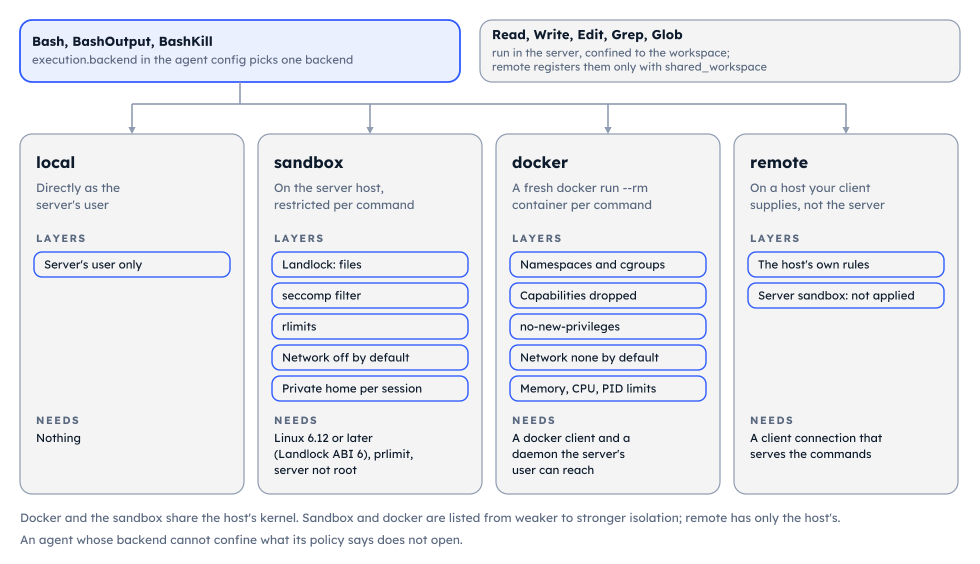

# Tools

[Bản gốc tiếng Anh](../../architecture/tools.md)

> Thuộc [hướng dẫn kiến trúc linch-rust](./README.md).

Trang này nói về hợp đồng tool trong `linch-core` (trait `Tool`, các scope,
registry và cách một batch chạy) và các tool trong `linch-tools`: các tool
workspace, hệ thống tệp ảo cùng việc chuyển kết quả ra ngoài, và các tool
task của session. Dùng trang này khi bạn viết một tool, đổi cách các lời gọi được lập lịch,
hoặc đụng đến giới hạn truy cập tệp.

[Giao thức tool](../../../../docs/architecture/tool-protocol.md) của Linch bản Python
mô tả cùng những ý tưởng. Điểm khác trong Rust:

- Một tool là bất kỳ kiểu nào implement trait `Tool`; không có struct cơ sở
  và không có decorator `@tool`. Các method bắt buộc của trait chính là các
  attribute mà Python đọc bằng duck typing.
- `scope()` không có mặc định. Ở Linch 3.x, một scope `read` mặc định đã để các hàm có
  tác dụng phụ chạy mà không được phê duyệt và chạy song song (issue #99,
  `crates/linch-core/src/tool.rs:4-7`).
- Kết quả luôn là `Result<ToolOutput, ToolOutputError>`. Không có đối tượng
  `ToolResult`; `output_schema` là tùy chọn.

## Trait Tool

`Tool` (`crates/linch-core/src/tool.rs:226`) là `Send + Sync` và không giữ trạng thái
giữa các lời gọi; dữ liệu theo từng lời gọi đến qua `ToolContext`.

| Method | Mặc định | Hợp đồng |
|---|---|---|
| `name()` | bắt buộc | 1 đến 64 chữ cái ASCII, chữ số, `_` hoặc `-`: những gì Anthropic, OpenAI và Gemini đều chấp nhận (`crates/linch-core/src/registry.rs:288-291`) |
| `description()` | bắt buộc | Hiển thị cho model |
| `input_schema()` | bắt buộc | JSON Schema draft 2020-12 với `"type": "object"` ở cấp cao nhất |
| `scope()` | bắt buộc | `Read`, `Write` hoặc `Exec` |
| `output_schema()` | `None` | Khi được đặt, một giá trị thành công phải thỏa mãn nó |
| `validate(input)` | identity | Các kiểm tra ngoài schema; chạy sau khi xác thực schema và chạy lại sau khi một hook `pre_tool_use` viết lại input |
| `parallel(input)` | `scope().is_parallel_safe()` | Lời gọi này có được chạy cùng các lời gọi đọc khác hay không |
| `polls()` | `false` | Tool có thăm dò (poll) một thứ đang chạy tiếp hay không, để loop guard không bao giờ đếm các lời gọi của nó là lặp ([vòng đời của lượt](./turn-lifecycle.md#loop-guard)); `BashOutput` trả về true |
| `summarize(input)` | tên tool | Một dòng cho event và lời nhắc phê duyệt |
| `execute(input, ctx)` | bắt buộc | Chạy trên input đã xác thực; trả về nhanh khi `ctx.cancel` kích hoạt |

`ToolOutput` giữ `value` mà model nhìn thấy và `metadata` mà model không thấy.
`ToolOutputError` giữ `message` mà model nhìn thấy, một `code` tùy chọn dành cho host,
và `details` tùy chọn dành cho host: một object tới event `tool_call_end` của lời
gọi như `metadata` của nó (`tool.rs:42-83`).

`ToolContext` (`tool.rs:117`) mang session id, run id, `tool_use_id`,
`principal` của bên gọi, một token `cancel` (bị hủy khi run abort hoặc khi
lời gọi kết thúc) và `deadline` của lời gọi khi agent đặt call timeout.
`idempotency_key()` là `run_id:tool_use_id` (`tool.rs:182-192`); `Bash` đưa nó cho host
`remote` trong `exec.start` (`Launch::idempotency_key`) và không đưa cho backend nào khác. Một run đã resume
không bao giờ chạy lại một lời gọi có phần bắt đầu đã bền vững mà phần kết thúc thì chưa:
nó báo lời gọi đó là bị gián đoạn. `Subagent` và `SubagentContinue` là
ngoại lệ: chúng được plan lại và resume run con bền vững của chúng
(`crates/linch-core/src/runner/batch.rs:118-139`). `report_progress` là
nỗ lực tối đa (best effort) và không bao giờ làm tool thất bại (`tool.rs:195`).

### Scope và phê duyệt

| Scope | Chế độ quyền mặc định | Chạy song song |
|---|---|---|
| `Read` | được phép | có, cùng các lời gọi đọc kế bên |
| `Write` | hỏi | không |
| `Exec` | hỏi | không |

Scope quyết định việc tự động phê duyệt (`crates/linch-core/src/permissions/engine.rs:320`)
và, qua `parallel` mặc định, tính đồng thời. Nó cũng là một phần của run contract
digest, bên cạnh schema (`registry.rs:216-218`).

## Registry

`ToolRegistry` (`registry.rs:72`) được dùng chung giữa các run sau một `Arc`.

- `register(tool)` (`registry.rs:86`) thêm một tool dưới một tên còn trống. Nó thất bại
  khi tên không hợp lệ, trùng tên, schema cấp cao nhất không phải đối tượng,
  hoặc schema không hợp lệ theo draft 2020-12 hoặc có một `$ref` cần I/O.
  Schema được biên dịch một lần ở đây.
- `replace(tool)` (`registry.rs:95`) ẩn mọi tool cùng tên. Tool thay thế
  giữ vị trí cũ trong `definitions()`.
- Mọi thay đổi của tập hiển thị đều tăng `generation()` (`registry.rs:100`).
- `snapshot()` (`registry.rs:107`) trả về một `ToolSnapshot` bất biến. Mỗi
  lượt lấy một snapshot và dùng nó xuyên suốt, nên một đăng ký diễn ra
  giữa lượt không bao giờ thay đổi những gì lượt đó thấy.
- `definitions()` (`registry.rs:209`) liệt kê các tool theo thứ tự đăng ký đầu tiên.
  Thứ tự ổn định giữa các snapshot vì prompt cache phụ thuộc vào nó.

### Đăng ký có thể hoàn tác

Mỗi đăng ký trả về một `Registration` (`crates/linch-core/src/registration.rs:19`).
`dispose()` hoàn tác đúng đăng ký đó và là idempotent; drop handle không hoàn tác gì
(`registration.rs:1-6`). Dispose một tool đã bị một `replace` sau đó ẩn đi không thay đổi
gì nhìn thấy được. Dispose tool đang hiển thị sẽ khôi phục đăng ký còn sống gần nhất của
tên đó, hoặc gỡ tên đi. Cùng kiểu handle này được trả về từ `HookChain::register`
(`crates/linch-core/src/hooks/chain.rs:132`) và từ MCP client, nên một
host hoàn tác cả một cụm kết nối bằng cách dispose các handle mà nó đã giữ.

### Thay đổi catalog giữa session

Prompt đầu tiên của một session được ghi log cùng một `PrefixEntry`: các block system,
các tool và các skill được liệt kê tại thời điểm đó
(`crates/linch-core/src/catalog.rs`). Mọi request sau đó của session
đều bắt đầu bằng đúng những byte này, nên prompt cache giữ chúng bất kể
registry, skill hay subagent làm gì. Một thay đổi thì đi vào phần đuôi:
một `CatalogChangeBlock` (văn bản `<system-reminder>` của Linch bản Python) trong
message user kế tiếp mà run vẫn ghi log, nên nó không tốn thêm lần ghi nào.

- Một tool bị gỡ giữ lại hàng của nó; một lời gọi tới nó bị từ chối với lý do chưa đăng ký.
- Một tool được thêm sẽ được nối vào các tool của request, việc này làm mất cache
  một lần. `native_catalog_changes` trên `AnthropicOptions` hoặc `ResponsesOptions`
  gửi nó tại thông báo thay vào đó (mặc định tắt, chưa được kiểm chứng trên môi trường
  thật). Request nêu tên các hàng đó trong `ProviderRequest::appended_tools`, để
  adapter cũng giữ chúng ngoài `tools` qua một lần compaction.
- Một mô tả mới được nói bằng văn bản; một input schema mới thay thế hàng của nó.
- Một lần compaction không bao giờ viết lại prefix; bản tóm tắt của nó nhắc lại các
  thay đổi.

`Agent::reload_skills` và `Agent::reload_subagents` (cùng
`OpenedAgent::reload_*`, vốn quét lại thư mục cấu hình cho loại mà
cấu hình đã bật, và nếu không thì chỉ áp dụng lại danh sách của một deep agent và
các skill tích hợp sẵn) là các đăng ký có thể hoàn tác cùng loại. Run contract vẫn là
contract mà agent được build với nó.

`AgentBuilder::tool_search(ToolSearch)` trì hoãn một catalog lớn
(`crates/linch-core/src/tool_search.rs`): vượt quá `max_tools`, một session mới
chỉ được đưa các tool mà `always_load` của chúng cho phép cùng `tool_search`. Những gì một
lần tìm kiếm thấy được thông báo dưới dạng tool được thêm ở phần đuôi và được đưa ra từ
request kế tiếp; một lời gọi tới tool chưa được đưa ra bị từ chối với lý do bị trì hoãn.

## Cách một batch chạy

Các lời gọi tool của một response đi qua hai bước
(`crates/linch-core/src/scheduler.rs:1-22`), để một run có thể suspend giữa
chúng:

1. **Plan.** Với mỗi lời gọi: phân giải tên trong snapshot của lượt, xác thực
   input, chạy chuỗi `pre_tool_use`, xác thực lại input cuối cùng,
   đánh giá quyền (và chuỗi `permission_request` khi gặp `Ask`), rồi
   áp dụng mọi phê duyệt đã ghi từ một lần suspend trước. Một lời gọi vẫn
   cần phê duyệt sẽ làm run suspend.
2. **Execute** (`crates/linch-core/src/scheduler/execute.rs:119`). Kết quả
   được trả về mỗi lời gọi một cái, theo thứ tự lời gọi. Một kết quả thành công được kiểm tra
   theo `output_schema` của tool, rồi chuỗi `post_tool_use` chạy trên kết quả.
   Một tool bị panic nhận một kết quả lỗi nêu tên panic đó.

### Một lời gọi, theo thứ tự

`Runner::call` (`scheduler/execute.rs`) đưa một lời gọi `Run` đã được lên kế hoạch
qua các bước này. Mỗi bước vắng mặt, và không tốn gì, khi trường của nó không được đặt:

1. **Tra cache** (`spec.tool_cache`). Một tool phạm vi read, không `polls`,
   không `asks_user`, có `Tool::cache_safe` mà policy nêu tên sẽ tra khóa
   `[session?, principal?, tool_name, input]` trong namespace của agent (`tool_cache.rs`,
   `cache_key`; session nằm trong khóa trừ khi `scope` là `namespace`). Lần tra trả về
   mục và epoch của namespace. Một mục còn sống trở thành kết quả: không có durable
   start trước nó, không chạy tool, `cache_hit` nằm trên `tool_call_end`; start và end
   được ghi cùng nhau, như với mọi lời gọi không chạy gì. Mỗi lời gọi store bị giới hạn
   bởi `STORE_TIMEOUT` (2 s) và việc hủy run; một lỗi hay một lần hết thời gian là miss.
   Sau lời gọi `Tool::launches_background` đầu tiên của agent, hoặc một lần xóa thất bại,
   `slot_of` không trả về gì và cache tắt cho agent.
2. **Invalidate.** Một tool write hoặc exec xóa namespace trước, khi
   `invalidate_on_write` được đặt, trước `tool_starting`, để một lần crash trong lúc
   tác dụng diễn ra không thể để lại một mục từ trước nó. Một lần xóa tăng epoch của
   namespace. Việc hủy trong lúc xóa này dừng lời gọi trước khi nó bắt đầu.
3. **`tool_starting`**, rào chắn bền vững. Từ đây một lần crash để lại một lời
   gọi bị gián đoạn mà một lần resume không bao giờ chạy lại.
4. **Các lần thử** (`invoke`). Mỗi lần thử là phần thân tool được bọc bởi waterfall
   `tool_execute` (`hooks/execute.rs`, `ToolPipeline`) khi có một
   layer được đăng ký, và bởi timeout của lời gọi. Một lỗi mà
   `spec.tool_retry` bao phủ (`tool_retry.rs`: tool là `Tool::idempotent`,
   `code` của lỗi hoặc `timeout` có trong danh sách, còn lần thử) đi tới
   `ToolSink::tool_retrying`, nơi ghi và flush một event `tool_retry`,
   rồi chờ (`base_delay_ms` nhân đôi đến `max_delay_ms`, cắt còn phần còn lại của
   `RETRY_BUDGET`, 5 phút retry cho cả run, mọi lời gọi cộng lại, và về 0 khi resume; hết thì không retry) và chạy lại.
   `error` của event đi qua redactor, rồi bị cắt còn `ERROR_BYTES`. Một host tool hết
   thời gian bị bỏ bằng `$/cancelRequest`, vốn không có xác nhận trong giao thức, nên
   một lần retry có thể chồng lên handler cũ.
5. **`finish`.** Output schema, redaction, rồi, khi tool vừa chạy, kết quả của nó được
   lưu vào cache (`put` có điều kiện theo epoch mà lần tra trả về, nên một lần xóa kể từ
   lần tra sẽ từ chối nó) sau kiểm tra schema và redaction, trước `post_tool_use`; các
   hook chạy lại ở mỗi lần hit. Khi có layer `tool_execute`, `body` ghi lại kết quả của
   chính tool cho mỗi lần thử (`Raw`) và kết quả chỉ được lưu nếu các layer trả nó
   nguyên vẹn (`untouched`): một veto hay `Replace` không bao giờ được cache, và một
   lần hit không chạy các layer. Không có `spec.redaction` bao phủ kết quả tool thì
   thứ được lưu là chưa che; tenant bị từ chối nếu thiếu nó. Rồi đến
   `post_tool_use`. Một câu trả lời `Mutate` đổi giá trị hoặc cờ lỗi và giữ nguyên
   metadata và mã lỗi; `content` của nó không được là `null` (một câu trả lời xấu, vì
   nó sẽ đọc như vắng mặt).
6. **Invalidate lần nữa** sau một lời gọi write hoặc exec (không bị việc hủy cắt ngắn:
   lần ghi có thể đã đổi trạng thái, và lời gọi bị giới hạn bởi `STORE_TIMEOUT`), rồi
   `tool_finished`.

Waterfall `tool_execute` là bản đối ứng bằng Rust của `tools/execute` trong Python:
một `ToolMiddleware` nhận lời gọi và một `Next`, await
`next.run()` để chạy phần bên trong, và trả về kết quả. Không await nó thì
phủ quyết lời gọi. Layer được đăng ký đầu tiên là ngoài cùng; một layer không thể
đổi input, thứ mà permission đã kiểm tra (hãy viết lại nó trong
`pre_tool_use`). Việc đăng ký trả về một `Registration`, và khi không có layer nào
thì scheduler gọi tool trực tiếp, nên đường đi chính là đường mà một run không có nó
vẫn luôn có.

### Chỉ công việc đọc mới chạy song song

`execute` duyệt các lời gọi theo thứ tự và gom chúng thành nhóm
(`execute.rs:137-151`). Một lời gọi chỉ vào nhóm hiện tại nếu nhóm
bắt đầu bằng một lời gọi đọc, nhóm còn dưới giới hạn, và lời gọi này cũng là
lời gọi đọc (`in_read_group`, `execute.rs:157`). Một lời gọi không chạy tool nào
(bị từ chối, được phục vụ từ một hook, bị abort) cũng vào được. Mọi lời gọi khác chạy
riêng, nên lời gọi kế tiếp phải chờ nó.

Một lời gọi đọc là lời gọi mà `parallel(input)` của tool trả về true. Mặc định
chỉ trả về true với scope `Read`. Một tool có thể trả về true cho một lời gọi chỉ
làm công việc đọc bất kể scope của nó, ví dụ một subagent mà mọi tool đều chỉ đọc
(`tool.rs:250-257`). Đừng bao giờ trả về true cho một lời gọi ghi hoặc chạy
bất cứ thứ gì.

Giới hạn là `AgentSpec::max_tool_concurrency`, mặc định 4; 0 được tính là 1
(`crates/linch-core/src/agent/spec.rs:53-55`). `call_timeout_ms` giới hạn từng
lời gọi: tới deadline, scheduler drop future của lời gọi và báo một lỗi
timeout.

### Tính bền vững quanh một tool

Một tool thực sự chạy tốn hai lần ghi run-store: phần bắt đầu của nó được làm bền vững
trước khi nó chạy, và phần kết thúc ngay sau khi nó trả về
(`crates/linch-core/src/runner/sink.rs:1-12`). Một lời gọi không chạy gì có
phần bắt đầu và kết thúc được stage và ghi cùng barrier kế tiếp. Xem
[stores](./stores.md#số-lần-ghi-của-group-commit) cho số lần ghi trên mỗi lượt.

<a id="workspace-tools"></a>

## Tool workspace

`workspace_tools(backend, reads, processes)` (`crates/linch-tools/src/lib.rs:63`)
trả về `Read`, `Write`, `Edit`, `Grep`, `Glob`, `Bash`, `BashOutput` và
`BashKill` trên một `ExecutionBackend` (`LocalFs` của nó cho các tool tệp, shell của
nó cho `Bash`; xem [Execution backend](#execution-backend)), dùng chung một
`ReadTracker` và một registry `Processes`. Crate này chỉ dành cho Unix vì Bash dùng process group.

| Tool | Scope | Hành vi |
|---|---|---|
| `Read` | read | Văn bản UTF-8 với số dòng; `offset`/`limit`, mặc định 2000 dòng; tệp trên 10 MiB bị từ chối (`crates/linch-tools/src/read.rs:14-17`) |
| `Write` | write | Thay cả một tệp theo cách nguyên tử và tạo các thư mục cha. Một tệp đã tồn tại phải đã được đọc đầy đủ tại stamp hiện tại của nó |
| `Edit` | write | Thay đúng đoạn văn bản, một lần trừ khi có `replace_all`. Tệp phải đã được đọc tại stamp hiện tại của nó, gồm mọi dòng mà một kết quả khớp chạm tới |
| `Grep` | read | Engine của ripgrep trong process; các chế độ `files_with_matches`, `count`, `content`; mặc định 250 mục, đầu ra giới hạn 30 000 byte (`crates/linch-tools/src/grep.rs:15-25`) |
| `Glob` | read | Quy tắc glob của ripgrep, mới nhất trước, tối đa 1000 đường dẫn (`crates/linch-tools/src/glob.rs:13`) |
| `Bash` | exec | `/bin/sh -c` trong thư mục gốc; xem bên dưới |
| `BashOutput` | read | Đầu ra chưa đọc của một lệnh chạy nền; xem [bên dưới](#bash-chạy-nền) |
| `BashKill` | exec | Kill group của một lệnh chạy nền |

Grep và Glob bỏ qua các tệp bị ignore và không đi theo symlink; Grep cũng bỏ qua
các tệp ẩn và nhị phân, và Glob chỉ liệt kê tệp ẩn khi mẫu
nêu tên một đoạn bắt đầu bằng dấu chấm (`crates/linch-tools/src/fs.rs:232-248`). Một mẫu Grep biên dịch ra tối đa
10 MiB (`REGEX_SIZE_LIMIT`; mẫu lớn hơn là `invalid_query`) và bộ nhớ đệm DFA lười của một
matcher chứa tối đa 32 MiB (`REGEX_DFA_CACHE_LIMIT`; mẫu cần nhiều hơn chạy trên engine
chậm hơn), nên bộ nhớ của một lần gọi bị chặn, ngoài 10 MiB mà searcher giữ của một tệp.

### Đọc trước khi ghi

`ReadTracker` (`crates/linch-tools/src/tracker.rs:24`) ghi lại, theo từng session và
đường dẫn workspace, stamp của tệp (thời gian sửa đổi và kích thước) cùng các dòng mà một
`Read` đã bao phủ. Một thay đổi stamp, do bất kỳ ai, làm bằng chứng vô hiệu. Một lần ghi
bị từ chối trả về mã `read_before_write` (`crates/linch-tools/src/input.rs:13`). Bằng
chứng nằm trong bộ nhớ: một process khởi động lại phải đọc lại trước khi ghi,
đó là chiều an toàn. Host gọi `ReadTracker::forget` khi một
session kết thúc (`tracker.rs:65`).

### Giới hạn truy cập

Mọi tool tệp đều đi qua trait `ExecutionFs` (`fs.rs:209`), nên một
thế giới thực thi từ xa có thể thay `LocalFs` mà không đổi các tool.
`LocalFs` (`crates/linch-tools/src/fs/local.rs:26`) canonicalize thư mục gốc
một lần; `new` là blocking, nên hãy gọi nó trước khi runtime khởi động hoặc từ một
blocking task. Mỗi đường dẫn được phân giải bằng cách canonicalize tiền tố dài nhất đã
tồn tại của nó; phần còn lại chỉ được chứa các tên thuần (`local.rs:68-72`). `..`, đường
dẫn tuyệt đối nằm ngoài thư mục gốc và symlink dẫn ra ngoài đều bị từ chối với
`FsError::Escape`. Các đường dẫn trả về là đường dẫn workspace: tương đối, phân tách bằng `/`,
symlink đã được phân giải, để một tệp có một tên. Phép kiểm tra bảo vệ các đối số đường
dẫn; nó không ngăn một process đồng thời hoán đổi một symlink giữa lúc kiểm tra
và lúc dùng. Công việc tệp chặn chạy trên blocking pool của Tokio.

### Bash

`Bash` (`crates/linch-tools/src/bash.rs:79`) không bị `LocalFs` giới hạn: với
backend `local` mặc định nó bắt đầu trong thư mục gốc, nhưng lệnh có thể chạm tới mọi
thứ mà user của process truy cập được. Hãy dùng permission engine (mặc định nó hỏi cho
`exec`) hoặc backend `sandbox` hay `docker` khi điều đó quan trọng.
Những gì nó bảo đảm dưới mọi backend:

- stdin bị đóng và lệnh dẫn đầu một process group mới
  (`crates/linch-tools/src/bash/process.rs:159-195`);
- cả group nhận `SIGKILL` khi timeout, khi hủy, khi future của lời gọi
  bị drop, và khi shell thoát, nên các job nền không bao giờ sống lâu hơn
  lời gọi (`process.rs:199-271`);
- chỉ chín biến của host được truyền qua (`PATH`, `HOME`, `TERM`, `LANG`,
  `LC_ALL`, `LC_CTYPE`, `USER`, `SHELL`, `TMPDIR`), nên thông tin xác thực của host
  nằm ngoài môi trường (`bash.rs:51`); `with_env` thêm các biến khác (`bash.rs:153`);
- timeout mặc định là 120 s (30 phút khi chạy nền) và bị chặn ở 30 phút
  (`bash.rs:38-41`);
  khi có deadline của lời gọi, nó kết thúc 100 ms trước deadline đó, để đầu ra cho đến lúc
  đó đến được model thay vì một timeout chung chung (`bash.rs:209`);
- mỗi stream giữ 4000 byte đầu và 26 000 byte cuối
  (`bash/capture.rs:5-8`);
- mọi exit status khác 0 là một kết quả lỗi mang cùng văn bản, với mã
  `exit_status`, `timeout` hoặc `aborted` (`bash.rs:309-326`).

### Bash chạy nền

`run_in_background: true` giao lệnh cho registry `Processes` của agent
(`crates/linch-tools/src/bash/background.rs:48`) và trả về id của nó ngay lập tức.
Registry thuộc về một agent đã mở (không có process global), khóa các process theo
session, và cho mỗi session chạy nhiều nhất `MAX_RUNNING` (4) process cùng lúc, giữ
tới 16 process đã kết thúc để đọc lần cuối (`background.rs:28-32`). Id có dạng `bash_`
cộng 12 chữ số hex ngẫu nhiên, nên một id từ trước khi khởi động lại không bao giờ chỉ
tới một process mới.

- Một supervisor task cho mỗi process sở hữu `Child`: nó chạy cùng `supervise` như một
  lời gọi foreground, bơm từng stream vào một capture có giới hạn mà một lần đọc lấy
  dữ liệu từ đó (4000 byte đầu và 26 000 byte cuối của phần chưa đọc), và reap shell dù
  điều gì kết thúc nó.
- Nó kết thúc khi thoát, khi hết timeout, bởi `BashKill`, `Processes::close_session`
  (nối với `Agent::close_session`), `Processes::close` và `Drop` của registry
  (agent đóng). Mỗi cách đều kill cả group và chờ reap.
- **Lifeline.** Một lệnh chạy nền chạy dưới một wrapper `/bin/sh` nhỏ
  (`process.rs:36`) có stdin là một pipe do server giữ. Một watchdog trong group của
  lệnh chặn trên pipe đó bằng builtin `read` và kill group khi nó đóng, việc kernel làm
  khi server chết, kể cả bằng `SIGKILL`. Nó không cần gì trên `PATH` của lệnh. Một lệnh
  foreground không có lifeline: nó chết cùng lời gọi của nó, nhưng một server bị kill
  giữa lời gọi để lệnh đó chạy tiếp.
- `BashOutput` (scope read, chạy song song) chờ tối đa `wait_ms` (nhiều nhất
  600 000, bị cắt theo deadline của lời gọi) cho tới khi kết thúc, rồi trả về đầu ra
  chưa đọc; một process đang chạy là một kết quả thành công kết thúc bằng
  `still running`, một process đã kết thúc được hiển thị như kết quả foreground.
  Nó là một poll (`polls()`): loop guard không bao giờ đếm một lần đọc lệnh đang
  chạy là lặp. `BashKill` có scope exec như `Bash`. Cả hai nằm trong
  `crates/linch-tools/src/bash/control.rs`.
- **Restart.** Process chỉ sống trong bộ nhớ và chết cùng server, nên `BashOutput`
  hoặc `BashKill` của một run được resume trên một id cũ thất bại với mã
  `no_such_process` (`control.rs:22`) và một thông báo nói rằng background process không
  sống sót qua restart. Không có gì về chúng được journal: kết quả bền vững của lời gọi
  khởi động giữ id của nó, và model khởi động lại lệnh.

### Execution backend

<picture>
  <source media="(prefers-color-scheme: dark)" srcset="../../assets/exec-isolation-dark.svg">
  
</picture>

*Các backend của Bash và các lớp cô lập mà mỗi backend có.*

`ExecutionBackend` (`crates/linch-tools/src/exec.rs:141`) là một thế giới thực thi,
`ExecutionBackend` của Python: `LocalFs` mà các tool tệp dùng và một shell mà `Bash`
dùng để khởi động lệnh. Mỗi cái thuộc về một agent đã mở, agent này gọi
`close_session` của nó từ `Agent::close_session`. `ExecutionBackend::open`
(`exec.rs:171`) dựng nó từ một `ExecutionConfig` (`exec.rs:59`), được gắn tag bởi
`backend`; nó chặn và thất bại với `ExecutionError` khi backend không thể giới hạn
những gì policy của nó nói, nên facade mở nó trên một blocking task và từ chối agent
thay vì chạy `Bash` không bị giới hạn.

Seam của shell là trait `Shell` riêng của crate (`exec.rs:308`): `spawn` khởi động một
`Launch` (lệnh, root, môi trường của `Bash`, session, có cần lifeline hay không) làm
leader của một process group mới với stdout và stderr được pipe, và trả về `Child`
cùng một `Cleanup` tùy chọn để chạy sau khi kill. Mọi thứ sau spawn, `supervise` với
việc kill group, drain, reap, mức trần và pipe lifeline, đều dùng chung, nên mọi
backend giữ các bảo đảm ở trên và `Processes::start` (`bash/background.rs:139`) chạy
các lệnh nền qua cùng shell đó.

| Backend | Shell | Thay đổi gì |
|---|---|---|
| `local` | `LocalShell` (`exec.rs:326`) | Không gì cả: `process::spawn`, từng byte giống `Bash` cũ (golden test trong `crates/linch-tools/tests/execution_golden.rs` và `crates/linch/tests/execution_golden.rs`) |
| `sandbox` | `SandboxShell` (`exec/sandbox/shell.rs:102`) | Landlock, seccomp và `prlimit` bao quanh shell; một `HOME`/`TMPDIR` riêng cho mỗi session |
| `docker` | `DockerShell` (`exec/docker.rs:178`) | `docker run --rm` cho mỗi lệnh; `docker rm -f` làm cleanup |
| `remote` | `RemoteShell` (`exec/remote.rs`) | Không có process cục bộ: một host chạy lệnh (xem bên dưới) |

Một backend không phải local kết thúc mô tả của `Bash` bằng
`ExecutionBackend::describe` (`Bash::in_backend`, `bash.rs:102`): model biết cái gì bị
giới hạn, và vì mô tả là một phần định nghĩa của mỗi tool, backend cùng toàn bộ policy
của nó là một phần của hợp đồng run. Backend local không thêm gì, nên các định nghĩa
và hợp đồng của nó là những cái có từ trước khi có backend.

**Sandbox.** Landlock và seccomp giới hạn *thread* gọi, và một process fork từ nó kế
thừa cả hai. `SandboxShell::spawn` (`sandbox/shell.rs:198`) giao mỗi lệnh cho một
`std::thread` mới; thread này tạo home của session, đếm các task của user trong `/proc`
(`user_tasks`, `shell.rs:288`), tự giới hạn mình (`Rules::confine`, `shell.rs:61`),
vào runtime Tokio và spawn `prlimit --as --cpu --fsize --nproc -- /bin/sh ...`
(`limits`, `shell.rs:179`); `prlimit` đặt các giới hạn rồi exec shell, nên pid,
group và stdin của lifeline được giữ nguyên. Các thread của chính server không bao giờ
bị giới hạn, và không có code nào chạy giữa fork và exec, nên crate giữ
`forbid(unsafe_code)`. Nếu lời gọi đã biến mất trong lúc đó, thread kill group mới.

- Landlock ABI 6 với `CompatLevel::HardRequirement`: truy cập tệp được xử lý, TCP bind
  và connect khi mạng tắt, cùng các scope signal và abstract Unix socket. `open` chạy
  `confine` một lần trên một thread dùng một lần, và mỗi lần spawn kiểm tra trạng thái
  là `FullyEnforced` với `no_new_privs`.
- Đọc và thực thi: `SYSTEM_READ_PATHS` (`exec/sandbox.rs:87`), `read_paths`, và khi mạng
  bật là đích của `/etc/resolv.conf`. Mọi quyền: root và home của session. Quyền tệp:
  năm thiết bị (`sandbox/shell.rs:35`), không có `/dev/tty`, terminal của server.
- Bộ lọc seccomp (`crates/linch-tools/src/exec/sandbox/seccomp.rs`) kill một syscall của kiến
  trúc khác, từ chối các syscall x32, `io_uring_setup` và `socket(AF_UNIX)`, và khi
  mạng tắt là mọi `socket`. Landlock chỉ giới hạn pathname Unix socket từ ABI 9, và
  một socket của user của server (session bus, socket Docker) sẽ khởi động thứ gì đó
  ngoài sandbox. Bộ lọc là một denylist: một syscall mà nó không nêu tên thì được
  phép, và Landlock cùng việc kiểm tra không-root mới là ranh giới.
- `RLIMIT_NPROC` đếm mọi task của user, nên giới hạn là số đếm lúc spawn cộng
  `max_processes`: khoảng dư, không phải hạn ngạch.
- Home là `s<n>` dưới một `TempDir` mà shell sở hữu; `close_session` xóa một cái trên
  blocking pool, và việc agent bị drop xóa tất cả.

**Docker.** `DockerShell::run_args` (`docker.rs:224`) dựng `docker run` của Python
(`--memory`, `--cpus`, `--pids-limit`, `--cap-drop ALL`,
`--security-opt no-new-privileges`, `--network`, `--user`, root được mount tại chính
đường dẫn của nó) với môi trường được truyền theo tên. Một lệnh nền chạy dưới
`DOCKER_LIFELINE` (`docker.rs:118`), watchdog của nó chạy `docker rm -f` trước khi kill
group. Chưa được kiểm chứng với một daemon trong CI ở đây;
`crates/linch-tools/tests/docker.rs` bỏ qua khi không có.

**Remote.** `spawn` trả về một `Started` (`bash/process.rs`): một `Spawned`
cục bộ, hoặc một `RemoteRun` mà `supervise` (`exec/remote.rs`) hỏi host thay
vì đọc pipe. Host là trait công khai `RemoteExec` (`start`, `read` kiểu long
poll, `kill`); `linch-rpc` cài đặt nó qua `Peer` của kết nối thành
`exec.start`, `exec.read` và `exec.kill` (`server/exec.rs`), và
`AgentConfig::open_with_remote` nhận nó, nên khi không có (worker, schedule,
extension Python) `ExecutionBackend::open` lỗi với `ExecutionError::NoHost`.
`End::Exited` mang một `Exit` (code hoặc signal) thay cho `ExitStatus`, và
`End::Interrupted` nghĩa là kết quả không biết: server chỉ báo một lệnh là
timed out hoặc aborted sau khi host xác nhận `kill` kèm exit, ngược lại báo
interrupted (cũng vậy sau một lần read bị mất, hoặc một lần start mà câu trả lời bị
mất: chỉ `Rejected` chứng minh lệnh đã không chạy), nên không bao giờ báo một kết quả
chưa quay về. Các lần read trả lời gần như trống ngay lập tức bị giãn nhịp, một lệnh
quá 256 MiB output bị kill và kết thúc `End::OutputLimit` (`interrupted` nếu host không
xác nhận kill), và một lệnh remote kết thúc `KILL_MARGIN` (6,1 giây, tối đa một nửa
hạn chót khi hạn chót dưới khoảng 12 giây, `Shell::deadline_margin`) trước hạn chót của
scheduler. Một call bị drop
gửi một kill tách rời. `PATH`, `HOME`, `USER`, `SHELL` và `TMPDIR` của server
không được gửi, và `workspace_tools` không đăng ký tool tệp trừ khi
`shared_workspace` của policy bật (`ExecutionBackend::has_file_tools`): chúng
sẽ tác động lên thư mục của server trong khi lệnh chạy chỗ khác. Policy nằm
trong mô tả của `Bash`, nên nằm trong contract. Xem
[Thực thi từ xa](../../usage/remote-execution.md).

## Hệ thống tệp ảo và chuyển kết quả ra ngoài

Hệ thống tệp ảo tách biệt với workspace: ghi chú nháp và các kết quả được chuyển ra
ngoài nằm ở bất cứ đâu backend giữ chúng. Hợp đồng,
`FileBackend` (`crates/linch-core/src/vfs.rs:83`), nằm trong lõi để một crate store có
thể triển khai nó mà không cần các tool. Nó lưu văn bản UTF-8 theo đường dẫn gốc `/` với
`read`, `write`, `edit`, `ls`, `exists` và `delete`. Mọi backend
chuẩn hóa đường dẫn bằng `normalize_path` (`vfs.rs:120`): `a//b/` và `/a/b` là
một tệp, `..` và NUL bị từ chối, và thư mục gốc không phải là tệp. `edit` là
nguyên tử theo từng backend và dùng `apply_edit` (`vfs.rs:163`). Mọi backend đều đạt
`vfs::conformance::backend_suite`.

Một tệp chứa tối đa `MAX_FILE_BYTES` (10 MiB, `vfs.rs:25`), giới hạn `Read` và `Edit` của
workspace. `apply_edit` từ chối một lần sửa mà kết quả sẽ vượt giới hạn đó, với
`VfsError::TooLarge`, dựa trên số lần khớp trước khi nó dựng kết quả, nên mọi backend
sửa qua nó (kể cả Postgres) đều bị giới hạn và `replace_all` không thể nhân một tệp lên
vô hạn. `write_file` từ chối nội dung vượt giới hạn; `write` riêng của một backend thì
không kiểm tra, để hook chuyển kết quả ra ngoài có thể lưu một kết quả lớn. Các tool báo
cả hai là `too_large`, nêu tên đường dẫn, và để tệp như cũ. `Edit` của workspace tính
cùng phép cộng (`text.len() - n*old.len() + n*new.len()`, có kiểm tra tràn số) trước khi
dựng kết quả và từ chối khi vượt `MAX_READ_BYTES`; `old_string` rỗng với `replace_all`
bị từ chối với mã `empty_old_string`.

| Backend | Tệp nằm ở đâu |
|---|---|
| `MemoryBackend` | Bộ nhớ, mất cùng process |
| `DiskBackend` | Tệp thật dưới một thư mục gốc, bị giới hạn như `LocalFs` |
| `linch_postgres::PgFileBackend` | Bảng `linch_files`, theo namespace, dùng chung giữa các process |
| `CompositeBackend` | Định tuyến theo tiền tố đường dẫn dài nhất tới các backend khác |
| `ScopedBackend` | Một cây con của backend khác làm thư mục gốc riêng của nó |

Các tool và hook chuyển kết quả ra ngoài tìm backend của một session qua
`SessionFiles` (`crates/linch-tools/src/vfs.rs:53`): `MemorySessions` cấp cho
mỗi session một backend bộ nhớ mới (gọi `forget` khi nó kết thúc), và
`SharedFiles` cấp cho mọi session một backend chung.

`vfs_tools(files)` (`crates/linch-tools/src/vfs/tools.rs:35`) trả về `ls` và
`read_file` (scope read) cùng `write_file` và `edit_file` (scope write).
`vfs::PROMPT` (`tools.rs:24`) dạy model về hệ thống tệp ảo; host
thêm nó vào system prompt khi cung cấp các tool này.

`ResultOffload` (`crates/linch-tools/src/vfs/offload.rs:87`) là một hook
`post_tool_use`. Một kết quả ước lượng vượt `threshold_tokens` (bốn byte cho mỗi token)
được ghi nguyên vẹn vào `/offload/{tool}_{tool_use_id}.txt` và được thay bằng 10 dòng đầu
(tối đa 2000 byte; con trỏ ghi "cut at 2000 bytes" khi số byte kết thúc phần xem trước) cùng
một con trỏ mà model có thể theo bằng `read_file`. Ba loại được phủ (`offload.rs:152`,
`offload.rs:190`):

- Một chuỗi được lưu nguyên.
- Một giá trị có cấu trúc được ước lượng theo JSON chính tắc gọn của nó, lưu dưới dạng JSON định
  dạng đẹp (mỗi giá trị một dòng, để `read_file` phân trang được) và được thay bằng cùng con trỏ
  dưới dạng chuỗi; metadata của nó có thêm các kích thước và `original_kind: "json"`, không bao
  giờ có chính giá trị.
- Thông báo của một lỗi được lưu và thay bằng con trỏ, qua `PostToolUseResponse::Replace` mang
  một `Err`: `code` được giữ, nên loop guard phân loại nó như trước (việc thử lại của tool chạy
  trước hook, nên lỗi nào được thử lại không đổi), và `details` có thêm các kích thước và đường
  dẫn khi nó là một đối tượng hoặc vắng mặt.

Bốn tool hệ thống tệp ảo không bao giờ được chuyển ra ngoài, nên đọc lại một tệp đã chuyển ra
ngoài không bao giờ bị chuyển ra ngoài lần nữa (`offload.rs:254`). `read_file` trả về tối đa
16384 byte của một dòng mỗi lần gọi (`tools.rs:277`), và kết thúc một dòng bị cắt bằng lời gọi để
đọc tiếp (`byte_offset`), nên một dòng rất dài được phân trang như nhiều dòng ngắn; một tệp không
có dòng nào dài hơn được đọc đúng từng byte như khi lưu.

- Từ đó trở đi, bản thay thế là kết quả của lời gọi: event kết thúc tool,
  session log và các request sau đều giữ con trỏ, không giữ payload.
- Việc ghi vào backend hoàn tất trước khi hook trả lời, nên một con trỏ đã được ghi log
  nêu tên một tệp đã được ghi khi backend là bền vững. Một sự cố giữa lúc ghi
  và phần kết thúc của tool để lại một tệp không được tham chiếu; một lần thử lại lời gọi
  ghi cùng đường dẫn đó (`offload.rs:12-20`).
- Hook fail open (`offload.rs:245`): một lỗi lưu trữ hiện trong hook
  record và kết quả gốc đi tới model.
- Policy id `linch.vfs.offload`, phiên bản 2, của nó là một phần của run contract. Phiên bản
  đổi khi phạm vi hook phủ đổi, và schema của `read_file` cũng nằm trong contract, nên một run đã
  lưu của agent có `filesystem` không thể resume qua một thay đổi như vậy (`ContractMismatch`).

Với `MemorySessions`, một run được resume trong process khác sẽ thấy con trỏ nhưng
không thấy tệp.

## AskUser

`AskUser` (`crates/linch-core/src/ask_user.rs`) nằm trong `linch-core`, vì runner phải
biết về nó: nó là tool duy nhất có `asks_user()` (một method `Tool` có giá trị mặc định,
`false` ở mọi nơi khác) là `true`. `AgentConfig` đăng ký nó khi `ask_user` bật; mặc định
nó tắt, cũng như `AskUserPlugin` của Python là opt-in.

- Input của nó là 1 đến 4 câu hỏi (`id`, `header` tối đa 12 ký tự, `question`, 2 đến 4
  option gồm `label` và `description`, `multi_select`); id và label phải là duy nhất.
  Scope `read`, không bao giờ chạy song song.
- Planner biến một lời gọi `AskUser` được phép thành `PlannedAction::AwaitingInput`
  thay vì chạy nó; một hook `pre_tool_use` xử lý lời gọi thì giữ câu trả lời của nó. Sau
  đó run suspend để chờ input ([vòng đời của lượt](./turn-lifecycle.md#suspend)). Bản
  thân `execute` chỉ trả về lỗi "cannot wait", là thứ mà lời gọi của một run con nhận
  được.
- `AskUserAnswer::check` đối chiếu một câu trả lời với các câu hỏi của nó: được chấp
  nhận, mọi câu hỏi đều được trả lời (một chuỗi không rỗng, hoặc một danh sách không rỗng
  cho `multi_select`); bị từ chối, không có câu trả lời. Một lựa chọn không bị kiểm tra
  với các label, nên người dùng có thể tự viết, như trong Python.
- `AskUserAnswer::render` là kết quả của lời gọi: `{"answers": {...}}` (và `note`)
  dưới dạng văn bản JSON, hoặc văn bản từ chối của Python.

<a id="session-task-tools"></a>

## Tool task của session

`task_tools(store, runs, namespace)` (`crates/linch-tools/src/tasks.rs:25`) trả về
`TaskCreate` và `TaskUpdate` (scope write) cùng `TaskList` và `TaskGet` (scope read)
trên một `TaskStore` (`crates/linch-core/src/store/tasks.rs`). Tên, schema và các văn bản
mà model nhìn thấy khớp với của Python. Task là dữ liệu của session, không phải log entry:
chỉ các lời gọi và kết quả của chúng đi vào session log. Task của một lời gọi thuộc về
session của run gốc trong cây của nó: `Tasks::session` (`tasks.rs:70`) đi theo
`parent_run_id` qua `RunStore`, nên một subagent dùng chung task của coordinator (Python
gắn chúng với session đang gọi). Một run mà store không biết thì dùng session của chính
nó. Hợp đồng của store nằm ở trang [stores](./stores.md#task-store).

## Tool bộ nhớ, tool lịch và ledger

Ba bộ tool nữa được host gắn với thứ nó sở hữu, nên input của model không bao
giờ đặt tên được namespace, scope hay hàng đợi:

- `memory_tools(store, scope)` (`crates/linch-tools/src/memory.rs:79`) trả về
  `MemorySave` và `MemoryDelete` (write) và `MemorySearch` (read) trên một
  `MemoryStore` (`crates/linch-core/src/memory.rs:202`), được gắn với một
  namespace khi dựng. Model chọn nội dung, tag, truy vấn và id; scope là
  principal của run đang gọi, hoặc bộ nhớ chung của agent, và do host quyết
  định. Mọi memory mà model đọc đều được escape trước (`crates/linch-tools/src/memory.rs:1-14`), và
  một lỗi của store đến model dưới dạng một văn bản cố định với mã `store`.
  `MemoryRecall` (`memory_recall.rs`) là hook `context_build` tìm bằng tin nhắn
  mới nhất của người dùng và thêm các kết quả khớp nhất vào đuôi request mà
  thôi, trong 8 KiB và 300 ms, nên một store chậm chỉ làm request mất recall
  chứ không mất gì khác. Store nằm ở trang [stores](./stores.md#store-postgres).
- `schedule_tools(backend)` (`crates/linch-tools/src/schedules.rs:88`) trả về
  `CreateSchedule` (exec), `ListSchedules` (read) và `CancelSchedule` (write)
  trên một `ScheduleBackend`. Model chọn prompt và thời điểm. Phần gắn trong
  `linch-rpc` (`schedule_tools.rs`) cố định định nghĩa agent đã lưu mà mỗi lần
  fire chạy, principal, namespace, hàng đợi và các cap của tenant, và từ chối
  lời gọi của một subagent. Phía worker nằm ở trang [worker](./worker.md#lịch-chạy).
- `TaskLedgerContext` (`crates/linch-tools/src/ledger.rs`) là một hook
  `context_build`, policy id `linch.tasks.ledger-context`, cho thấy các task
  còn mở của một danh sách task dùng chung trong mỗi request. Nó không ghi gì
  và khối đó không bao giờ vào log; ghi policy id trong `context_budget.pinned`
  để giữ nó khi một budget bỏ bớt các khối.

## Viết một tool bằng Rust

Đoạn này biên dịch và chạy được ở revision này. Nó đăng ký một tool scope read,
điều khiển một run gọi tool đó qua `ScriptedProvider`, rồi dispose đăng ký:

```rust
use std::sync::Arc;

use async_trait::async_trait;
use futures::StreamExt;
use linch_core::provider::scripted::TurnBuilder;
use linch_core::{
    AgentBuilder, AgentSpec, Event, JsonObject, JsonValue, MemoryRunStore, MemorySessionStore,
    PermissionEngine, PermissionMode, PermissionPolicy, RunOptions, ScriptedProvider, Tool,
    ToolContext, ToolOutput, ToolOutputError, ToolRegistry, ToolResult, ToolScope,
};
use serde_json::json;

/// Counts the words in a text. It only reads, so its calls may run in
/// parallel with other read calls and need no approval.
struct WordCount {
    schema: JsonObject,
}

impl WordCount {
    fn new() -> Self {
        let schema = json!({
            "type": "object",
            "properties": {"text": {"type": "string", "description": "Text to count."}},
            "required": ["text"]
        });
        let JsonValue::Object(schema) = schema else { unreachable!() };
        Self { schema }
    }
}

#[async_trait]
impl Tool for WordCount {
    fn name(&self) -> &str {
        "word_count"
    }

    fn description(&self) -> &str {
        "Count the words in a text."
    }

    fn input_schema(&self) -> &JsonObject {
        &self.schema
    }

    fn scope(&self) -> ToolScope {
        ToolScope::Read
    }

    async fn execute(&self, input: JsonObject, ctx: ToolContext) -> ToolResult {
        if ctx.cancel.is_cancelled() {
            return Err(ToolOutputError::new("cancelled"));
        }
        let text = input.get("text").and_then(JsonValue::as_str).unwrap_or_default();
        ctx.report_progress("counting", None);
        Ok(ToolOutput::new(text.split_whitespace().count()))
    }
}

#[tokio::main(flavor = "current_thread")]
async fn main() {
    let tools = Arc::new(ToolRegistry::new());
    let registration = tools.register(Arc::new(WordCount::new())).unwrap();
    assert!(tools.register(Arc::new(WordCount::new())).is_err(), "names are unique");

    let provider = ScriptedProvider::new([
        TurnBuilder::new("m")
            .tool_call("c1", "word_count", &json!({"text": "one two three"}))
            .build(),
        TurnBuilder::new("m").text("Three words.").build(),
    ]);
    let permissions =
        PermissionEngine::new(PermissionPolicy::new(PermissionMode::Default, "/")).unwrap();
    let agent = AgentBuilder::new(AgentSpec::new("m"))
        .provider(Arc::new(provider))
        .tools(Arc::clone(&tools))
        .permissions(permissions)
        .run_store(Arc::new(MemoryRunStore::default()))
        .session_store(Arc::new(MemorySessionStore::default()))
        .namespace("docs")
        .build()
        .unwrap();
    let mut stream = agent.run("How many words?", RunOptions::new("s1"));
    let mut result = None;
    while let Some(item) = stream.next().await {
        if let Event::ToolCallEnd(end) = item.unwrap().event {
            result = Some(end.result);
        }
    }
    assert!(!result.expect("the tool ran").is_error);

    registration.dispose();
    registration.dispose(); // a second dispose does nothing
    assert!(tools.snapshot().resolve("word_count").is_none());
}
```

Việc kết nối các tool tích hợp sẵn theo cùng khuôn mẫu. Đoạn này cũng biên dịch và
chạy được: nó đăng ký các tool workspace, các tool hệ thống tệp ảo và
hook chuyển kết quả ra ngoài, và giữ mọi handle:

```rust
use std::path::Path;
use std::sync::Arc;

use linch_core::{Hooks, Registration, ToolRegistry};
use linch_tools::vfs::{MemorySessions, OffloadConfig, ResultOffload, SessionFiles, vfs_tools};
use linch_tools::{LocalFs, Processes, ReadTracker, workspace_tools};

/// Register the workspace tools over `root`, the virtual filesystem tools,
/// and the offload hook. Keep the handles to undo every registration.
fn wire(root: &Path, tools: &ToolRegistry, hooks: &Hooks) -> Vec<Registration> {
    let fs = Arc::new(LocalFs::new(root).expect("an existing directory"));
    let reads = Arc::new(ReadTracker::new());
    let processes = Arc::new(Processes::new());
    let files: Arc<dyn SessionFiles> = Arc::new(MemorySessions::new());
    let mut registrations = Vec::new();
    for tool in workspace_tools(fs, reads, processes).into_iter().chain(vfs_tools(Arc::clone(&files))) {
        registrations.push(tools.register(tool).expect("names are free"));
    }
    let offload = ResultOffload::new(files, OffloadConfig::new(8_000)).expect("a valid prefix");
    registrations.push(hooks.post_tool_use.register(Arc::new(offload)).expect("a policy id"));
    registrations
}

fn main() {
    let (tools, hooks) = (ToolRegistry::new(), Hooks::default());
    let registrations = wire(&std::env::temp_dir(), &tools, &hooks);
    assert_eq!(tools.snapshot().definitions().len(), 12);
    for registration in &registrations {
        registration.dispose();
    }
    assert!(tools.snapshot().definitions().is_empty());
}
```

Run contract digest bao phủ các tool được đăng ký khi
`AgentBuilder::build` chạy (`crates/linch-core/src/agent/builder.rs:219`). Một
tool được đăng ký sau đó, chẳng hạn một tool MCP sau một lần relist, được đưa ra từ
snapshot của lượt kế tiếp nhưng không thuộc contract.

---

Quay lại [mục lục kiến trúc](./README.md).
