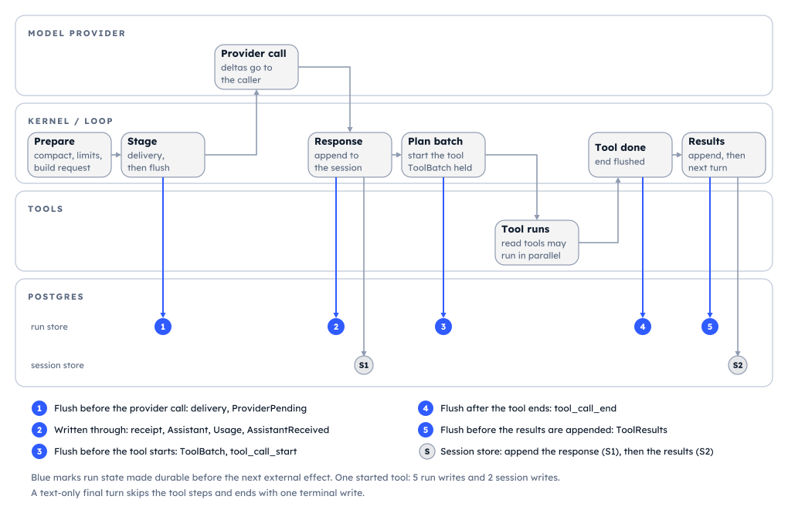
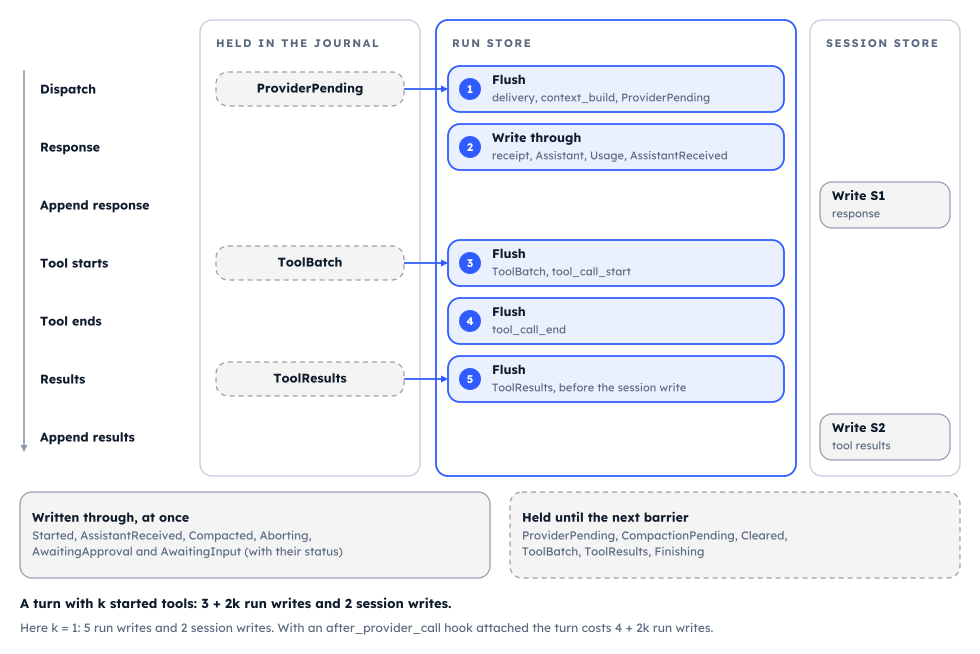

# Vòng đời của lượt

[Bản gốc tiếng Anh](../../architecture/turn-lifecycle.md)

> Thuộc [hướng dẫn kiến trúc linch-rust](./README.md).

Một run là một máy trạng thái trong `crates/linch-core/src/runner/`. Run là một
future mà bên gọi điều khiển bằng cách poll một `RunStream`. Mỗi lượt gửi đi một lời
gọi provider, nối response vào session và, khi response có lời gọi tool, lập kế hoạch
rồi chạy chúng. Trạng thái run được ghi vào run store theo nhóm, tại các barrier.
Dùng trang này để lần theo một run từ `Agent::run` đến terminal của nó, để đặt một
lần ghi mới so với một barrier, hoặc để xem một lần resume làm gì từ mỗi checkpoint.

Linch bản Python có cùng vòng lặp ([vòng đời của lượt](../../../../docs/architecture/turn-lifecycle.md)).
Điểm khác trong Rust:

- Vòng lặp được viết tường minh: một enum `Step`, mỗi variant ứng với một nơi mà run
  có thể resume (`crates/linch-core/src/runner/turn.rs:45-109`). Một lần resume đọc
  checkpoint bền vững và chọn bước; nó không phát lại vòng lặp.
- Run chỉ tiến lên khi stream của nó được poll. Drop stream là drop run ngay tại chỗ nó
  đang đứng, giống như một sự cố (`runner.rs:98-102`).
- Loop guard kết thúc một run bị kẹt trước lời gọi provider kế tiếp
  ([bên dưới](#loop-guard)): các kiểm tra lời gọi lặp lại và lỗi lặp lại của Python,
  bật mặc định, cùng một giới hạn cho số lượt không có lời gọi provider luôn bật
  (`loop_guard.rs`, `runner/end.rs:179-192`).
- Các hook point là hai mươi ba point trong [kernel](./kernel.md#chuỗi-hook), trong đó
  mười ba point chỉ quan sát. `before_provider_call` có thể viết lại hoặc block
  request sắp được gửi, và `after_provider_call` có thể viết lại hoặc block response
  mà một lời gọi vừa dựng xong, trước khi nó được stage, hoặc chấp nhận nó rồi chạy
  thêm một lượt thay vì làm theo nó (`retry` và `force_continue` của Python tại
  đó). `before_final_answer` của Python không phải một point riêng: `stop` có thể
  viết lại văn bản trả lời cuối cùng của run (không phải tin nhắn assistant, đã
  được nối vào từ trước khi `stop` chạy), block việc dừng lại, hoặc đòi trả lời lại
  một lần cho mỗi lần gọi run (`retry` của `before_final_answer` trong Python);
  `continue` của nó là `force_continue` của stop trong Python. `force_continue` của
  Python tại `before_provider_call` bỏ qua lời gọi: feedback được ghi log như một
  stop feedback và run chạy thêm một lượt, bị giới hạn bởi `max_turns` và bởi
  `max_idle_turns` của loop guard. Python
  cũng chạy point đó trên một response được resume mà các lời gọi tool của nó chưa
  có kết quả, và trả lời chúng bằng feedback (`src/linch/loop/runner.py:767-783`);
  một lần resume response đó trong Rust đi tiếp tới các lời gọi tool của nó và không
  bao giờ quay lại point này, nên trường hợp đó không xảy ra. `event_emit`, một trong các
  point chỉ quan sát, chạy một lần cho mỗi event sắp được gửi tới bên gọi, nhưng chỉ
  với event vừa được stream vừa được ghi bền — không bao giờ cho record của chính một
  hook, cũng không cho một delta chỉ stream.
- Một run bị suspend chờ trong store, nên có thể bị hủy ở đó
  (`Agent::cancel`, [bên dưới](#cancel-a-suspended-run)). Các lần chờ permission và
  `AskUser` của Python chạy bên trong run đang sống (trạng thái
  `waiting_permission`): `session.abort()` kết thúc chúng bằng `AbortError`
  (`src/linch/scheduler.py:1335`, `src/linch/tools/ask_user.py:323-326`) và terminal
  abort (`src/linch/loop/runtime.py:968-1006`); một tiến trình khác chỉ có thể đánh
  dấu một run như vậy là failed qua store (`mark_failed`, `src/linch/run_store.py:709`).
- Run của một subagent không thể suspend: một lời gọi cần phê duyệt sẽ bị từ chối
  (`runner/batch.rs:84-87`).

## Một lượt

<picture>
  <source media="(prefers-color-scheme: dark)" srcset="../../assets/turn-lifecycle-dark.svg">
  
</picture>

*Một lượt: run store được ghi trước lệnh gọi provider, trước và sau mỗi tool, và trước mỗi lần ghi session.*

`runner.rs:1-39` liệt kê các bước của lượt. Theo thứ tự:

1. **Compact** khi `spec.compaction` được đặt và provider view đến hạn
   ([thu gọn ngữ cảnh](./compaction.md)): xóa các kết quả tool cũ khi `micro` được đặt
   và như vậy là đủ, nếu không thì tóm tắt. Khi tắt, một lượt bắt đầu ở bước dispatch
   (`turn.rs:401-404`).
2. **Kiểm tra giới hạn.** Một token đã bị hủy sẽ abort run. `max_turns` và budget kết
   thúc run với trạng thái failed trước khi lời gọi được thực hiện (`turn.rs:442-455`).
3. **Dựng request** từ provider view của session. Các hook `context_build` chỉ thêm
   block vào phần đuôi của request (`turn.rs:457-467`, `runner/hooks.rs:278-289`).
   Chúng không bao giờ được ghi log, và request mang số lượng của chúng trong
   `context_tail`, nên cache breakpoint của provider vẫn ở block đã ghi log cuối cùng trước chúng.
   Khi `spec.context_budget` được đặt, `ContextBudget::apply` (`context_budget.rs`)
   bỏ cả block theo thứ tự đã khai báo cho đến khi chúng vừa: nó chỉ đếm các block
   này, bốn ký tự một token, không bao giờ đếm system, các tool hay log, và không
   bao giờ làm run thất bại. Quyết định là một hàm thuần của câu trả lời của các
   hook, được tính lại cho mọi request và báo cáo trong `budget` của event
   `context_build`; không có gì trong checkpoint phụ thuộc vào nó, nên một resume
   quyết định lại. Bản thân các system block được cố định lúc dựng từ `spec.system`
   (`system.rs`), nằm trong contract. Sau đó `before_provider_call` chạy trên request
   đã dựng: một rewrite thay thế nó trước khi bất cứ thứ gì phía sau thấy nó; một
   block kết thúc run với trạng thái failed và provider không bao giờ được gọi
   (`hooks/call.rs`, `runner/hooks.rs`). Một `force_continue` bỏ qua các bước
   4-8: không có gì được stage cho lời gọi, feedback được stage như một
   `notification` và được giữ dưới dạng `ToolResults`, rồi bước 9 nối nó vào
   session, như sau một feedback của `stop`.
4. **Stage và flush delivery.** Event `context_build` và delivery của lời gọi model được
   stage. Checkpoint `ProviderPending` được giữ lại, rồi `flush` ghi các event và
   checkpoint trong một lần commit (`turn.rs:514-520`). Đây là barrier trước khi gọi provider.
5. **Điều khiển lời gọi.** Các delta của stream được chuyển ngay cho bên gọi dưới dạng
   event chỉ có trong stream (`turn.rs:523-540`), trừ khi redaction của spec bao gồm response:
   khi đó không có delta nào được gửi, vì một match có thể nằm vắt qua hai delta. Lời gọi kết thúc với một receipt, dù nó
   được chấp nhận, thất bại hay bị hủy (`provider/call.rs:1-9`, `43-55`).
   Khi có một hook `after_provider_call` được gắn, một receipt được chấp nhận và `Usage`
   của nó được ghi ngay, với `ProviderPending` được lưu lại ở các tổng đã tính chúng,
   trước khi các hook chạy, kể cả `provider_call_stop` (`turn.rs:556-563`,
   `runner/hooks.rs`, `checks_responses`). Một hook có thể là callback của client không
   có timeout; một lần crash trong lúc nó chạy vẫn giữ usage đã trả phí
   ([bên dưới](#một-lần-crash-giữa-receipt-và-response-của-nó)). Bản thân response chưa được ghi: một rewrite của
   `after_provider_call` (chẳng hạn một lần redact) phải là phiên bản duy nhất đến được log.
6. **Ghi write-through response.** Redaction của spec, khi nó bao gồm response, che văn bản
   và reasoning không có chữ ký của response đã dựng trước (`redaction.rs`,
   `Runner::after_provider_call` trong `runner/hooks.rs`), nên các hook, log và request kế
   tiếp chỉ thấy văn bản đã che; nó chạy kể cả khi không có hook nào được gắn, và chạy lại
   trên một rewrite của hook. `after_provider_call` chạy trên response đã dựng
   tiếp theo: một rewrite thay thế nó trước khi được stage; một block kết thúc run với
   trạng thái failed và không gì được stage (`hooks/assembly.rs`, `runner/hooks.rs`).
   Khi thành công, run sau đó stage event `Assistant`, và event `Usage` trừ khi bước 5 đã
   ghi nó, rồi lưu `AssistantReceived`, thứ được ghi write-through cùng receipt khi bước 5
   chưa làm vậy (`turn.rs:617-650`, `journal.rs:209-212`). Một lần retry của hook đi cùng lần ghi đó dưới dạng
   `retry_feedback` của checkpoint, nên response đã trả tiền và việc phải làm với
   nó bền vững cùng nhau. Bên gọi chỉ thấy các event đó sau lần commit này
   (`journal.rs:27-30`).
7. **Nối response vào session** (`turn.rs:677-679`).
8. **Rẽ nhánh theo các lời gọi tool** của response (bên dưới).
9. **Nối các kết quả tool**, chạy `post_turn`, và bắt đầu lượt kế tiếp
   (`turn.rs:344-367`).

Các point chỉ quan sát chạy xuyên suốt các bước này: `agent_start` chạy một lần,
ngay sau khi prompt được chấp nhận và trước lượt đầu tiên (`runner/start.rs`);
`turn_start` mở đầu bước 1 của mọi lượt (`runner/turn.rs`);
`provider_call_start`/`provider_call_stop` bao quanh bước 5 (`runner/turn.rs`);
`pre_compact`/`post_compact` bao quanh một lần thu gọn ngữ cảnh thực sự chạy, trước
bước 1 (`runner/compact.rs`); `tool_use_start`/`tool_use_stop` bao quanh một lời gọi
tool thực sự chạy, và `post_tool_use_failure` chạy cùng lúc với `post_tool_use` khi
kết quả là lỗi (`runner/sink.rs`, `scheduler/execute.rs`); `agent_stop` chạy một lần,
ở cuối cùng của mọi run, dù thành công hay thất bại (`runner/end.rs`).
`subagent_start`/`subagent_stop` chạy tương tự trên hook của agent cha, quanh một
run con của subagent (`subagents/run.rs`, `subagents/background.rs`). Không point nào
trong số này có thể thay đổi thứ nó quan sát.

Một lời gọi thất bại kết thúc run với trạng thái failed bằng một lần ghi terminal duy nhất
mang theo receipt, usage, `Error`, trạng thái và `Result` (`turn.rs:600-604`), trừ khi `provider_retry` hoặc `fallback_models` của spec
nhận một lỗi có thể thử lại: khi đó run quay lại bước 4 với `attempt` của delivery
kế tiếp, sau một lần ghi `provider_retry` và một lúc chờ, hoặc chuyển ngay sang một
model fallback cùng một event `model_fallback`
([providers](./providers.md#retry-và-fallback-model), `runner/retry.rs`).
Một lỗi `context_length`, tức provider từ chối prompt vì dài hơn cửa sổ ngữ cảnh của
model, không bao giờ được retry; khi `spec.compaction` được đặt, `overflow` rút ngắn view
(micro trước, rồi một bản tóm tắt bắt buộc, bị giới hạn bởi `max_forced`) và run quay lại
bước 4 với `attempt` của delivery kế tiếp của lượt và không có event `provider_retry`;
khi không còn gì để rút ngắn, run kết thúc ở trạng thái failed
([khôi phục theo độ dài ngữ cảnh](./compaction.md#context-length-recovery),
`turn.rs:590-594`, `runner/compact.rs:320-353`). Một
response bị giới hạn đầu ra cắt trước khi có bất kỳ văn bản hay một lời gọi tool trọn vẹn
nào thì không phải là một câu trả lời: session không nhận gì, và run kết thúc theo cách
tương tự (`turn.rs:547-549, 562-566`, `runner/end.rs:128-142, 214-223`).

Với `spec.truncation_recovery`, một câu trả lời văn bản bị giới hạn đầu ra cắt (stop
reason `max_tokens`, không có lời gọi tool) được nối vào và được đáp bằng một message
phản hồi thay vì kết thúc run, chừng nào `max_attempts` còn; văn bản cuối cùng của run
ghép các phần lại
([câu trả lời bị cắt](./compaction.md#cut-off-answers), `turn.rs:683-700, 736-743`).

### Vòng lặp tiếp tục khi response có lời gọi tool

`received` thu thập các block `tool_use` của response (`turn.rs:666-670`).

- **Bị `after_provider_call` retry**, response được nối vào nhưng không nhánh nào
  bên dưới chạy: không lời gọi tool nào của nó được lập kế hoạch, và `stop` không
  được hỏi. Message user tiếp theo là phản hồi của hook, dựng như
  `_primary_control_message` của Python: khi không có lời gọi tool, phản hồi nằm
  trong một `<system-reminder>`; khi có, mỗi lời gọi nhận một kết quả lỗi, lời gọi
  đầu tiên mang phản hồi và các lời gọi còn lại ghi "Tool not executed; revise and
  resubmit your final answer.", để lịch sử provider vẫn ghép cặp
  (`runner/hooks.rs`, `retry_message`). Nó được stage như một `notification` và
  giữ dưới dạng `ToolResults`, rồi lượt kế tiếp bắt đầu. Chỉ `max_turns` giới hạn
  các lần retry này, như trong Python.
- **Có lời gọi tool**, run chuyển sang `Step::Batch` (`turn.rs:734-739`).
  Sau đó `Step::Results` nối các kết quả và bắt đầu lượt kế tiếp. `stop_reason` của
  provider không quyết định điều này; các block mới quyết định.
- **Không có**, trước hết run chờ mọi subagent chạy nền mà nó có, việc này có thể thêm
  một thông báo và một lượt nữa (`turn.rs:706-708`, `runner/inbox.rs:145-154, 175-213`). Với một output schema (`spec.output_schema`,
  hoặc schema riêng của run từ event `init` đầu tiên) câu trả lời được kiểm tra tiếp theo
  (`runner/structured.rs`, `structured.rs`). Một câu trả lời không đạt, khi
  `structured_output_retries` còn, stage một event `verification`
  (`verifier: "output_schema"`, `action: "retry"`) và phản hồi dưới dạng một
  `notification`, giữ dưới dạng `ToolResults`, nên cả hai nằm trong cùng một commit
  trước lần append vào session; lượt kế tiếp bắt đầu. Số lần retry được
  đọc lại từ các event đó khi resume, nên một lần crash không bao giờ đặt lại nó. Quá
  giới hạn, run kết thúc thất bại trong một lần ghi terminal: `verification` với
  `action: "stop"`, một `Error` tên `StructuredOutputError`, và một `Result`
  với `structured_error`. Một lần resume từ `AssistantReceived` kiểm tra lại cùng
  câu trả lời đã lưu và stage cùng retry đó; không có response đã trả tiền nào bị mua
  hai lần. Một câu trả lời thỏa schema (hoặc mọi câu trả lời, khi không có schema) sau đó gặp
  các verifier của spec (`verification.rs`, `Runner::verify` trong `runner/structured.rs`)
  qua cùng các bước, với ngân sách riêng, `verification.max_retries`, được đếm từ mọi lần
  retry `verification` bền vững trừ của schema. Một verifier `retry` quá ngân sách đó stage
  `exhausted` và câu trả lời đi tiếp; một verifier `stop` kết thúc run thất bại với một
  `VerificationError`. Sau đó chuỗi hook `stop` chạy, chỉ trên một câu trả lời hợp lệ và với
  `structured_output` đã parse trong request của nó: một hook có thể giữ run tiếp tục bằng một phản hồi
  (`continue`, chỉ bị giới hạn bởi `max_turns`), đòi một câu trả lời khác (`retry`,
  được chấp nhận một lần cho mỗi lần gọi run, hoặc với spec `verification` tối đa
  `max_retries` của nó, mỗi lần được stage như một event `verification` dưới policy id của
  hook; quá giới hạn thì được tính như allow và các hook
  phía sau quyết định), viết lại văn bản trả lời cuối cùng (giá trị mà `post_turn` và
  `Result` cuối cùng sẽ thấy), hoặc block việc dừng lại, khiến run thất bại
  (`turn.rs:714-718`, `runner/hooks.rs`). Phản hồi của cả hai đến model như của
  Python, trong một message user `<system-reminder>` được stage như một
  `notification`, và một lượt khác bắt đầu. Với một output schema, một bản viết lại được kiểm tra lại,
  và bản không đạt kết thúc run thất bại mà không hỏi lại model;
  câu trả lời sau một `retry` hoặc `continue` được kiểm tra từ đầu, với
  ngân sách riêng của nó. Khi mọi hook cho phép dừng, `post_turn`
  chạy và run kết thúc với trạng thái `completed` cùng văn bản đó, và giá trị đã parse làm
  `structured_output` của result (`turn.rs:727-732`).

`max_turns` là điều kiện dừng của vòng lặp: lời gọi sẽ vượt quá giới hạn này không được
thực hiện và run thất bại với `TurnLimitError` (`runner/end.rs:161-177`).

### Loop guard

`spec.loop_guard` (`loop_guard.rs:114`) kết thúc một run bị kẹt, kể cả khi `max_turns`
chưa đặt. Nó bật mặc định; giá trị mặc định không được ghi lên wire, nên hợp đồng của
một spec không đặt nó không đổi.

| Kiểm tra | Mặc định | Kích hoạt | Kiểm tra khi |
|---|---|---|---|
| `max_identical_tool_calls` | 3 | Cùng một lời gọi với cùng kết quả chừng này lần trong 20 kết quả gần nhất: một tool, cùng input và cùng nội dung kết quả (cả hai là JSON chuẩn tắc, đã bỏ tên file offload), không phải lỗi. Một tool poll chỉ lặp khi một lệnh đã xong bị đọc lại. Một write hay exec thành công với input mới cũng xóa bộ đếm này của mọi lời gọi khác (dòng kế) | Tại `Step::Results`, sau khi kết quả của batch được nối vào (`turn.rs:350-354`) |
| `max_identical_inputs` | 10 | Một tool được gọi với cùng input chừng này lần trong 50 lời gọi gần nhất, bất kể kết quả và lỗi; một tool poll không được đếm. Một lời gọi write hay exec (tool bất kỳ thuộc scope đó) thành công với input mới trong 50 lời gọi như vậy gần nhất xóa bộ đếm của mọi lời gọi khác, cả input giống nhau lẫn kết quả giống nhau, không bao giờ xóa của chính nó. Không có trên wire khi bằng 10 | Như trên |
| `max_consecutive_failures` | 3 | Chừng này batch tool liên tiếp mà mọi lời gọi đều lỗi; một batch có một lời gọi thành công thì đếm lại từ đầu | Như trên |
| `max_idle_turns` | 25 | Thêm một lượt so với con số này, liên tiếp, không có lời gọi provider: một `force_continue` của `before_provider_call` | Trong nhánh `force_continue` của dispatch, trước khi feedback của nó được stage (`turn.rs:489-492`) |

0 tắt một trong ba kiểm tra đầu; `max_idle_turns` tối thiểu là 1, nên giới hạn số
lượt không có lời gọi provider luôn bật. Một lượt như vậy không bao giờ chạm tới budget và lần nào cũng
nối vào session, nên nếu không có giới hạn này, một hook luôn bỏ qua lời gọi sẽ lặp
cho đến khi run bị hủy.

Một lần kích hoạt là một lần ghi terminal: event `loop_guard` (`reason`
`repeated_tool_call`, `repeated_failures` hoặc `idle_turns`, `action` `stop`), một
`Error` tên `LoopGuardError` mang `detail` của event, và một `Result` failed với
`stop_reason` `error` (`end.rs:179-192`). Một lần kích hoạt do tool xảy ra sau khi kết
quả đã nằm trong session, nên chúng vẫn được ghép cặp; không có `post_turn` nào chạy
cho lượt đó.

Một lần lặp là cùng một lời gọi với cùng kết quả. Một lời gọi có kết quả khác với
kết quả của mọi lời gọi giống hệt trước đó là đã có tiến triển (một file đọc lại sau
khi sửa, một trạng thái đã đổi) và bắt đầu một bộ đếm riêng; quay lại một kết quả cũ
là một lần lặp của kết quả đó. Một kết quả lỗi không bao giờ là lần lặp, vì chính Linch
yêu cầu model lặp lại một số lời gọi bị từ chối (một tool bị hoãn: `call tool_search
with select:X first`); các lời gọi cứ lỗi mãi thuộc về chuỗi lỗi. Số lần gọi giống nhau nhìn vào 20 kết quả
gần nhất, nên một trạng thái thỉnh thoảng được đọc trong một run dài không phải vòng
lặp, và cách đếm thứ hai là luật của Python (đếm các input giống nhau của một tool trên toàn
run, kể cả kết quả và lỗi, với ngưỡng 3) được nới thành 10 trong 50 input gần nhất. Một kết quả thành công của tool write hay exec
(`writes()` trong `registry.rs`, đọc từ các tool của agent) xóa chỗ của mọi lời gọi khác trong cửa sổ đó và trong cửa sổ kết quả giống nhau
(`Recent::keep_only`, giữ lại khóa của chính lời gọi write) khi input của chính nó là mới trong một cửa sổ thứ hai không bao giờ bị xóa
gồm các write và exec thành công (`mutations`), vì điều nó đã đổi khiến một lời gọi giống hệt về
sau là một câu hỏi mới: mười lần chạy test giữa mười lần sửa không phải vòng lặp, kể cả khi test in cùng một lỗi mỗi lần. Một input
write hay exec lặp lại không đổi gì, nên cùng một lời gọi chạy đi chạy lại, một chu trình 2, 3
hoặc 5 lời gọi exec, và một lần sửa cùng lần hoàn tác nó với một lần chạy test sau mỗi lần, đều
giữ nguyên bộ đếm và kích hoạt ở 10, còn cùng một lời gọi với cùng kết quả và không có bản vá nào ở giữa kích hoạt ở 3. Một lần write thất bại không xóa gì.

Cửa sổ không nhìn thấy gì: một chu trình hơn 5 lời gọi khác nhau mà kết quả đổi mỗi lần
không bao giờ có 10 lần của một lời gọi trong 50, nên chỉ `max_turns` và budget (cả hai mặc
định đều không đặt) kết thúc nó; một tool poll mà câu trả lời đổi mỗi lần nằm ngoài cả hai
bộ đếm và chỉ bị hai giới hạn đó chặn. Guard cũng không phân biệt được một bản vá với một lệnh
shell chỉ đọc: mọi lời gọi `Bash` thành công với input mới đều xóa bộ đếm của các lời gọi khác,
nên một `Read` trả lời giống nhau giữa các lệnh shell luôn khác nhau nằm ngoài cả hai bộ đếm,
và chỉ `max_turns` và budget kết thúc nó.

Một tool có `polls()` là true (`tool.rs:279`; `BashOutput`, một host tool có `polls`,
một MCP tool trong `polls` của server) chờ một thứ đang chạy. Các câu trả lời của nó
được đếm riêng: cùng một câu trả lời `max_idle_turns` lần liên tiếp (một câu mới thì
đếm lại) kết thúc run với `repeated_tool_call`, nên một lệnh im lặng không bị poll mãi.
Một kết quả mà metadata `ToolCallEnd` có `poll_done` (`BashOutput` của một lệnh đã
thoát hoặc bị kill) là một lần lặp của kết quả đó theo ngưỡng thường, vì một lệnh đã
xong trả lời giống nhau cho mọi lần đọc. Các lần lỗi của nó vẫn được tính vào chuỗi
lỗi. `ToolCallEnd` đến guard ngay khi chạy qua journal sink và được đọc lại từ log khi
resume như phần còn lại.
`force_final_answer` của Python (thêm một lượt không có tool) không được port: kích
hoạt là dừng.

Không có gì được checkpoint cho guard. `Watch::of` (`loop_guard.rs:301`) gộp các
event bền vững của run: một event `assistant` nêu tên các lời gọi của response đó, một
event `tool_call_end` cho biết lệnh của một lần poll đã xong chưa (`poll_done` trong
metadata của nó, với các tool poll mà runner đọc từ registry), event user
`tool_result` kế tiếp đếm các lời gọi theo nội dung kết quả của chúng (cái lời gọi
trả về, đã bỏ tên file offload) và cập nhật chuỗi lỗi, và một `model_call_delivery`
chính ghi lại lượt của nó. Run đang chạy gộp cùng các event này khi stage chúng
(`Runner::stage_seen`, `turn.rs:411-417`; các event `tool_call_end` của tool khi journal
sink stage chúng, `runner/sink.rs`), và một lần resume gộp các event đã lưu
(`start.rs:519-521`). Mỗi cái đều bền vững trước bước kiểm tra nó (kết
quả cùng checkpoint `ToolResults`, một delivery trước lời gọi của nó), và lượt lấy từ
checkpoint, nên một sự cố ở bất kỳ lần ghi nào cũng resume với đúng các con số mà run
đã có và kích hoạt tại cùng điểm (`tests/e2e_loop_guard.rs`).

### Reliability policy

`spec.policy` (`gates.rs`, đừng nhầm với `reliability.rs`, nơi retry các lời gọi
provider) giữ các prerequisite và completion gate. Khi không đặt, nó là `None` trên
spec, không có trên wire và không nằm trong contract digest; khi đặt, nó được xác thực
lúc build (các tool được nêu phải là của chính agent và không phải final tool của nó,
không có vòng lặp, mọi gate đều đòi một điều gì đó, mọi check đều biên dịch được) và
được biên dịch một lần thành `Rules`.

- **Prerequisite** được quyết định trong `scheduler::plan_gated`, ngay sau khi tool
  được phân giải và trước khi xác thực input, chuỗi `pre_tool_use` và permission: runner
  truyền vào một gate từ chối lời gọi mà các tool nó yêu cầu chưa thành công, và lời gọi
  trở thành một `PlannedAction::Error`, như lời gọi của một tool không tồn tại. Không
  hook hay approval callback nào thấy nó, và bản ghi `plan_decisions` của nó là không
  có, nên một lần re-plan quyết định lại từ log. Event `policy` của mỗi lời gọi bị từ
  chối được stage ngay sau plan (`runner/gates.rs`), nên nó commit cùng lần ghi
  `ToolBatch` của batch, và chỉ khi `Gates` chưa giữ nó, khóa theo response (`Gates`
  đếm các event `assistant`) và `tool_use_id`, nên một lần re-plan sau sự cố không báo
  nó hai lần còn một id dùng lại ở lượt sau thì có. Thông báo chỉ nêu tên một tool còn
  thiếu khi `Runner::snapshot`, tập tool được cung cấp ở lượt này, phân giải được nó.
- **Gate** được kiểm tra trên cả hai đường hoàn tất: `check_answer` cho câu trả lời văn
  bản (sau `hear_back`) và `final_call` cho final tool, mỗi cái trước schema, các
  verifier và chuỗi `stop`. Một lần không đạt stage một event `policy` (`correct`) và
  quay lại qua `send_back`, bước `ToolResults` được giữ lại mà retry của verifier dùng,
  nên event, notification và checkpoint commit cùng nhau. Quá `max_corrections`, việc
  dừng là một lần ghi terminal: event `policy` (`stop`), một `Error` tên
  `PolicyGateError`, và một `Result` failed với `stop_reason` `error`. Một lời gọi final
  tool đang được quyết định được trả lời bằng feedback như kết quả lỗi của nó, hoặc
  `Final answer not taken` khi dừng, nên session vẫn được ghép cặp. Input của final
  tool được xét như văn bản JSON của nó và như từng chuỗi nó chứa (`gates::leaves`),
  vì văn bản JSON escape những gì một pattern có thể nêu; một bản viết lại của `stop`
  được xét lại (`gate_rewrite`), và không đạt ở đó là một `policy` stop terminal không
  có lần sửa. Một `tool_choice` có hiệu lực mọi lượt bị từ chối khi nó đi cùng một
  policy mà nó khiến không thỏa (`ReliabilityPolicy::choice_problem`), lúc build và lúc
  bắt đầu run.

State là `Gates` (`gates.rs`), được gộp như `Watch`: một event `assistant` nêu tên các
lời gọi của response đó (của các tool mà một rule đếm), event user `tool_result` kế tiếp
đếm những lời gọi đã thành công (không lỗi, không phải `run_in_background`), và các
event `policy` ghi lại các lần từ chối đã thực hiện và các lần sửa đã dùng. Run đang
chạy gộp cùng các event này khi stage chúng (`Runner::stage_seen`), và một lần resume
gộp các event đã lưu (`start.rs`). Các lần thành công đến từ event kết quả của batch,
bền vững cùng cả batch, nên một lời gọi trong cùng batch không bao giờ được tính cho
lời gọi khác và một lần re-plan sau sự cố quyết định giống như lần plan đầu.

Một lượt sửa có một lời gọi provider và không chạy tool nào, nên nó không phải lượt rảnh
(`Watch::idle_trip` đếm từ lần delivery chính cuối cùng) cũng không phải batch lặp hay
batch lỗi. Một batch mà mọi lời gọi đều bị từ chối là một batch lỗi, và được tính vào
`max_consecutive_failures`.

`AgentInner` của một subagent nhận các prerequisite và không nhận gate nào
(`agent/child.rs`). Test: `tests/e2e_policy.rs`, với một sự cố ở mọi lần ghi của một
run prerequisite, một gate đạt sau một lần sửa, một gate không bao giờ đạt, và cùng các
trường hợp đó qua một final tool.

## Barrier và group commit

<picture>
  <source media="(prefers-color-scheme: dark)" srcset="../../assets/group-commit-dark.svg">
  
</picture>

*Journal giữ các checkpoint và flush chúng cùng nhau tại các barrier: 3 + 2k lần ghi run và 2 lần ghi session cho mỗi lượt có tool.*

Một `Journal` giữ các event và checkpoint của một run trong bộ nhớ và ghi chúng bằng
`RunStore::commit` tại các barrier (`journal.rs:1-34`). Số lần ghi cho mỗi lượt và các
đường ghi Postgres nằm ở
[stores](./stores.md#số-lần-ghi-của-group-commit). Phần này nói về thời điểm một lần ghi diễn ra.

`Journal::save` áp dụng quy tắc theo phase (`journal.rs:207-229`):

| Phase | Ghi | Trạng thái |
|---|---|---|
| `Started`, `AssistantReceived`, `Compacted`, `Aborting` | Write-through, ngay lập tức | không đổi |
| `AwaitingApproval` | Write-through, ngay lập tức | `awaiting_approval` |
| `AwaitingInput` | Write-through, ngay lập tức | `awaiting_input` |
| `ProviderPending`, `CompactionPending`, `Cleared`, `ToolBatch`, `ToolResults`, `Finishing` | Giữ lại | không đổi |

Một checkpoint được giữ lại là một snapshot: nó chỉ bao phủ các event đang chờ khi nó
được lưu (`journal.rs:83-87`, `222-223`). Mọi trạng thái đã commit đều là trạng thái mà
việc ghi write-through từng bước cũng sẽ tạo ra (`journal.rs:27-30`).

Bên gọi đặt các barrier, và run làm điều đó ở những chỗ sau:

| Barrier | Lời gọi | Vị trí |
|---|---|---|
| Trước khi gửi tới provider | `Journal::flush` | `turn.rs:517-520` |
| Sau một lời gọi được chấp nhận, trước các hook theo sau nó (chỉ khi có hook `after_provider_call`) | `flush`, với `ProviderPending` được lưu lại | `turn.rs:557-563` |
| Trước lúc chờ của một lần retry | `flush`, với `ProviderPending` được lưu lại | `runner/retry.rs:69-72` |
| Quanh lời gọi tóm tắt của compaction | `flush` trước lời gọi; `flush` hoặc write-through `Compacted` sau lời gọi | `runner/compact.rs:164-167, 245-248, 265-269` |
| Trước mỗi tool thực sự chạy | `ToolSink::tool_starting` flush | `scheduler/execute.rs:46-52`, `runner/sink.rs:219-224` |
| Sau mỗi tool thực sự đã chạy | `tool_finished` flush | `sink.rs:246-289` |
| Trước mọi lần ghi session store | `Journal::flush_checkpoint` | `runner/write.rs:98-103`, `journal.rs:251-262` |
| Kết thúc run | `Journal::finish` | `journal.rs:264-288`, `runner/end.rs:105` |

Đây là quy tắc rằng trạng thái run phải bền vững trước tác dụng phụ kế tiếp: provider
được gọi, một tool bắt đầu, session store được ghi, hoặc run kết thúc chỉ sau khi mọi
event và checkpoint đang chờ đã bền vững. Đừng bao giờ hoãn một lần ghi qua một barrier.
Ba loại ghi không chờ barrier kế tiếp:

- Một receipt đã trả phí. Một lời gọi được chấp nhận ghi write-through cùng
  `AssistantReceived` (`turn.rs:650`), hoặc, khi có một hook `after_provider_call` được gắn, tự
  ghi riêng với `ProviderPending` được lưu lại ở các tổng đã tính nó, trước các hook
  (`turn.rs:557-563`). Một bản tóm tắt compaction ghi write-through
  cùng `Compacted` (`compact.rs:266-281`). Một lời gọi tóm tắt không trả về văn bản sẽ
  lưu `CompactionPending` và flush ngay, nên một lần resume không mua lại nó
  (`compact.rs:23-29, 245-248`). Một lời gọi thất bại mà run thử lại sẽ lưu lại
  `ProviderPending`, ở tổng đã tính receipt của nó, và flush cùng event
  `provider_retry` của nó trước lúc chờ (`runner/retry.rs:69-72`).
  Một receipt đã được tính mà không có lần lưu nào sau nó (lời gọi bị bỏ dở của một run
  được resume, một lời gọi thất bại mà run đi tiếp từ đó: chuyển model dự phòng, tóm tắt bắt buộc) để lại phase
  của run trong `Runner::unsaved`; một lần flush không phải là lần lưu (chờ provider
  gate, một steer: `Runner::flush_staged`) sẽ lưu phase đó trước, ở trạng thái giữ, nên
  cùng một lần ghi mang cả receipt lẫn checkpoint ở tổng đã tính nó.
- Phần kết thúc của một tool. Nó được flush ngay sau khi tool trả về, từ
  `tool_finished`, nên một lần resume tìm thấy kết quả và không chạy lại tool
  (`sink.rs:284-286`, `journal/reconcile.rs:381-385`).
- Một lần suspend. `AwaitingApproval` và `AwaitingInput` ghi write-through cùng
  trạng thái của chúng (`journal.rs:213-214`).

Một lời gọi không chạy tool nào (được hook phục vụ, bị từ chối, bị deny hoặc bị abort)
có phần bắt đầu và kết thúc được stage mà không flush. Chúng đến store cùng barrier kế tiếp
(`sink.rs:3-7`, `284-286`). Hook không phải là barrier
(`runner/hooks.rs:1-9`).

`Journal::finish` commit trạng thái đang giữ trước, rồi đến trạng thái terminal cùng
event `Result`. Khi không có gì đang giữ, các event đang chờ, `Result` và trạng thái được
ghi trong một lần ghi, nên một sự cố không bao giờ để lại một receipt thất bại cùng
`Error` của nó mà trạng thái lại là `running` (`journal.rs:264-288`).

Một lần ghi thất bại làm journal bị nhiễm lỗi (poison): mọi lần ghi sau đó đều thất bại
với `JournalError::Poisoned`, và không còn gì đến được store. Run giữ trạng thái bền vững
cuối cùng của nó và một lần resume sẽ khôi phục từ đó (`journal.rs:32-34`,
`320-330`).

Bên gọi chỉ thấy một event sau khi nó được commit. `Outbox::deliver` xếp hàng các
envelope mà một lần commit đã làm bền vững và yield một lần, để stream chuyển chúng đi
trước khi run tiếp tục (`runner.rs:307-315`). Các delta và tiến độ của tool bỏ qua bước này:
chúng đi ra ngay và mang theo seq bền vững gần nhất (`runner.rs:301-305`,
`runner/sink.rs:291-306`).

Hook point `event_emit` chạy ngay trước mỗi lần gọi `deliver` này, một lần cho mỗi
envelope trong batch đó, theo thứ tự (`runner/hooks.rs`). Vì bên gọi không bao giờ thấy
một delta, tiến độ của tool, hay record của chính một hook theo cách này, `event_emit`
cũng không bao giờ thấy chúng: nó chỉ chạy cho event vừa được stage cho bên gọi vừa mới
được ghi bền.

## Batch tool

`Step::Batch` lập kế hoạch, rồi suspend hoặc chạy (`runner/batch.rs:29-153`).

1. **Plan.** `scheduler::plan` quyết định mọi lời gọi mà không chạy gì, dưới cancel token
   của run (`batch.rs:64-83`). Một lần hủy ở bước này kết thúc run giống như
   hủy qua store ([bên dưới](#cancel-a-suspended-run)): một kết quả aborted cho
   mỗi lời gọi chưa có kết quả, `Aborting`, phần nối vào session, rồi terminal,
   nên session vẫn ghép cặp đủ. Các hook record của từng lời gọi được chuyển cho bên gọi
   (`batch.rs:105-108`). Các quyết định được ghi lại cho checkpoint (`batch.rs:109-111`).
   Các bước của `plan` nằm ở
   [kernel](./kernel.md#các-seam-của-lời-gọi-tool).
2. **Suspend hoặc chạy.** Nếu có lời gọi nào chờ phê duyệt, run suspend và batch không
   được thực thi (`batch.rs:114-117`). Nếu không, nó lưu `ToolBatch` (được giữ lại, với
   `after_seq` = seq đã stage cuối cùng) và thực thi (`batch.rs:122-128`).
3. **Thu thập.** Các kết quả, mọi ghi chú từ peer và thông báo catalog trở thành một
   message của user, được stage dưới dạng event `user` với subtype `tool_result`. Run lưu
   `ToolResults` (được giữ lại). Sau đó `Step::Results` nối message đó, việc này trước
   hết flush checkpoint ấy (`batch.rs:129-148`, `turn.rs:344-347`).

### Chỉ công việc đọc mới chạy song song

`execute` gom các lời gọi thành nhóm (`scheduler/execute.rs:191-205`). Một lời gọi chỉ
vào một nhóm nếu lời gọi đầu tiên của nhóm là lời gọi đọc, nhóm còn dưới
`max_tool_concurrency`, và lời gọi đó cũng là lời gọi đọc, hoặc không chạy tool nào
(`execute.rs:196-201, 209-217`). Mọi lời gọi khác chạy riêng. `try_join_all` chạy các lời gọi của
một nhóm cùng nhau, và các kết quả được trả về theo thứ tự lời gọi.

Một lời gọi đọc là lời gọi mà `Tool::parallel(input)` trả về true. Mặc định chỉ true với
scope `Read` (`crates/linch-core/src/tool.rs:34-36, 250-257`). Tool `Subagent` có scope
`Exec` và chỉ trả về true cho một lời gọi foreground của một loại có tên mà định nghĩa
liệt kê các tool của nó và mọi tool trong đó đều là tool `Read` đã đăng ký. Mọi thứ không
xác định đều fail closed
(`crates/linch-core/src/subagents/tool.rs:129-151`). Giới hạn mặc định là 4,
và 0 được tính là 1 (`agent/spec.rs:87-89`, `execute.rs:191`).

Các lời gọi trong cùng một nhóm chồng lấn nhau, nên `ToolSink` phải chấp nhận các lời gọi
đồng thời (`execute.rs:40`). Sink của journal lần lượt từng lượt qua một mutex được giữ
trong suốt mỗi lần flush (`sink.rs:41-42`). Một lỗi của sink dừng batch: tool này và mọi
tool sau đó không chạy, và các tool đang chạy trong nhóm bị hủy
(`execute.rs:46-52`).

## Suspend và resume

### Suspend

Một lời gọi vẫn cần phê duyệt sau chuỗi `permission_request` sẽ làm run suspend. `suspend`
stage một event `permission_request` và một event `suspended`, park subagent family
(nếu agent có subagent) để các run con của nó sống lâu hơn stream, và lưu
`AwaitingApproval` cùng các id đang chờ (`batch.rs:178-210, 244-256`). Lần ghi write-through đó đặt
trạng thái `awaiting_approval` (`journal.rs:213`). Stream kết thúc bằng `Suspended` thay
vì `Result`. Sau đó run chờ trong store với trạng thái `awaiting_approval`; chỉ một lần
claim mới đưa nó về `running`
([stores](./stores.md#run-store)). Một lần ghi thất bại sẽ lấy lại phần park
(`batch.rs:244-256`).

Một lời gọi `AskUser` ([tools](./tools.md#askuser)) suspend theo cách tương tự khi không
còn lời gọi nào của batch cần phê duyệt: plan đánh dấu nó là
`PlannedAction::AwaitingInput`, và `suspend_for_input` stage một `input_request` cho mỗi
lời gọi (các câu hỏi của nó) và một event `suspended`, rồi lưu `AwaitingInput` cùng các
id đang chờ, việc đặt trạng thái `awaiting_input` (`batch.rs:212-242`). Các lời gọi khác
của batch đó chờ cùng nó. Một run con không thể chờ người dùng: các lời gọi `AskUser` của
nó bị từ chối bằng một kết quả lỗi trước khi batch chạy (`batch.rs:86`).

### Resume và approve

`Agent::resume` tiếp tục một run sau sự cố, mất lease hoặc stream bị drop.
`Agent::approve` trả lời các lời gọi đang chờ của một run đã suspend và tiếp tục nó, và `Agent::answer` trả lời các lời gọi `AskUser` đang chờ của nó
(`agent.rs:386-459`). Cả ba đều vào `continue_run`
(`runner/start.rs:250-552`):

1. Một token đã bị hủy từ trước thì không làm gì: không claim, không ghi
   (`start.rs:261-263`).
2. `check` từ chối một run đã ở terminal, một run thuộc contract khác, một approve
   trên run không ở trạng thái chờ phê duyệt, và một answer trên run không ở trạng thái
   chờ input (`start.rs:757-788`). `check_answers` từ chối một câu trả lời không khớp
   với các câu hỏi `input_request` mới nhất bằng `InvalidAnswer` (`start.rs:793`). Nó
   chạy trước claim, để một lời gọi nhầm
   không fence một owner đang sống, và chạy lại sau claim
   (`start.rs:269-276`, `366-373`).
3. `claim` lấy lease và cộng 1 vào epoch, thứ fence owner trước đó
   ([stores](./stores.md#fencing)); một run con thì bị seize thay vì claim
   (`start.rs:277-290`). Trên một store có claim hết hạn, một run mà bên giữ khác
   vẫn đang duy trì sẽ bị từ chối với `RunLeased` trước khi có gì được ghi, và từ
   đây một task heartbeat gia hạn lease và run release nó nếu dừng mà chưa settle
   ([leases](./stores.md#leases), `runner/lease.rs`).
4. `reconcile` đọc checkpoint, các event và session log, rồi trả về việc cần làm tiếp
   theo. Nó là hàm thuần (`journal/reconcile.rs:197-219`).
5. Một event `init` mới với `resumed: true` được stage. Nó đi cùng barrier đầu tiên
   (`start.rs:466-481`).
6. Với approve, các câu trả lời của host được ghi lại thành các quyết định và commit
   cùng một checkpoint `ToolBatch` trước khi run tiếp tục, nên một sự cố sau đó vẫn giữ
   được chúng (`start.rs:354-358, 543-546`, `batch.rs:283-299`).
   Với answer, `tool_call_start` và `tool_call_end` (câu trả lời đã hiển thị) của mỗi lời
   gọi được trả lời được stage sau `init` và commit cùng một checkpoint `ToolBatch` trước
   khi run tiếp tục (`start.rs:482-484`, `374-407`). Khi đó model đọc một kết quả bền vững,
   như với mọi tool đã chạy. Không hook `pre_tool_use`, `post_tool_use` hay
   `tool_use_start`/`tool_use_stop` nào thấy một câu trả lời.

Những gì `reconcile` làm với từng phase (`journal/reconcile.rs:220-312`):

| Phase của checkpoint | Khôi phục | Run tiếp tục với |
|---|---|---|
| `Started` | `Started` | Nối prompt trừ khi nó đã có trong session, rồi đến lượt |
| `ProviderPending` | `Redispatch` | Một receipt bị hủy cho delivery không có receipt, rồi attempt + 1; attempt + 1 ngay sau một receipt thất bại (lúc chờ của một lần retry bị cắt ngắn, hoặc một lần chuyển model), hoặc sau một receipt được chấp nhận mà response của nó chưa bao giờ được ghi (một orphan, bên dưới), trên model và với các lần retry mà event `provider_retry` và `model_fallback` của nó cho biết |
| `AssistantReceived` | `Received` | Nối response trừ khi nó đã có trong session, rồi rẽ nhánh theo các lời gọi tool của nó; khi có `retry_feedback`, gửi phản hồi đó thay vào, không hỏi lại hook |
| `ToolBatch` | `ToolBatch` | Với mỗi lời gọi: kết quả bền vững của nó, một placeholder, hoặc một lần plan lại |
| `AwaitingApproval` | `AwaitingApproval` | Plan lại với các quyết định đã ghi; suspend lần nữa nếu còn lời gọi cần câu trả lời |
| `AwaitingInput` | `AwaitingInput` | Với một câu trả lời: kết quả của chúng, rồi phần còn lại của batch; không có câu trả lời (một resume): suspend lần nữa với cùng các id đang chờ |
| `ToolResults` | `ToolResults` | Nối message trừ khi nó đã có trong session, rồi đến lượt kế tiếp |
| `CompactionPending` | `Recompact` hoặc `Redispatch` | Một lần tóm tắt khác, hoặc lời gọi chính khi lời gọi tóm tắt đã kết thúc mà không có bản tóm tắt |
| `Compacted` | `Compacted` | Nối projection trừ khi nó đã có trong session, rồi dispatch |
| `Aborting` | `Aborting` | Nối các kết quả của cancel trừ khi chúng đã có trong session, rồi terminal `aborted` ([bên dưới](#cancel-a-suspended-run)) |
| `Finishing` | `Finishing` | Nối các kết quả ghép cặp với một lời gọi final tool trừ khi chúng đã có trong session, rồi terminal mà `ending` của nó giữ ([bên dưới](#the-final-tool)) |

Mỗi lời gọi tool của một batch được khôi phục sẽ tự khôi phục riêng
(`reconcile.rs:374-397`):

- Một lời gọi có phần kết thúc bền vững thì dùng lại kết quả đó (`Done`).
- Một lời gọi đã bắt đầu nhưng không có phần kết thúc nhận một kết quả lỗi nói rằng nó
  bị gián đoạn, và tool không được chạy lại (`Interrupted`,
  `reconcile.rs:21-23`). Run stage placeholder đó làm phần kết thúc của lời gọi
  (`batch.rs:46-60`). Một lời gọi `Subagent` hoặc `SubagentContinue` là ngoại lệ: nó được
  plan lại và resume run con bền vững của nó (`batch.rs:155-176`).
- Một lời gọi chưa từng bắt đầu được plan lại, và xin quyền lại trừ khi một quyết định
  đã ghi bao phủ nó (`Replan`).

Một allow đã ghi chỉ bao phủ input mà host đã thấy, và một deny đã ghi luôn từ chối
(`scheduler.rs:64-71`). Reconcile thất bại khi session log không khớp với checkpoint
(`journal/reconcile/session.rs:9-22`).

Một approve hoặc answer được thử lại nhận `NotSuspended`: khi nó đã commit thì run ở
`ToolBatch`, và host tiếp tục nó bằng `resume`
(`agent.rs:406-409, 419-421`, `start.rs:782-786`).

### Hủy một run bị suspend

Một run bị suspend không có stream, nên không cancel token nào chạm tới nó.
`Agent::cancel` (`agent.rs`) kết thúc nó qua store: nó vào `continue_run` với
`Reply::Cancel` (`runner/start.rs`), và các bước khác với một approve:

1. `check` nhận một run có phase là `AwaitingApproval`, `AwaitingInput` hoặc
   `Aborting` (một cancel bị cắt ngắn), dưới bất kỳ contract nào: cancel không chạy
   gì của agent. Mọi run khác là `NotSuspended` và một run terminal là `Terminal`;
   `Agent::cancel` biến cả hai thành `false`.
2. `claim`, như với một approve. Sau claim, cancel không kiểm tra phase nữa: claim đã
   loại bên điều khiển run kể từ lần check, nên cancel kết thúc run từ bất cứ chỗ nào
   nó đang đứng. Chỉ một run đã kết thúc từ đó mới là `Terminal`.
3. `reconcile`, rồi `cancel::step` (`runner/cancel.rs`) chọn thứ session còn nợ.
   Runner nhận một token đã bị hủy sẵn, nên một bước `Dispatch` hoặc `Compact` stage
   receipt bị bỏ của nó và abort trước mọi lời gọi.
4. `Step::Abort` ghép cặp session, rồi kết thúc run. Với các lời gọi của response cuối
   không có end bền vững (mọi lời gọi của một batch bị suspend, đọc từ các event sau
   response) nó stage một `tool_call_start` và một `tool_call_end` với `ABORTED`
   ("Tool call aborted", `scheduler/execute.rs`), hoặc end của placeholder bị gián
   đoạn cho một lời gọi đã bắt đầu, rồi event `user` của các kết quả, và lưu
   `Aborting` cùng message đó: một lần write-through. Sau đó nó nối message vào
   session (barrier không thấy gì bị giữ) và gọi `abort`, mà `end_with` của nó dừng
   các run con chạy nền của run và commit `Result` (subtype `aborted`) với trạng thái
   `aborted`.

Một cancel của run `AwaitingApproval` như vậy tốn bốn lần ghi: claim, commit
`Aborting`, nối session, commit terminal. Một crash trước lần thứ hai để run vẫn bị
suspend (trạng thái `running` với phase suspend, mà một cancel hoặc một approve vẫn
nhận); sau nó, cancel là bền vững: `reconcile` biến `Aborting` thành
`Recovery::Aborting`, và một resume hoặc một cancel khác nối message trừ khi nó đã có
và kết thúc run, còn một approve hoặc answer nhận `NotSuspended`. Một message kết quả
được giữ trong `ToolResults` cũng được lưu thành `Aborting` trước; một session đã
ghép cặp (claim thấy run đã qua batch của nó) được kết thúc ngay.

Hai continuation chạy đua trên một run bị suspend đều qua `check`; claim sau chuyển
epoch và loại claim trước. Một cancel claim sau cùng thắng: lần ghi kế tiếp của
approve thất bại với `LeaseLost`, hoặc check của nó sau claim thấy run là `aborted`.
Một approve claim sau cùng thắng: lần ghi đầu tiên của cancel thất bại với
`LeaseLost`, hoặc, khi approve đã kết thúc run, check của cancel sau claim trả về
`Terminal`. Trên Postgres một claim bị từ chối khi lease của một holder khác còn
sống (`RunLeased`), nên một cancel không bao giờ lấy một run mà một approve ở nơi
khác đang điều khiển; khi approve đó đã commit các quyết định của nó, run không còn
bị suspend và cancel trả về `false` mà không claim. Các test là
`crates/linch-core/tests/e2e_cancel_suspended.rs` (cả hai kiểu xen kẽ, và một crash
trước và sau mỗi trong bốn lần ghi) và `crates/linch-postgres/tests/pg/cancel.rs`.

### Một lần crash giữa receipt và response của nó

Khi có một hook `after_provider_call` được gắn, một receipt được chấp nhận bền vững
trước khi các hook chạy (kể cả `provider_call_stop`), còn response chỉ sau chúng. Một lần crash
ở giữa để lại `ProviderPending` (ở các tổng đã tính receipt), một receipt `accepted` cùng
event `usage` của nó, và không có event `assistant`. Receipt đó là một orphan:

- Nó giữ nhãn `accepted` mà nó được ghi với. Log chỉ nối thêm, nên không gì gán nhãn lại
  cho nó; một orphan là một receipt được chấp nhận không có event `assistant` trước lần
  delivery kế tiếp của lời gọi logic của nó. Vì vậy một lượt có một receipt được chấp nhận
  đã có câu trả lời, cộng nhiều nhất một orphan cho mỗi lần crash trong khoảng đó.
- Nó vẫn nằm trong các tổng. Checkpoint đã tính usage và chi phí của nó, budget được dựng
  lại từ mọi receipt bền vững (`Spent::of`), và event `usage` của nó nằm trong log, nên
  `total_usage` và `total_cost_usd` của kết quả là tổng của mọi receipt, kể cả orphan.
- Lời gọi được gửi lại. `reconcile` trả về `Redispatch` với attempt kế tiếp và không có
  receipt bị bỏ dở (`journal/reconcile.rs:315-332`), nên lời gọi nhận một id attempt
  delivery mới dưới cùng id lời gọi logic. Không có event `provider_retry` nào được ghi,
  nên nó không tốn lần retry nào của lượt (`Standing::of` chỉ đếm những event đó). Dưới
  một budget có giới hạn, chi phí của orphan có thể không còn chỗ cho lời gọi: run được
  resume khi đó kết thúc vì budget, điều này đúng, vì tiền đã được tiêu.

Response không được giữ, nên `after_provider_call` chạy lại trên response mới. Python làm
giống vậy: nó kết thúc một receipt chỉ có usage ngay khi stream kết thúc
(`src/linch/loop/streaming.py:498`), trước khi các hook `after_provider_call` của nó chạy
(`src/linch/loop/provider_turn.py:370`, `453`) và trước projection `primary_append` ghi
lại response (`provider_turn.py:466`). Khi resume, một receipt không có projection như vậy
không khôi phục prefix nào và lời gọi được dispatch lại (`src/linch/loop/resume.py:243-300`),
với receipt được khôi phục vào ledger cùng các tổng của nó
(`src/linch/model_calls.py:870`). Không có hook `after_provider_call` thì không có gì đổi,
có observer `provider_call_stop` hay không: receipt đi
cùng `AssistantReceived` như trước, từng byte một (được cố định bởi
`without_hooks_the_receipt_rides_the_response_write`,
`crates/linch-core/tests/e2e_durable_receipt.rs`).

## Steering

`Agent::steer` (`agent/steer.rs`, `run.steer` qua RPC) đưa text vào một run
đang chạy. Nó là một đầu vào điều khiển run như approve và cancel, không phải
message của mailbox: model không thể gửi nó.

- **Tiếp nhận.** Một run đăng ký một inbox trong map `Steering` của agent khi
  nó bắt đầu hoặc tiếp tục (`runner/steer.rs`, `attach_steering`);
  `Agent::steer` gửi text vào đó. Ở đầu mỗi bước runner rút inbox
  (`take_steers`): nó stage một event `steer_received` chỉ-journal, flush một
  lần, emit nó, rồi mới trả lời `{queued, id}`. Vậy câu trả lời là bền vững,
  và phải chờ bước đang chạy (một lần gọi model hay một batch tool giữ journal).
  Một id gửi lại được trả lời mà không tạo event thứ hai; hơn 16 steer chưa đọc
  là `SteerQueueFull`.
- **Một run bị suspend** (chờ approval hoặc câu trả lời) mà không runner nào
  của process này lái được claim, được ghi event dưới claim, rồi được đặt lại
  trạng thái cũ (`steer_stored`). Một lease còn sống ở nơi khác là
  `RunLeased`; một run terminal là `Terminal`. Không có định tuyến giữa các
  server.
- **Một run nhàn rỗi** (đang xếp hàng, hoặc `running` mà không ai lái: server
  crash, stream bị bỏ) bị từ chối với `InvalidSteer`, theo yêu cầu của chủ dự án;
  trên store bền vững, việc từ chối trước hết claim một run `running` chỉ để phân
  biệt holder còn sống ở nơi khác (`RunLeased`) với không có, rồi release nó.
  Hãy resume nó, sau đó mới steer.
- **Giao.** `Runner::steered` chạy ở nơi kết quả của một batch được append
  (`Step::Results`) và trước khi một câu trả lời text kết thúc run (`received`):
  nó lấy một steer đang chờ qua prompt redactor và `user_prompt_submit`
  (`source` là `"steer"`), stage một event `user` có subtype `alignment` mang
  `steer_id`, và đi qua cùng checkpoint `Phase::ToolResults` mà một stop
  feedback dùng. Nó không bao giờ chạy giữa một `tool_use` của assistant và kết
  quả của nó, vì chỉ được hỏi sau khi cả batch đã được append. Một câu trả lời
  text mà còn steer đang chờ thì chạy thêm một lượt thay vì kết thúc.
- **Resume.** Đang chờ = các id `steer_received` trừ các id `alignment`, dựng
  lại từ journal (`steers_of`), như `Watch` và `Standing`. Không có bảng ack.
  Một crash ở bất kỳ lần ghi nào vẫn giao một steer đúng một lần
  (`e2e_steer.rs` cắt từng lần ghi). Một steer bị hook `user_prompt_submit` chặn
  chỉ bị bỏ khỏi bộ nhớ, nên resume sẽ hỏi lại hook.
- **Kho memory** giữ event trong process: không an toàn khi crash.

`Session.align` của Python Linch (`src/linch/session.py:565`) giữ text trong
một hàng đợi trong process, rút ở đầu lượt (`loop/runtime.py:327`), và lưu các
entry chưa rút vào checkpoint dưới tên `pending_alignment` cho lần resume. Ở
đây journal chính là hàng đợi, nên không có chỗ thứ hai để giữ nhất quán;
`images` không được nhận.

## Các terminal

Mọi terminal đều đi qua `Runner::end`: nó hủy và await các run con của run, stage trạng
thái cuối của chúng, dựng `Result` và gọi `Journal::finish` (`runner/end.rs:74-110`).

| Terminal | Trạng thái | Khi nào |
|---|---|---|
| `Result` success | `completed` | Một response chỉ có văn bản, sau `stop` và `post_turn` (`turn.rs:727-732`) |
| Abort | `aborted` | Cancel token đã kích hoạt (`end.rs:112-116`), hoặc `Agent::cancel` đã kết thúc một run bị suspend (`runner/cancel.rs`) |
| Hook fail closed | `failed` | Một hook `stop` fail closed (`end.rs:118-126`) |
| Giới hạn đầu ra | `failed` | Response không có văn bản hoặc lời gọi tool trọn vẹn (`end.rs:128-142`) |
| Giới hạn lượt | `failed` | Đạt `max_turns`, kèm một event `loop_guard` (`end.rs:161-177`) |
| Policy gate | `failed` | Một completion gate vẫn không đạt sau `max_corrections`, kèm một event `policy` (`stop`) và một `PolicyGateError` ([ở trên](#reliability-policy)) |
| Loop guard | `failed` | Loop guard kích hoạt, kèm một event `loop_guard` và một `LoopGuardError` (`end.rs:179-192`, [ở trên](#loop-guard)) |
| Budget | `failed` | Budget không cho phép thêm lời gọi nào (`end.rs:194-206`) |
| Lỗi provider | `failed` | Lời gọi thất bại, và không có retry hay model fallback nào nhận nó (`turn.rs:600-604`, `runner/retry.rs`) |

Một trạng thái terminal là cuối cùng trong store ([stores](./stores.md#run-store)).
`Agent::fail` đánh dấu một run không bao giờ có thể tiếp tục (contract không khớp, một
trạng thái không reconcile được) là `failed` (`agent.rs:518-557`).

## Ví dụ về trace

Một lượt với một tool ghi, `k` = 1, tốn `3 + 2k` = 5 lần ghi run và 2
lần ghi session (`runner.rs:36-37`):

| Bước | Ghi |
|---|---|
| Dispatch | Run: delivery, `context_build` và `ProviderPending` được flush (1) |
| Response | Run: receipt, `Assistant`, `Usage` và `AssistantReceived` write-through (2) |
| Nối response | Session (1) |
| Tool bắt đầu | Run: `ToolBatch` và `tool_call_start` được flush (3) |
| Tool kết thúc | Run: `tool_call_end` được flush (4) |
| Kết quả | Run: `ToolResults` được flush trước lần ghi session (5); session (2) |

Bảng này là hình dạng được cố định bởi
`a_tool_turn_costs_three_plus_two_k_run_writes_and_two_session_writes`
(`journal/tests/turn.rs:121`). Khi có một hook `after_provider_call`
được gắn, bước response là hai lần ghi: receipt và `Usage` với
`ProviderPending` trước các hook, rồi `Assistant` với `AssistantReceived` sau chúng, nên
lượt tốn `4 + 2k`.

## Final tool

Một run có thể có một final tool (`structured.rs`, `FinalTool`): `spec.final_tool_name`
của agent, hoặc một tool được tạo từ output schema khi provider không báo có
structured output native (`Provider::native_output_schema`). Khi đó
`Runner::request` (`runner/catalog.rs`) bỏ `output_schema` ra, thêm tool được tạo
vào sau các tool khác, và ép nó khi nó là tool duy nhất và provider nhận một lựa
chọn bị ép với thinking của request (`Provider::tool_choice_refusal`).

`received` giao một response đã ghi log mà gọi nó cho `final_call`
(`runner/final_tool.rs`) thay vì plan một batch, nên không có event tool nào được
ghi. Trước hết `final_call` lắng nghe các child nền và peer đang chờ
(`Runner::hear_back_final`, `runner/inbox.rs`: các ghi chú nằm chung với kết quả của
response trong một message `ToolResults`), rồi quyết định lời gọi bằng
`scheduler::plan_one` (validate của chính tool, `pre_tool_use`, permission; `Ask` được
coi là cho phép, một veto hay deny dùng ngân sách `structured_output_retries` qua
`retry_or_fail`). Final tool do run tạo ra được plan như một `MadeTool` có scope read
(`structured.rs`) vì nó không được đăng ký. Một lần `stop` viết lại được parse và kiểm tra
lại (`recheck`). Trong lúc run quyết định, `Runner::unpaired` giữ response đó:

- Phản hồi (một lần thất bại schema, một retry của verifier hoặc của hook `stop`)
  đi qua `send_back`, thứ biến nó thành các kết quả của response (kết quả của lời
  gọi cuối mang phản hồi, mọi lời gọi khác là `Tool not executed`) được giữ dưới
  dạng `ToolResults`, nên lượt kế tiếp bắt đầu ở trạng thái đã ghép cặp.
- Mọi terminal đi qua `end_with`, thứ mà, khi một response vẫn chưa ghép cặp, dựng
  các kết quả của nó (xác nhận của một câu trả lời được nhận, lỗi schema, hoặc
  `Final answer not taken`), stage event `user` của chúng, giữ chúng cùng `Ending`
  (trạng thái, lý do dừng và câu trả lời) dưới dạng `Finishing`, nối chúng (barrier
  `flush_checkpoint` commit checkpoint và các event `verification` và `error` đã
  stage trước), rồi ghi terminal.

Một crash trước barrier đó resume từ `AssistantReceived` và quyết định lại: việc
kiểm tra schema là tất định và các retry đã dùng được đếm từ các event bền vững.
Một crash sau nó resume từ `Finishing`, thứ chỉ nối và kết thúc.
`crates/linch-core/tests/e2e_tool_choice.rs` cho crash ở mọi lần ghi của một câu
trả lời tốt, một câu trả lời đã retry và một câu trả lời quá số retry của nó.
