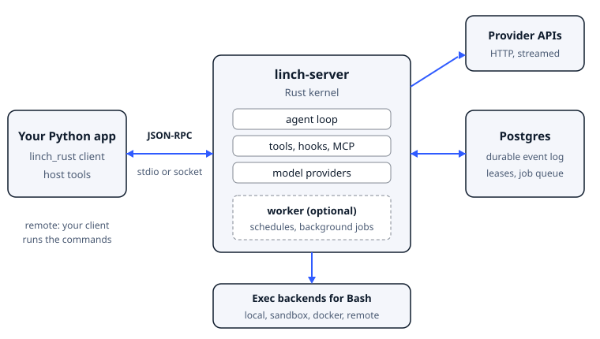

<div align="center">


</div>

# linch-rust

A Python client for the Linch agent kernel written in Rust: durable runs on Postgres, a
worker for schedules and background jobs, hooks, MCP and OpenTelemetry. Your application
owns the HTTP API, TLS and metrics, and chooses how commands are isolated.

The package is one wheel with two parts: the `linch_rust` client and the `linch-server`
binary (the Rust sidecar the client starts and drives over JSON-RPC). Wheels are built for
Linux and macOS. It needs Python 3.11 or newer; the only other runtime dependency is
`orjson`.



## Install

```sh
pip install linch-rust              # the client and the linch-server binary
pip install 'linch-rust[otel]'      # with OpenTelemetry spans and metrics
pip install 'linch-rust[websocket]' # to reach a remote server over WebSocket
```

## Quickstart

The scripted provider replays turns you write, so this runs without a key or a network:

```python
import asyncio

from linch_rust import AgentConfig, ResultEvent, Server
from linch_rust.scripted import MODEL, text_turn

config: AgentConfig = {
    "namespace": "quickstart",
    "spec": {"model": MODEL},
    "provider": {"id": "scripted", "turns": [text_turn("Hello from linch-rust.")]},
}


async def main() -> None:
    async with Server() as server:
        agent = await server.open_agent(config)
        run = await agent.run("session-1", "Say hello")
        async for envelope in run:
            print(envelope.seq, envelope.event.type)
            if isinstance(envelope.event, ResultEvent):
                print(envelope.event.final_text)


asyncio.run(main())
```

It prints the events of the run and ends with `Hello from linch-rust.`

To start a project that runs and tests offline:

```sh
linch-rust new my-agent
linch-rust docs path                # where the installed docs are
```

## Extras

| Extra | Adds |
|---|---|
| `otel` | OpenTelemetry spans and metrics of each run, through your own providers (`opentelemetry-api`) |
| `websocket` | `Server.connect("ws://...")` for a remote `linch-server` (`websockets`) |

## Documentation

- [Quickstart](https://github.com/DuyTa506/linch/blob/master/linch-rust/docs/usage/quickstart.md)
- [Usage guide](https://github.com/DuyTa506/linch/blob/master/linch-rust/docs/usage/README.md)
- [Architecture](https://github.com/DuyTa506/linch/blob/master/linch-rust/docs/architecture/README.md)
- [Benchmarks against Python Linch](https://github.com/DuyTa506/linch/blob/master/linch-rust/docs/benchmarks.md)
- [Changelog](https://github.com/DuyTa506/linch/blob/master/linch-rust/CHANGELOG.md)
- [Source repository](https://github.com/DuyTa506/linch)

## Status

linch-rust is at 0.1.x. Read the changelog before each upgrade.

## License

MIT
